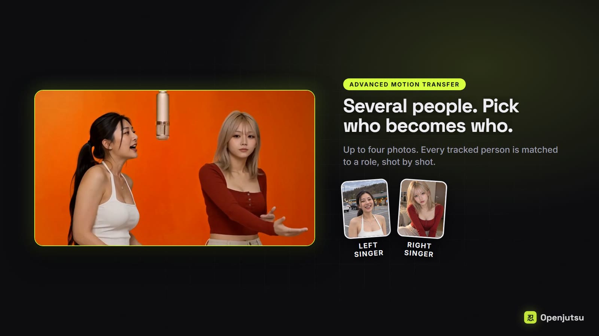
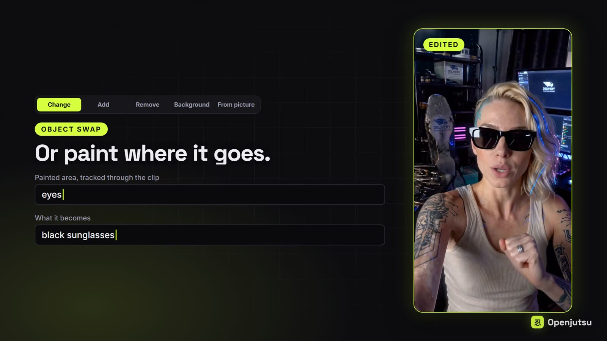
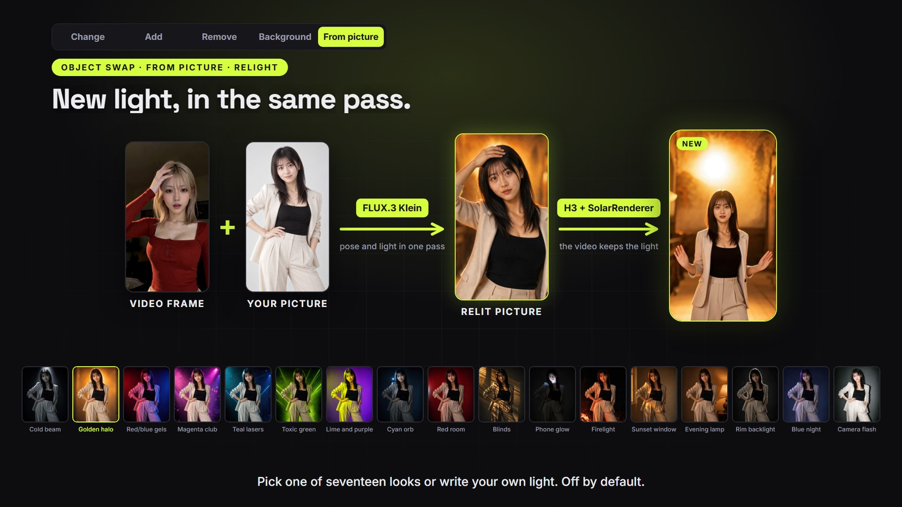
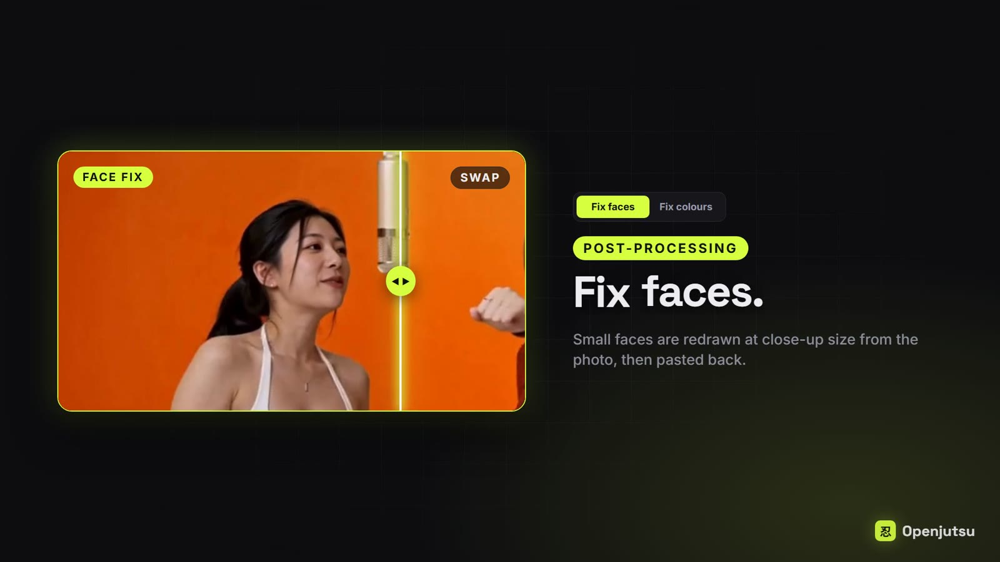

# Openjutsu：把视频表演变成可换角、改物与重打光的本地工作流

> 项目：[donghaozhang/openjutsu](https://github.com/donghaozhang/openjutsu)，上游为 [D3voz/openjutsu](https://github.com/D3voz/openjutsu)。核查日期：2026 年 11 月 3 日，固定提交 `7fe118b`；核查时两个仓库的 `main` 相同。本文是源码与工作流分析，不是首次发布报道，也没有复现 GPU 生成效果。

有一段表演、动作和镜头都合适的视频，能不能保留这些条件，把里面的人换成自己的角色？Openjutsu 处理的正是这类任务。它还把换衣服、删除物体、更换背景，以及从角色图片出发重新组织光线和场景，放进了同一个应用。

最容易误解的地方是它的身份：**这是一套围绕 ComfyUI 搭建的本地视频编辑应用，不是新训练的基础模型，也不是直接调用 MiniMax 云端 API 的网页。** 仓库将它定位为 Genjutsu 风格的开源替代方案；这是一种产品定位，不是本文完成了与商业服务的效果对照。[项目说明](https://github.com/donghaozhang/openjutsu/blob/7fe118bb5a61fcfac0148e1bfea3dd29884dbf26/README.md)

*本文四张图片均来自固定版本仓库的产品演示图，不是本文运行生成的结果，也不是独立质量评测。*

## 1. 它把什么东西接在了一起

项目采用 Next.js、React 与 `@comfyorg/sdk`，在界面后面加载 ComfyUI API 格式的 JSON 工作流。按仓库配置，主要模型分工如下：

| 组件 | 工作 | 不能由此推出的结论 |
|---|---|---|
| MiniMax H3 | 根据参考图片、视频条件与提示词重新生成视频内容 | 不是把原片每一帧做完全确定的像素替换 |
| SAM 3.1 | 跟踪人物或待编辑对象，提供区域信息 | 跟踪成功不等于生成后的身份、遮挡和边缘都正确 |
| Qwen3-VL 等视觉描述模型 | 描述照片、镜头和动作，辅助角色匹配 | 描述仍可能误读，需要检查 |
| FLUX.3 Klein | 在 From picture 路径中准备新首帧，可同时改光 | 不是给整段视频建立物理灯光场景 |
| Metric3D 与 SolarRenderer 路径 | 使用法线运动参考和相应采样配置生成视频 | 法线参考不是可编辑的三维骨骼或网格资产 |

这些模型名称与能力分工来自项目文档和工作流配置；本次没有下载权重或逐一复核外部模型实现。应用的工程贡献在于把上传、参数选择、节点裁剪、任务进度与结果下载串起来。核心生成能力仍由模型和外部自定义节点承担。[依赖配置](https://github.com/donghaozhang/openjutsu/blob/7fe118bb5a61fcfac0148e1bfea3dd29884dbf26/package.json)、[工作流提交](https://github.com/donghaozhang/openjutsu/blob/7fe118bb5a61fcfac0148e1bfea3dd29884dbf26/lib/comfy.ts)

## 2. 换角不是只贴一张脸

常规换角路径先找出人物，形成编辑遮罩，再把人物处理成保留轮廓与动作的灰色人形参考。H3 同时接收新角色图片和运动条件，生成新的角色表现；较长片段通过上下文循环、重叠片段与最终组装完成。

可以把它理解为：**旧视频提供“怎么演、身体怎样动”，参考图提供“要变成谁”，遮罩限定“主要改哪里”。** 这比单纯替换脸部的范围更大，也更容易受到体形、衣服轮廓和复杂遮挡的影响。

源码中的 `pruneSimple` 会按选项裁剪帽子修正、No lip-sync 等节点，并设置分辨率、种子、角色和片段长度。改变某些模型或运动参考设置，还会区分保存片段的运行名称，减少重试时误用旧结果的风险。这些是工作流管理，不是新的生成算法。[简单换角实现](https://github.com/donghaozhang/openjutsu/blob/7fe118bb5a61fcfac0148e1bfea3dd29884dbf26/lib/simple.ts)、[模型与运行名处理](https://github.com/donghaozhang/openjutsu/blob/7fe118bb5a61fcfac0148e1bfea3dd29884dbf26/lib/model.ts)

Advanced 支持 1 至 4 张角色参考图，并按镜头把跟踪到的人匹配到角色；没有分配角色的人按设计保持不变。两角色还可选逐人处理模式，但意味着额外生成开销。这里应把“保留动作、镜头与剪辑”理解为工作流目标，而不是每个结果都已证明与原片严格一致。原声的复用，也不等于嘴型同步已经过验收。[模式与限制](https://github.com/donghaozhang/openjutsu/blob/7fe118bb5a61fcfac0148e1bfea3dd29884dbf26/README.md)

## 3. 改物体时，参考条件不能一概保留

物体编辑有几种不同的数据处理方式，不能都叫作“自动跟踪后替换”：

- **Change**：跟踪已有对象，按文字或图片修改；可以选择保留轮廓，也支持绘制编辑区域。
- **Remove**：移除目标，生成它后面的内容。
- **Background**：反转保留主体的遮罩，编辑主体之外的环境。
- **Add**：用手动画出的区域关键帧定义位置；基础路径不是先让 SAM 跟踪一个原本不存在的对象，特定同步动作还有单独处理逻辑。

`lib/object.ts` 里最值得注意的是参考视频的取舍：删除、新增，以及不保留轮廓的修改，会去掉原来的视频运动参考连接。代码注释解释，保留灰色旧轮廓可能让被删除物体重新出现；新增对象时，原视频里的空白又可能把新对象压回去。[物体编辑实现](https://github.com/donghaozhang/openjutsu/blob/7fe118bb5a61fcfac0148e1bfea3dd29884dbf26/lib/object.ts)

这也解释了一个实际限制：保留轮廓有利于稳定原动作，却可能妨碍大幅换装。项目举例，原来是背心，想改成衬衫时仍可能保留无袖外形。要改变轮廓，就要接受运动约束减弱后的不确定性。

## 4. 先确认新首帧，再花时间生成视频

From picture 是另一条路径：先用 FLUX 根据原视频首帧的姿势与取景，准备新角色图片；用户检查、修改或重试，明确选择采用后，才进入视频生成。视频阶段复用已经保存的图片，不自动重跑首帧编辑。

这个确认点很重要。首帧里人物身份、身体裁切或背景已经错了，继续生成往往只是把错误延长。

Relight 默认关闭，可选 17 种外观或自定义灯光描述。启用后，姿势调整与改光放在同一次 FLUX 编辑中；视频首帧的姿势由提示词扩写器读取，再用文字传递给 FLUX。也可不换角色，直接对原视频人物准备重打光首帧。

后续视频使用 Metric3D 法线作为运动参考，并结合动作描述，走原生 H3 或 SolarRenderer 配置。**这条路径不使用 SAM 编辑遮罩，也没有上下文循环**，不能照搬常规换角的机制。文档把法线明确称为软参考条件，而不是专门训练的法线 ControlNet。[From picture 工作流](https://github.com/donghaozhang/openjutsu/blob/7fe118bb5a61fcfac0148e1bfea3dd29884dbf26/workflows/picture/README.md)

文档称单片可选择最长 15 秒，但会向下对齐 H3 的有效帧网格：6 秒对应 141 帧、5.875 秒，15 秒对应 345 帧、14.375 秒，均按 24 fps 计算。精确卡时长的剪辑任务需要看实际输出长度。灯光还可能改变背景或构图；这不是可在三维软件里重新摆灯、换机位的场景工程。

## 5. 面部更像，不一定口型更准

Fix faces 对匹配到的脸进行裁切、近景重绘和贴回，主要处理人物在画面中较小时的脸部质量。它明确提供两种取舍：

- **Match the photo** 更侧重参考照片的相似度，但可能重新编造表情和嘴部动作。
- **Follow the mouth** 更侧重原视频的表情和嘴部运动，但相似度会退让。

因此，面部变清楚不能直接当作口型、身份和情绪全部正确。Fix colours 则是细节对比度与色调映射处理，不再运行 H3；它也不等于上面的生成式重打光。[面部工作流处理](https://github.com/donghaozhang/openjutsu/blob/7fe118bb5a61fcfac0148e1bfea3dd29884dbf26/lib/face.ts)、[调色处理](https://github.com/donghaozhang/openjutsu/blob/7fe118bb5a61fcfac0148e1bfea3dd29884dbf26/lib/color.ts)

## 6. 本地可控，代价是环境与算力

项目要求 NVIDIA GPU、ComfyUI 0.41.2 或更新版本、Node.js 22.6 以上，以及相应 Python 环境、自定义节点和多组模型。作者测试配置是 RTX 4060 Ti 16 GB 显存、64 GB 系统内存，H3 INT8 权重从内存流式加载。**这不是“有 16 GB 内存的电脑都能跑”，也没有据此验证 Apple Silicon 推理支持。**

README 给出的性能参考是：该显卡上，6 秒、480p 片段约需 6 至 13 分钟；默认分辨率为 736p。From picture 文档另列出一项 SolarRenderer 长片测试：选择 9 秒，帧网格对齐后约 8.708 秒，耗时 34 分 23 秒。两项是不同工作流、不同设置下的作者记录，不能拼成统一速度结论，更不是本文实测。[硬件与耗时说明](https://github.com/donghaozhang/openjutsu/blob/7fe118bb5a61fcfac0148e1bfea3dd29884dbf26/README.md)、[SolarRenderer 测试条件与补丁要求](https://github.com/donghaozhang/openjutsu/blob/7fe118bb5a61fcfac0148e1bfea3dd29884dbf26/workflows/picture/README.md)

启动前检查会根据实际启用的工作流，检查 ComfyUI 已注册节点和模型文件列表。它能提示缺少哪个节点包、模型应放在哪个目录，但不验证权重完整性、显存余量或所有运行时依赖。[预检实现](https://github.com/donghaozhang/openjutsu/blob/7fe118bb5a61fcfac0148e1bfea3dd29884dbf26/lib/setup.ts)

## 7. 用之前，先把失败条件和授权分开

项目明确说明，**镜子和人物反射目前不受支持**：反射里的原人物可能把旧发型、衣服和体形重新带回生成结果。首轮试验宜选无反射、主体清楚、遮挡较少的短片，先看遮罩，再检查身份、手部、边缘、口型和声音。

本地运行也不是自动获得安全与商用许可：

- 应用代码采用 MIT，但模型权重与依赖另有许可。项目特别列出 Fix faces 使用的 InsightFace `buffalo_l` 限制；InsightFace 上游也明确区分 MIT 代码与默认仅限非商业研究的预训练模型，并提供商业授权联系渠道。[项目许可说明](https://github.com/donghaozhang/openjutsu/blob/7fe118bb5a61fcfac0148e1bfea3dd29884dbf26/README.md#license)、[InsightFace 许可政策](https://github.com/deepinsight/insightface#license)
- 默认启动脚本绑定本机回环地址。若对外提供访问，代码要求设置至少 12 位的 `OPENJUTSU_PASSWORD`；共享密码不等于多租户权限隔离，不能直接当公开生成服务。Basic 认证对外使用还应配合 HTTPS。[访问检查](https://github.com/donghaozhang/openjutsu/blob/7fe118bb5a61fcfac0148e1bfea3dd29884dbf26/lib/http.ts)、[启动检查](https://github.com/donghaozhang/openjutsu/blob/7fe118bb5a61fcfac0148e1bfea3dd29884dbf26/instrumentation.ts)
- 文档说明任务结束后的代理上传清理，不会顺带删除 ComfyUI 输入目录中的副本。人物照片、原片与输出仍需自己管理，并确认肖像和素材使用授权。[运行与部署说明](https://github.com/donghaozhang/openjutsu/blob/7fe118bb5a61fcfac0148e1bfea3dd29884dbf26/README.md)

Openjutsu 值得研究的，是它怎样把不同编辑目标转成不同参考条件，以及怎样在昂贵生成之前安排预览和确认。它提供的是一条可检查、可调整的视频再生成流程，而不是无条件保真、实时运行或自动获得商用授权的承诺。

本次在固定提交、Node.js `v25.7.0` 下运行了 7 个文件中的 **65 项单元测试，全部通过**，范围包括节点裁剪、模型参数、角色映射、物体编辑与片段计算。没有安装模型、启动 ComfyUI、运行完整 `npm test`、TypeScript 检查或生产构建，也没有验证输出视频质量。来源、测试命令和图片记录见 [SOURCES.md](imgs/openjutsu-local-video-character-swap/SOURCES.md)。
