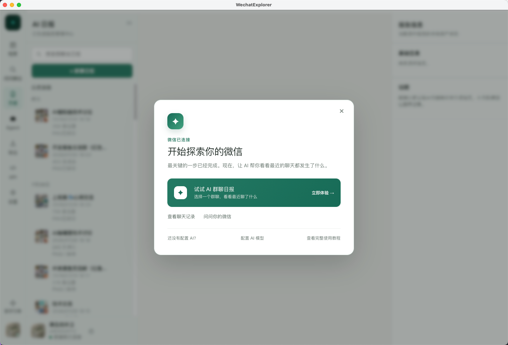
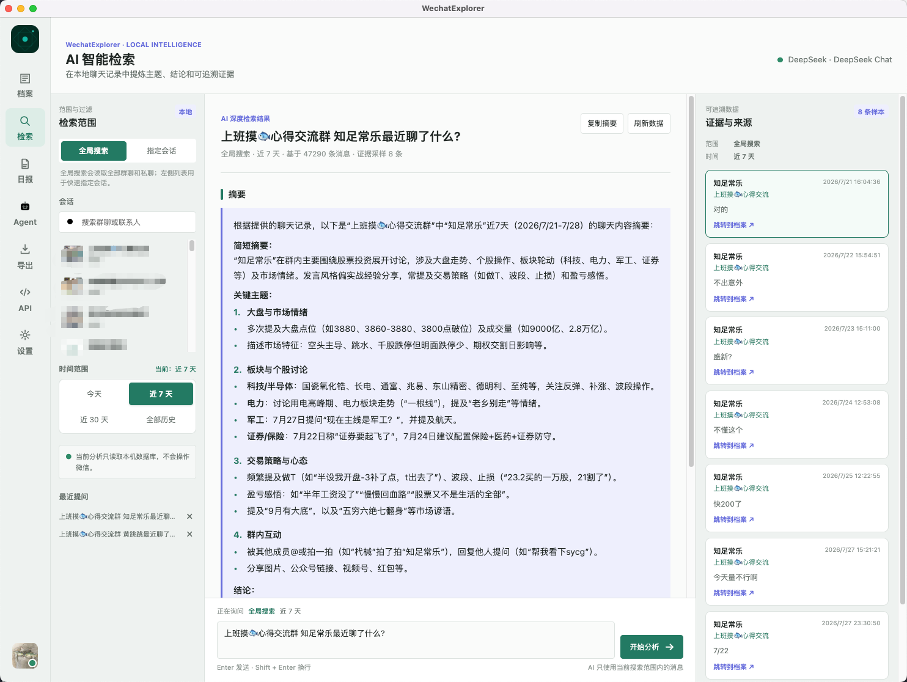

# TraceMemo: A Local WeChat Knowledge Workbench with Traceable Answers

> Project: [Wxw-Gu/TraceMemo](https://github.com/Wxw-Gu/TraceMemo), formerly WechatExplorer. Reviewed November 3, 2026 at `main` commit `d6d837e`. The latest GitHub Release checked that day was `v2.5.2`, published October 27. This is a project analysis, not a launch announcement or a test against real chat data.

Information in WeChat is often hard to retrieve because its location is forgotten: a price appears in a screenshot, a discussion spans several groups, and someone later corrects the conclusion. Summarization alone does not establish who said something, when, or whether a later message changed it.

TraceMemo brings archive browsing, local indexing, scoped retrieval, and optional AI answers or reports into one desktop application. Its primary input is **local WeChat chat history**. It is not a downloader for arbitrary Official Account article links, and it does not introduce a new foundation model.

*Existing repository screenshot, still carrying the former WechatExplorer name. It is not evidence of a connection established on this review machine, or a guarantee of every current screen's appearance.*

## 1. Find the Original Message Before Calling AI

The product is easier to understand as three layers:

| Layer | Main tasks | Boundary to retain |
|---|---|---|
| Archive and local processing | Browsing, keyword search, exports, image-text indexing, offline transcription | Index and media coverage limit what can be found |
| Retrieval and generation | Find scoped evidence and produce answers or reports | Model interpretation and external processing need separate checks |
| Actions and integrations | Scheduled reports, departure notices, Agent Hub, external API access | Generation, delivery, and authorization are distinct states |

Basic browsing, search, and export do not require configuring AI first. That ordering is useful: an exact price lookup may need only the original message. Cross-group synthesis or a vaguely remembered discussion can justify the additional retrieval and generation path. [Project overview](https://github.com/Wxw-Gu/TraceMemo), [data flow](https://github.com/Wxw-Gu/TraceMemo/blob/d6d837e6f6705741000b747af99d75ab120281bd/docs/concepts/how-it-works.md)

## 2. Traceability Starts with Program-Owned Evidence

The interface places answers beside supporting messages and offers navigation back to the archive and retrieval trace. That supports checking dates, senders, forwarded material, and later corrections.

*Existing project screenshot illustrating information organization. Its example chat summary is not a claim or recommendation independently checked in this review.*

The inspected implementation adds concrete detail. `knowledge-store.ts` uses SQLite FTS5 with a BM25 ranking path. Account-specific storage paths and account-matching checks separate knowledge data. This is a definite full-text retrieval path; the label “knowledge base” alone does not establish a particular embedding or vector model. [Knowledge implementation](https://github.com/Wxw-Gu/TraceMemo/blob/d6d837e6f6705741000b747af99d75ab120281bd/src/main/knowledge/knowledge-store.ts)

`ai-search-evidence.ts` deduplicates by conversation/message identity, ranks and selects evidence, then assigns IDs such as `E1` and `E2` in application code. Its sanitizer removes `[E<number>]` citations outside the allowed set and records the invalid IDs. [Evidence implementation](https://github.com/Wxw-Gu/TraceMemo/blob/d6d837e6f6705741000b747af99d75ab120281bd/src/main/services/ai-search-evidence.ts)

A valid citation is not proof that an answer is correct. A real message can still be misinterpreted, quoted out of context, or selected from incomplete coverage. The documentation explicitly recommends returning to context and checking index freshness, missing media, and untranscribed voice messages. [Source-checking guide](https://github.com/Wxw-Gu/TraceMemo/blob/d6d837e6f6705741000b747af99d75ab120281bd/docs/concepts/answer-sources.md)

## 3. Local-First Does Not Mean Every Operation Stays Offline

The project describes database parsing, ordinary search, knowledge indexing, local image OCR, offline voice transcription, and export generation as local processing. Image OCR and AI image understanding are different paths: the former produces local searchable text; the latter can send content to a configured provider.

According to the privacy guide, remote AI Search, reporting, or image understanding can transmit the current question, limited context, and selected evidence. An external agent can also take results from the local API and pass them to its own cloud model. Avoiding a whole-database upload is therefore not equivalent to auditing every model request. A local provider still has its own logging and configuration. [Privacy guide](https://github.com/Wxw-Gu/TraceMemo/blob/d6d837e6f6705741000b747af99d75ab120281bd/docs/user-guide/privacy.md)

This review inspected documentation and selected code, not live network traffic. It does not certify all data paths. Before handling real conversations, identify the chosen chats, time range, media types, and model destination.

## 4. Reader Skill Is Not MCP, and Its Token Is Not Read-Only

External agents use a Reader Skill and Local HTTP API. The skill provides instructions; the application supplies the data endpoints. This is not an MCP server. Agent Hub is a separate entrance for requests arriving through a WeChat bot. [Reader Skill guide](https://github.com/Wxw-Gu/TraceMemo/blob/d6d837e6f6705741000b747af99d75ab120281bd/docs/agent/reader-skill.md)

At the inspected revision, `http-server.ts` defaults to `127.0.0.1:6131`. Health is public; other dispatched data routes check a Bearer token. The token store generates 32 random bytes, encrypts persisted credentials with Electron `safeStorage`, and applies `0600` file permissions. Credential issuance fails when secure storage is unavailable. [HTTP implementation](https://github.com/Wxw-Gu/TraceMemo/blob/d6d837e6f6705741000b747af99d75ab120281bd/src/main/http-server.ts), [token store](https://github.com/Wxw-Gu/TraceMemo/blob/d6d837e6f6705741000b747af99d75ab120281bd/src/main/api-token-store.ts)

However, the API also includes report generation, message sending, and scheduled-task management. Its security guide says it has no fine-grained permission scopes. Giving an agent this token cannot be interpreted as granting only a few searches. The Reader Skill's name does not narrow server-side authorization. [API security](https://github.com/Wxw-Gu/TraceMemo/blob/d6d837e6f6705741000b747af99d75ab120281bd/docs/agent/api-security.md)

Two integration principles follow: scope reads to the actual task, and confirm sending or scheduled execution separately. Loopback binding is not a reason to publish credentials in Git, screenshots, or a public proxy.

## 5. Export Completion and Delivery Are Different

Exports support HTML, Markdown, CSV, and JSON, but not identical media behavior. HTML can include media and voice transcripts and combine up to five conversations. Other formats mainly retain text and do not copy the HTML resource set. ZIP compresses the HTML package; it is not another content format. For durable archives, inspect whether media are actually present rather than accepting file creation alone. [Export guide](https://github.com/Wxw-Gu/TraceMemo/blob/d6d837e6f6705741000b747af99d75ab120281bd/docs/user-guide/export.md)

Automation likewise distinguishes policy rejection, unavailable capability, and send failure. A report can be generated and retained in history without being delivered to WeChat. Separating those states helps diagnosis and avoids regenerating a report merely because delivery failed. [Action boundaries](https://github.com/Wxw-Gu/TraceMemo/blob/d6d837e6f6705741000b747af99d75ab120281bd/docs/concepts/how-it-works.md)

## 6. Mac Support Is Not a Blanket Permission Requirement

The latest checked release, `v2.5.2`, includes Windows x64 and macOS arm64/x64 artifacts. The README still contains a 2.5.1 support statement while `package.json` reports 2.5.2. Specific artifacts and pinned source should take precedence over blending these into an implied runtime acceptance result. [Release](https://github.com/Wxw-Gu/TraceMemo/releases/tag/v2.5.2)

The macOS guide distinguishes database-read permissions from key-acquisition prerequisites. A database-read error does not automatically justify disabling SIP; some key-acquisition flows may involve system security settings. SIP changes reduce protection and are not an ordinary installation step to automate indiscriminately. [macOS guide](https://github.com/Wxw-Gu/TraceMemo/blob/d6d837e6f6705741000b747af99d75ab120281bd/docs/platform/macos.md)

The complete inspected tree also contained no standard `LICENSE` or `COPYING` file. Publicly readable source should not be described as an established unrestricted modification, redistribution, or commercial-use grant; reuse requires clarification from the maintainer.

The project's useful ideas concern how data, evidence, and actions are organized, not a promise that installation gives AI unrestricted memory of every conversation. This review did not run the app, connect an account, obtain keys, read real chats, enable the API, or test sending. Version, implementation, and screenshot provenance are recorded in [SOURCES.md](imgs/tracememo-local-wechat-evidence-workbench/SOURCES.md).
