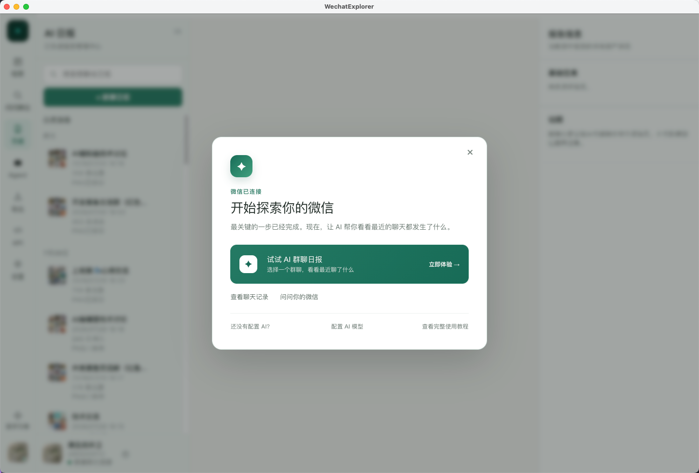
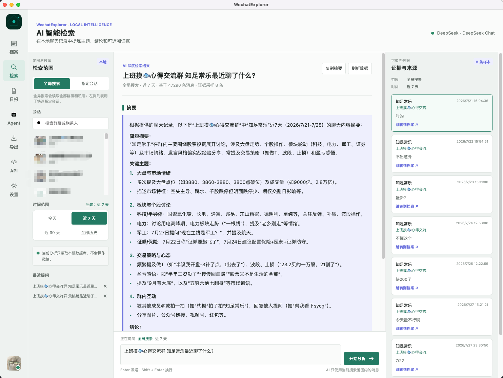

# TraceMemo：把微信聊天变成可搜索、可追溯的本地知识工作台

> 项目：[Wxw-Gu/TraceMemo](https://github.com/Wxw-Gu/TraceMemo)，原名 WechatExplorer。核查日期：2026 年 11 月 3 日。源码检查固定于 `main` 提交 `d6d837e`；当日最新 GitHub Release 是 2026 年 10 月 27 日发布的 `v2.5.2`。本文是项目分析，不是首次发布报道或真人聊天实测。

微信里的信息经常不是找不到，而是不记得应该在哪里找：一个报价藏在截图里，一次讨论分散在几个群里，后来又有人修正过结论。直接把聊天扔给模型总结，未必能解决“这句话是谁说的、什么时候说的、后面有没有改”的问题。

TraceMemo（迹忆）试图把这些环节放进同一个桌面工作台：连接本机微信数据，建立档案和索引，按范围检索，再按需生成带来源的回答或日报。它主要处理**本机微信聊天记录**，不是输入任意公众号链接就下载文章的工具，也不是训练了一个新的基础模型。

*项目仓库中的既有截图，仍显示旧名称 WechatExplorer；不是本文在本机连接微信后的截图，也不代表当前版本所有页面的外观。*

## 1. 先查原话，再决定要不要用 AI

它的功能可以按数据流分成三层，而不必先记一串产品名：

| 层次 | 主要任务 | 需要分清的边界 |
|---|---|---|
| 档案与本地处理 | 浏览聊天、关键词搜索、导出、图片文字索引、离线语音转写 | 索引与媒体是否完整，会影响能查到什么 |
| 检索与生成 | 按会话、时间和问题找证据，生成回答或群聊日报 | 模型是否误读、是否调用远程服务，要另外判断 |
| 动作与接入 | 定时日报、退群通知、Agent Hub、外部 Agent/API | 生成成功、发送成功和授权范围是不同状态 |

普通浏览、搜索和导出不要求先配置 AI。这个顺序有实际意义：想确认某人报过什么价格，先找到原消息即可，不必为了一个精确查询把资料交给模型。需要跨群整理或理解模糊记忆时，再使用 AI Search。[项目说明](https://github.com/Wxw-Gu/TraceMemo)、[工作方式](https://github.com/Wxw-Gu/TraceMemo/blob/d6d837e6f6705741000b747af99d75ab120281bd/docs/concepts/how-it-works.md)

## 2. 可追溯的关键，是来源由程序管理

界面把回答和证据放在一起，还提供回到原消息、查看检索过程的入口。这比只输出一段总结更适合核对日期、责任人、转发内容和后续修正。

*项目既有产品截图，用于说明信息组织；其中的聊天摘要不是本文核实过的事实或建议。*

源码提供了一些具体实现依据。`knowledge-store.ts` 使用 SQLite FTS5，并有 BM25 排序路径；知识库按账号派生存储路径，查询和索引也检查账号是否匹配。至少这条已读路径是明确的全文检索实现，不能仅凭“知识库”三个字就推断它采用了某种向量模型。[知识库实现](https://github.com/Wxw-Gu/TraceMemo/blob/d6d837e6f6705741000b747af99d75ab120281bd/src/main/knowledge/knowledge-store.ts)

`ai-search-evidence.ts` 会按会话与消息标识去重，排序和选择证据，然后由程序分配 `E1`、`E2` 等编号。回答里的 `[E数字]` 标记如果不在允许集合中，会被清除并记录为无效引用。[证据与引用处理](https://github.com/Wxw-Gu/TraceMemo/blob/d6d837e6f6705741000b747af99d75ab120281bd/src/main/services/ai-search-evidence.ts)

这里要避免把“引用有效”误解成“结论正确”。一个真实存在的消息编号，仍可能被模型引用错、断章取义，或只覆盖了部分讨论。文档也要求回到上下文检查；索引尚未同步、语音未转写、图片缺失，都可能造成遗漏。[来源核对说明](https://github.com/Wxw-Gu/TraceMemo/blob/d6d837e6f6705741000b747af99d75ab120281bd/docs/concepts/answer-sources.md)

## 3. 本地优先，不是所有步骤都不出电脑

项目把数据库解析、普通搜索、知识索引、本机图片文字识别、离线语音转写及导出列为本地处理。需要特别区分的是：**图片 OCR 与 AI 图片理解不是一条路径**。前者提取本机文字索引；后者使用配置的 Provider 时，可能涉及向外发送内容。

按项目隐私文档，远程 AI Search、日报或图片理解可能发送本次问题、有限上下文与最终证据；外部 Agent 读取本机 API 后，还可能按自身配置把结果交给云端模型。因此，“数据库没整库上传”不能替代对每条模型调用链的审查。使用本机 Provider 也仍需考虑它自己的日志与配置。[隐私说明](https://github.com/Wxw-Gu/TraceMemo/blob/d6d837e6f6705741000b747af99d75ab120281bd/docs/user-guide/privacy.md)

本文核对的是文档和部分实现，没有抓取实际网络流量，不能据此宣布所有路径都已完成隐私审计。处理真实聊天前，应先明确所选会话、日期范围、媒体类型和模型去向。

## 4. Reader Skill 不是 MCP，Token 也不是只读钥匙

外部 Agent 的接入方式是 Reader Skill 加 Local HTTP API。Skill 是操作说明，真正读数据的是应用提供的接口；它不是一个 MCP Server。Agent Hub 则是另一条入口，用于接收微信机器人请求并调用本机能力。[Reader Skill](https://github.com/Wxw-Gu/TraceMemo/blob/d6d837e6f6705741000b747af99d75ab120281bd/docs/agent/reader-skill.md)

固定版本的 `http-server.ts` 默认绑定 `127.0.0.1:6131`，health 是公开检查，其余已分发的数据路由会检查 Bearer Token。Token 存储代码使用 32 字节随机值、Electron `safeStorage` 加密和 `0600` 文件权限；安全存储不可用时不会签发凭据。[HTTP 实现](https://github.com/Wxw-Gu/TraceMemo/blob/d6d837e6f6705741000b747af99d75ab120281bd/src/main/http-server.ts)、[Token 存储](https://github.com/Wxw-Gu/TraceMemo/blob/d6d837e6f6705741000b747af99d75ab120281bd/src/main/api-token-store.ts)

但接口还包含生成报告、发送消息和管理定时任务的操作，文档明确说明当前没有细粒度权限 Scope。把这个 Token 交给 Agent，不能理解为只允许它搜索几条聊天；Reader Skill 的名字也不会自动缩小服务端权限。[API 安全](https://github.com/Wxw-Gu/TraceMemo/blob/d6d837e6f6705741000b747af99d75ab120281bd/docs/agent/api-security.md)

因此，本文更看重两项集成原则：把读取范围限制在明确任务内；把发送、定时执行等动作单独确认。不要因为服务监听在本机，就把凭据公开到 Git、截图或公网代理。

## 5. 导出与自动化，不能只看“完成”两个字

导出支持 HTML、Markdown、CSV、JSON，但媒体能力不同：HTML 可打包媒体与语音转写，并支持最多五个会话合并；其余格式主要保留文本，不自动复制 HTML 的资源文件。ZIP 是 HTML 资源包的压缩选项，不是另一种内容格式。需要长期留档时，必须检查图片和语音是否实际包含在产物里，而不只是文件生成成功。[导出说明](https://github.com/Wxw-Gu/TraceMemo/blob/d6d837e6f6705741000b747af99d75ab120281bd/docs/user-guide/export.md)

自动化也区分策略阻止、能力不可用与发送失败。日报可以已经生成并保存在历史里，但尚未成功发回微信；这种状态拆分有助于定位故障，也避免为一次发送失败重复生成整份报告。[动作边界](https://github.com/Wxw-Gu/TraceMemo/blob/d6d837e6f6705741000b747af99d75ab120281bd/docs/concepts/how-it-works.md)

## 6. Mac 支持存在，但连接权限需要单独评估

核查时最新 Release 为 `v2.5.2`，提供 Windows x64、macOS arm64 与 x64 产物；README 仍有“2.5.1 支持”的文字，而 `package.json` 为 2.5.2。读者应以具体发布资产和固定代码为准，不要把这些版本信息混成一次完整运行验收。[Releases](https://github.com/Wxw-Gu/TraceMemo/releases/tag/v2.5.2)

macOS 文档把数据库读取权限和密钥获取前置条件分开：不能读取数据库，不等于应该关闭 SIP；某些密钥获取流程可能涉及系统安全设置。SIP 调整会降低系统保护，不是普通安装步骤，不能自动执行，也不应为了试用而一概关闭。[macOS 说明](https://github.com/Wxw-Gu/TraceMemo/blob/d6d837e6f6705741000b747af99d75ab120281bd/docs/platform/macos.md)

另外，本次固定提交的完整文件树未找到标准 `LICENSE`／`COPYING` 文件。源码可公开阅读，不应被直接表述为已经取得任意修改、分发或商用授权；需要复用时应向维护者确认许可。

这套项目值得研究的是数据、证据与动作的组织，而不是“装上后 AI 就能无条件记住所有微信”。本次没有运行应用、连接账号、获取密钥、读取真实聊天、启用 API 或测试发送。实现核查、版本和两张来源图的记录见 [SOURCES.md](imgs/tracememo-local-wechat-evidence-workbench/SOURCES.md)。
