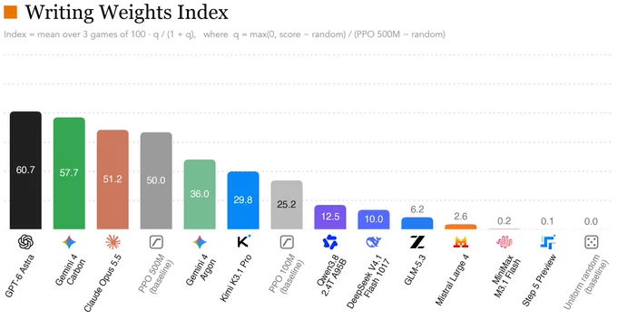
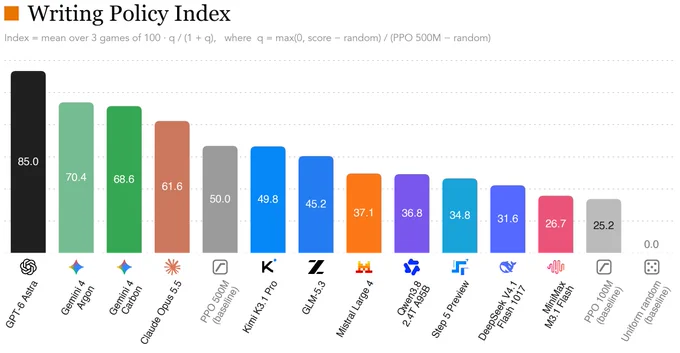
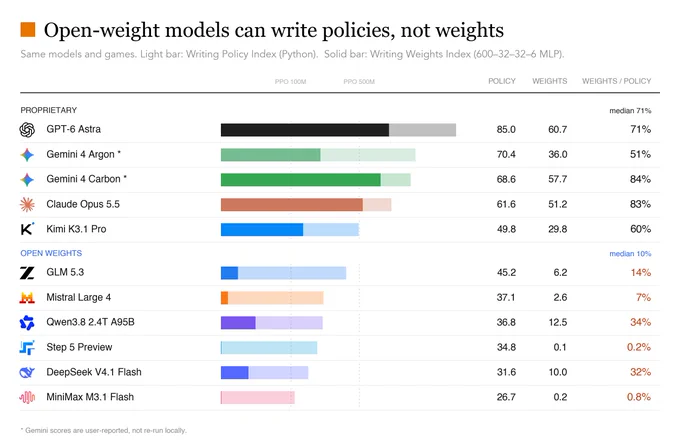

# Writing Weights Index: Why Writing a Policy Is Easier Than Writing Its Neural Weights

> Sources: [Xingyu Dang's benchmark thread](https://x.com/xingyudang/status/2117428789068386630), November 3, 2026 in Melbourne, and the background study [Sparks of Weight-Space Programming](https://rikiyat.github.io/blog/weight-space-programming/), published November 2. Reviewed November 3, including spot checks of the original research logs at commit `4d09ba6`.

Writing a Python program that plays a game and encoding its strategy into neural-network parameters are different tasks. Python offers variables, conditionals, and arithmetic. A fixed network must implement behavior within specified layers, widths, activations, and input/output layouts.

That distinction makes Xingyu Dang's Writing Weights Index interesting. The initial chart ranks weight-writing performance; subsequent charts compare it with directly writing Python policies. The gap means a weak resulting network cannot simply be read as failure to understand the game, nor can one weights leaderboard establish general coding ability. [Main post](https://x.com/xingyudang/status/2117428789068386630), [Python comparison](https://x.com/xingyudang/status/2117428791660134736)



*Original author chart. Scores and model names follow the source; the cross-model evaluation was not rerun here.*

## 1. The Task Is to Encode Rules in a Small Network

Experiment 5 of the original research uses MinAtar's Breakout, Seaquest, and Asterix. The model receives rules, game source, observation/action layouts, and a fixed architecture, then supplies weight edits in one reply without gameplay feedback. The target is a `600 → 32 → 32 → 6` tanh MLP with 20,486 parameters, all initially zero.

The 600 inputs represent six channels on a 10×10 grid, not unrestricted screen pixels. Six outputs provide action logits. This is closer to implementing a decision procedure in a constrained network than learning an unfamiliar large game from visual experience. The original experiment evaluates both generated networks and PPO over 1,000 episodes, with 0.1 sticky-action probability and a 10,000-step episode limit. [Original setup and artifact guide](https://github.com/RikiyaT/lm_understand-logs/blob/4d09ba6d6a7e891dd8063974dfe81b3d78e3494f/exp5_write_from_scratch/README.md)

No training refers to constructing the target network, not to the absence of pretraining in the model producing it. Other experiments in the research allow different tools or forward-pass budgets; Experiment 5's no-feedback condition should not be generalized to the entire study.

## 2. An Index of 50 Is Not a 50% Success Rate

The chart defines a game-wise normalization relative to random play and PPO trained for 500 million steps, followed by a bounded transformation and an average over three games:

```text
q_game = max(0, score_game - random_game)
         / (PPO500M_game - random_game)

index = mean_over_games(100 * q_game / (1 + q_game))
```

With positive baseline denominators, random play maps to zero and PPO 500M maps to 50. A normalized gain of `q=3` maps to 75. The transformation limits how much an extreme result in one game can dominate, but also makes index differences nonlinear in raw reward.

A score of 60.7 is therefore not a percentage of successful episodes. Dividing two indices does not recover a raw-reward multiplier. The weights/policy ratios in the third chart are ratios of compressed indices, not compiler-correctness rates.

| Model | Weights Index | Python Policy Index |
|---|---:|---:|
| GPT-6 Astra | 60.7 | 85.0 |
| Gemini 4 Carbon† | 57.7 | 68.6 |
| Claude Opus 5.5 | 51.2 | 61.6 |
| Gemini 4 Argon† | 36.0 | 70.4 |
| Kimi K3.1 Pro | 29.8 | 49.8 |
| Qwen3.8 2.4T A95B | 12.5 | 36.8 |
| DeepSeek V4.1 Flash | 10.0 | 31.6 |
| GLM 5.3 | 6.2 | 45.2 |
| Mistral Large 4 | 2.6 | 37.1 |
| MiniMax M3.1 Flash | 0.2 | 26.7 |
| Step 5 Preview | 0.1 | 34.8 |

*Transcribed from the author's charts, not independently reproduced. PPO 500M is 50.0, PPO 100M is 25.2, and random is 0.0. †The third chart identifies Gemini results as user-reported rather than rerun locally; the thread specifically attributes Carbon results to [Wenhao Chai's post](https://x.com/wenhaocha1/status/2117383529273405747).*

## 3. The Python Comparison Separates Two Difficulties



GLM 5.3 scores 45.2 for Python policies but 6.2 for weights; Step 5 Preview scores 34.8 and 0.1. GPT-6 Astra scores 85.0 and 60.7. Strategy generation alone does not explain the differences.

For an intuitive Breakout example, a policy might estimate where the ball will land and move the paddle there. Python can express the calculations and branches directly. A fixed MLP must represent positions, direction, boundaries, and action selection through matrices, biases, and nonlinearities, while respecting coordinate order and numerical scale.



*The author interprets the gap as a policy-to-neural-weight translation bottleneck. Open-weight/proprietary group labels follow the chart and were not independently audited as release or licensing classifications.*

The comparison supports an additional difficulty introduced by weight writing, but it does not isolate every cause. Python and a small tanh network have different expressive constraints. Budgets, output length, numerical reasoning, capacity, and parsing can all matter. A stronger conversion-specific test would supply an identical fixed policy, ask each model to implement it in weights, and check semantic agreement and intermediate computations. That is a proposed follow-up, not an experiment established by this thread.

## 4. Public Research Logs Are Not a Reproduction of This Leaderboard

The original study publishes `lm_understand-logs`, including prompts, responses, run records, network files, and evaluation JSON. Its Experiment 5 reports these raw mean rewards:

| Game | Original generated network | Best PPO 100M seed | Best PPO 500M seed |
|---|---:|---:|---:|
| Breakout | 517.4 | 15.8 | 25.3 |
| Seaquest | 53.1 | 5.6 | 88.9 |
| Asterix | 53.2 | 25.8 | 55.2 |

These are rewards from the original experiment, not the index above. A read-only script checked the pinned JSON's three generated-policy entries, 1,000 episodes each, displayed means, and best-seed selection. A sampled Breakout application record reports 92 applied edits, no parser errors, and 815 nonzero parameters. Its author-provided tool audit says `tool_free=true`. This checks published records; it does not rerun games or independently audit the full event stream. [Evaluation JSON](https://github.com/RikiyaT/lm_understand-logs/blob/4d09ba6d6a7e891dd8063974dfe81b3d78e3494f/exp5_write_from_scratch/eval/minatar_eval.json), [application record](https://github.com/RikiyaT/lm_understand-logs/blob/4d09ba6d6a7e891dd8063974dfe81b3d78e3494f/exp5_write_from_scratch/runs/breakout/apply.json)

The experiment README also records an initial reader rejecting some two-dimensional list formatting in Seaquest and Asterix. After fixing the reader, the researchers parsed the same replies again without asking the model another question. This is useful methodological disclosure: parsing failure and policy failure are different, and parser revisions need an audit trail. [Experiment README](https://github.com/RikiyaT/lm_understand-logs/blob/4d09ba6d6a7e891dd8063974dfe81b3d78e3494f/exp5_write_from_scratch/README.md)

Those original Astra logs do not automatically validate Dang's additional model comparisons. The thread reviewed here does not supply enough complete configuration and records to reconstruct every leaderboard entry. Prompts, reasoning budgets, attempts, parsing rules, per-game rewards, random baselines, and statistical uncertainty still need confirmation for that comparison.

## 5. An Interesting Direction, Not a Universal Verdict

The useful research question is whether natural-language strategies can reliably become small, independently executable neural networks. That could support rule-based controllers, behavior analysis, or targeted weight edits, but each application needs its own validation.

Three games do not establish that a model can design arbitrary large networks from scratch, or that open-weight models are worse at every reasoning and programming task. The more productive capability map separates strategy quality, network capacity, weight implementation, complete parsing, and observed runtime behavior.

This article preserves three source charts, checks a few mathematical anchors of the index, and spot-checks structured records from the original study. It invokes no evaluated model, trains no PPO agent, executes no generated policy, and reruns no game. See [SOURCES.md](imgs/writing-weights-index-policy-translation/SOURCES.md) for provenance, the audit script, aggregate results, and licensing scope.
