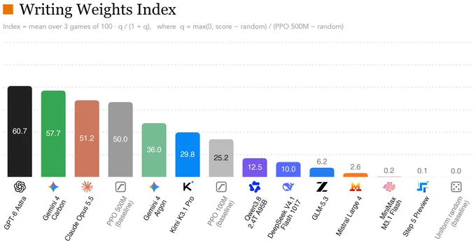
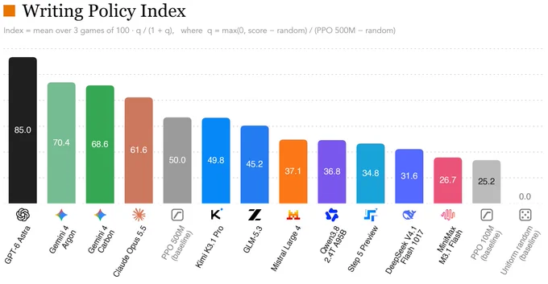
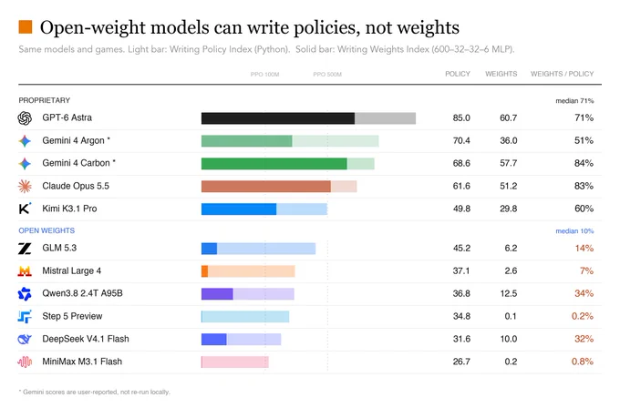

# Writing Weights Index：会写游戏策略，为什么还写不好神经网络权重

> 来源：[Xingyu Dang 的评测帖](https://x.com/xingyudang/status/2117428789068386630)，墨尔本时间 2026 年 11 月 3 日。背景研究：[Sparks of Weight-Space Programming](https://rikiyat.github.io/blog/weight-space-programming/)，2026 年 11 月 2 日发布。本文 11 月 3 日核查，并抽查原研究公开日志的固定提交 `4d09ba6`。

让大模型写一个玩游戏的 Python 程序，和让它把策略写进一组神经网络参数，是两项不同的任务。前者能使用条件、变量和计算；后者必须在指定的层数、宽度、激活函数与输入输出布局中实现同样的行为。

Xingyu Dang 发布的 Writing Weights Index，值得看的就是这个差异。主帖展示写权重的成绩，后续又给出直接写 Python 策略的对照。两张榜之间的落差说明：最终网络表现不佳，不能直接解释成模型完全不懂游戏，也不能只凭一张权重榜判断通用编程能力。[主帖](https://x.com/xingyudang/status/2117428789068386630)、[Python 对照](https://x.com/xingyudang/status/2117428791660134736)



*作者原图，分数为其报告值；本文未重跑跨模型评测。模型名称与版本沿用图中标注。*

## 1. 测的是把规则写进一个小网络

原始研究的实验 5 使用 MinAtar 的 Breakout、Seaquest、Asterix。模型获得规则、游戏源码、输入输出布局及固定架构，在一次回复里给出权重编辑，不接受游戏运行反馈。目标是 `600 → 32 → 32 → 6` 的 tanh MLP，共 20,486 个参数，初始全部为零。

这里的 600 个输入不是完整游戏画面，而是 10×10 网格的六个通道；六个输出是动作 logits。因此，它更接近“把可执行决策逻辑实现成一个受约束的神经网络”，不是通过屏幕观察学习一个全新的大型游戏。原实验对生成网络和 PPO 都用 1,000 局评估，包含 0.1 的 sticky actions，单局最多 10,000 步。[原实验的设置与文件说明](https://github.com/RikiyaT/lm_understand-logs/blob/4d09ba6d6a7e891dd8063974dfe81b3d78e3494f/exp5_write_from_scratch/README.md)

“无训练”描述的是这次目标网络的构造过程，不代表生成权重的大模型没有经过预训练。原研究的其他实验还允许不同的工具或前向运行预算，也不能把实验 5 的无反馈条件推广到整篇研究。

## 2. 指数 50 分，不是 50% 成功率

帖图给出的计算方式，是先按每个游戏的随机策略与 PPO 500M 基线归一化，再压缩到有限范围，最后对三个游戏取平均：

```text
q_game = max(0, score_game - random_game)
         / (PPO500M_game - random_game)

index = mean_over_games(100 * q_game / (1 + q_game))
```

在对应基线分母为正的条件下，随机策略对应 0，PPO 500M 对应 50。某个游戏的归一化增益 `q=3` 对应 75，而不是 150 或 300。这个压缩有助于防止某个游戏的超高分无限主导平均值，但也让分数差与原始游戏得分差不再成正比。

因此，60.7 不等于“60.7% 的局数成功”，不能用两个指数相除就得到原始奖励提升倍数；作者第三张图的 weights/policy 比例，同样只是两个压缩指数的比值，不是编译正确率。

| 模型 | 写权重指数 | Python 策略指数 |
|---|---:|---:|
| GPT-6 Astra | 60.7 | 85.0 |
| Gemini 4 Carbon† | 57.7 | 68.6 |
| Claude Opus 5.5 | 51.2 | 61.6 |
| Gemini 4 Argon† | 36.0 | 70.4 |
| Kimi K3.1 Pro | 29.8 | 49.8 |
| Qwen3.8 2.4T A95B | 12.5 | 36.8 |
| DeepSeek V4.1 Flash | 10.0 | 31.6 |
| GLM 5.3 | 6.2 | 45.2 |
| Mistral Large 4 | 2.6 | 37.1 |
| MiniMax M3.1 Flash | 0.2 | 26.7 |
| Step 5 Preview | 0.1 | 34.8 |

*从作者图表转录，非独立复测。PPO 500M 基线为 50.0，PPO 100M 为 25.2，随机基线为 0.0。†第三张图注明 Gemini 分数由他人报告，未在作者本地重跑；帖串另将 Carbon 结果指向 [Wenhao Chai 的分享](https://x.com/wenhaocha1/status/2117383529273405747)。*

## 3. Python 对照，把难点分成了两段



GLM 5.3 的两个指数是 45.2 与 6.2，Step 5 Preview 是 34.8 与 0.1；GPT-6 Astra 则是 85.0 与 60.7。差异不能只用“有没有想出策略”解释。

一个直观例子是打砖块：策略可能是预测球的落点，再把挡板移过去。Python 可以直接写计算与分支；固定 MLP 则需要把位置、方向、边界和动作选择表示成矩阵、偏置与非线性组合，还要正确处理坐标、展平顺序和数值尺度。



*作者将这些差异解释为策略到神经网络权重的转换瓶颈。图中的开放权重／专有模型分组沿用作者分类，不是本文重新审查过的发布或许可状态。*

这组对照支持“直接写权重增加了额外困难”的判断，但还没有完全隔离每一项原因。Python 策略的表达空间与小型 tanh 网络并不相同；预算、输出长度、数值计算、网络容量和解析器也可能影响结果。若要单独测量转换能力，更强的实验应提供同一份固定策略，只让各模型完成权重实现，再做语义等价与逐层检查。这是本文提出的后续验证方式，不是这条帖串已经完成的实验。

## 4. 原研究有日志，但不等于复现了这张跨模型榜

本次确认原研究公开了 `lm_understand-logs`，其中有提示词、回复、运行记录、网络文件与评估 JSON，而不只是博客演示。抽查实验 5 的文件可得到以下原始平均分：

| 游戏 | 原研究生成网络 | PPO 100M 最佳种子 | PPO 500M 最佳种子 |
|---|---:|---:|---:|
| Breakout | 517.4 | 15.8 | 25.3 |
| Seaquest | 53.1 | 5.6 | 88.9 |
| Asterix | 53.2 | 25.8 | 55.2 |

这些是原研究的游戏奖励，不是前面的指数。本次用脚本读取固定版本 JSON，核对了三个生成网络各有 1,000 局记录、表中均值及 PPO 最佳种子的取法；还抽查 Breakout 的解析记录：92 条编辑全部应用、无解析错误、815 个非零参数。它的工具审计字段记录为 `tool_free=true`。这仍是在核对研究者发布的记录，不是重新运行游戏或独立检查完整事件流。[原始评估 JSON](https://github.com/RikiyaT/lm_understand-logs/blob/4d09ba6d6a7e891dd8063974dfe81b3d78e3494f/exp5_write_from_scratch/eval/minatar_eval.json)、[解析记录](https://github.com/RikiyaT/lm_understand-logs/blob/4d09ba6d6a7e891dd8063974dfe81b3d78e3494f/exp5_write_from_scratch/runs/breakout/apply.json)

原实验 README 还说明，Seaquest 和 Asterix 的部分二维列表最初被读取器拒绝，修正读取器后重新解析同一份回复，没有重新提问。这正是评测需要报告的细节：解析失败与策略失败不同，改变解析器后也应保留前后记录。[实验 README](https://github.com/RikiyaT/lm_understand-logs/blob/4d09ba6d6a7e891dd8063974dfe81b3d78e3494f/exp5_write_from_scratch/README.md)

但是，原研究的 Astra 日志不能自动验证 Xingyu Dang 对其他模型的榜单。本次读到的帖串没有给出足以逐项重建这张跨模型榜的完整配置和记录，仍需确认各模型的提示词、推理预算、尝试次数、解析规则、每游戏奖励、随机基线与统计误差。

## 5. 有趣的方向，不宜扩大成通用结论

这个方向真正有价值的问题，是能否让自然语言策略稳定落到一个独立运行的小网络中。若能做到，它可能成为生成规则控制器、检查网络行为或针对性修改权重的一种工具；但每项用途都需要各自的验证。

当前三游戏结果不能证明大模型已经能从头设计任意大型网络，也不能据此认定开放权重模型在所有推理或编程任务上都更差。更值得追踪的，是把失败拆开：策略是否合理、网络是否有表达能力、权重是否正确实现、输出是否被完整解析，以及运行时行为是否符合预期。

本文保存三张来源图，核对指数公式的几个锚点，并抽查原研究的结构化记录；没有调用任何评测模型、训练 PPO、执行生成策略或重跑游戏。复现核对脚本、汇总结果与许可说明见 [SOURCES.md](imgs/writing-weights-index-policy-translation/SOURCES.md)。
