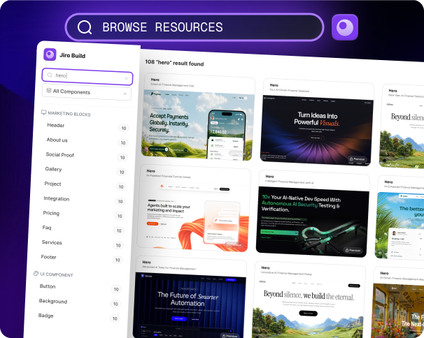
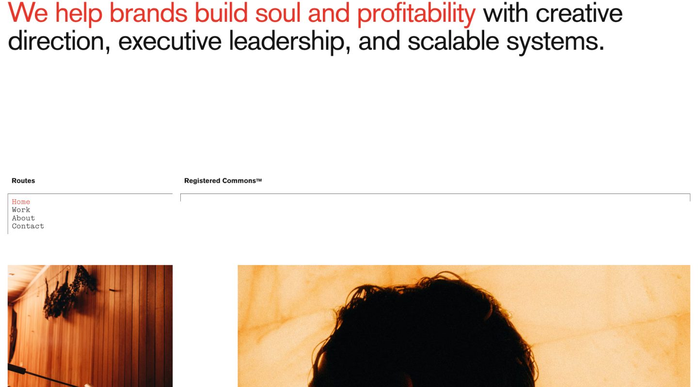

# Seven AI Design Links: Jiro's Implementation Recipes, Minimal Gallery, and 3dicons

> Source: [Tanzil Chowdhury's seven-site recommendation](https://x.com/iamtanzil_/status/2117951858404913336). The post displayed November 4, 2026 at 23:07; reviewed November 5. The author's profile says he is building Jiro. This is a recommendation that includes his own product, not an independent comparison of seven services.

Four entries overlap our recent coverage: Landbook, Godly, Font In Logo, and 60fps. The additions, Jiro, Minimal Gallery, and 3dicons, make a useful distinction: **design references, implementation material, and visual assets solve different problems.**

The list is best understood as a set of resources for visual website work, rather than a complete application stack. Data, permissions, business behavior, and release testing remain separate responsibilities.

## 1. Classify the Outputs Before Choosing Tools

| Resource | Role | What not to assume |
|---|---|---|
| [Jiro](https://jiro.build/) | Design prompts, components, and page templates | Every preview includes anonymously accessible code or guaranteed cross-tool reproduction |
| [Landbook](https://land-book.com/) | Website and landing-page references | Every listing supplies reusable source code |
| [Godly](https://godly.website/) | A reference URL now redirecting to Recent | It remains a separate gallery from Recent |
| [Minimal Gallery](https://minimal.gallery/) | Curated sites, with separate template and tool sections | Every listing is a free template |
| [Font In Logo](https://www.fontinlogo.com/) | Brand and typeface references | Every match identifies an unmodified original font with commercial rights included |
| [60fps](https://60fps.design/) | Application interaction and motion references | A still image explains the complete interaction |
| [3dicons](https://3dicons.co/) | Icons, rendered images, and editing resources | Every feature is free or every PNG is an editable model |

See the earlier [five-site reference workflow](../2026-11-05/2026-11-05-ai-design-five-reference-sites-en.md) and [font evidence and Godly follow-up](../2026-11-05/2026-11-05-ai-design-eight-sites-studio-fonts-en.md) for the overlapping entries. This article concentrates on the three additions.

## 2. Jiro Offers a More Specific Starting Point, with Access Conditions

Jiro advertises **1,454+ templates and components**, with prompts containing component code and design instructions. That combined count is not a verified inventory of 1,454 complete websites. Its promise of identical results across AI builders is a vendor claim, not a result established here. [Jiro homepage](https://jiro.build/)

*An official explanatory image showing resource categories, not an editor integration tested for this article or a complete current inventory.*

The practical attraction is specificity. A request for a polished homepage leaves an agent considerable room to guess. Supplied structure, code, and visual requirements could narrow that space. Whether they reduce revision work depends on the target project.

The public [Miles template](https://jiro.build/templates/portfolio/brand-marketing-designer-landing-page-miles) rendered a page preview. Clicking **View Code** opened a **Sign up to see the code** gate. We did not obtain its full implementation, audit dependencies, or verify licensing. A short visible snippet is not evidence that the complete template is publicly available.

Identical inputs also do not establish identical delivery. Model versions, dependency resolution, asset paths, and subsequent edits can affect a build. A reproduction claim needs a controlled comparison rather than inference from the preview.

## 3. MCP Changes Retrieval, Not Engineering Responsibility

Jiro documents MCP access for clients including Claude Code, Codex, and Cursor. Its endpoint, `https://mcp.jiro.build`, supports Streamable HTTP with OAuth, and setup includes approving a sign-in. Not needing an API key does not mean anonymous access. [MCP documentation](https://jiro.build/mcp)

That integration could reduce manual transfer from a library to an editor. It does not establish compatibility with an existing application. Account entitlements, usage limits, resource licenses, dependencies, and style conflicts still need review. We read the instructions without changing local configuration, authorizing the server, or calling its tools.

## 4. Minimal Gallery Is Useful for Structural Decisions

Minimal Gallery separates **Websites, Templates, and Tools**, and provides website-type and platform categories. This helps narrow references by task instead of treating every attractive page as interchangeable. [Minimal Gallery](https://minimal.gallery/)

*The listing credits Roko Gabrilo for direction, design, and development. This is the gallery's screenshot, not our implementation or a grant to reuse the design, images, or code.* [Listing](https://minimal.gallery/registered-commons/)

In this image, a large headline carries the message, red emphasizes selected words, and thin rules separate navigation and imagery. These are observable hierarchy choices, not proof that oversized type and whitespace suit every product.

For an editor or operational dashboard, removing necessary information can increase search effort. Better questions are: what becomes visible first, where does the next action sit, and does the structure survive realistic copy and another language? These are suggested review criteria, not automated evaluations supplied by the gallery.

## 5. Separate 3dicons' Free Collection from Its Editor Plans

The official **V1 collection** lists **122 icons and 1,464 renders**, labels the collection **CC0**, and identifies Blender, FBX, and PNG formats. Render counts are not counts of distinct models. We inspected the listing, not every file in a downloaded archive. [V1 collection](https://3dicons.co/collection/b68cf8-v1)

*A V1 example by Realvjy / Vijay Verma. The collection is marked CC0. This local file is a 200 × 200 WebP preview, not a Blender or FBX model.*

A rendered image may be enough for a website illustration. Changing geometry or placing the object in a real 3D scene requires checking the corresponding model files. A PNG's dimensional appearance does not make it a mesh.

The current editor also has Free and Pro tiers. Its published comparison lists PNG exports up to 800px for Free and 4096px for Pro, with premium materials and textures among the Pro features. **The V1 license, free editor allowances, and paid features are separate questions.** [Editor plans](https://3dicons.co/pro)

Consistent camera angles, materials, and lighting usually matter more than adding more icons. That consistency is an integration decision, not an automatic benefit of choosing a single library.

## 6. Give Each Source One Job

1. **Establish information structure.** Choose a small set of relevant references and identify the hierarchy or navigation worth borrowing.
2. **Choose an implementation starting point.** Before using Jiro material, check access, dependencies, and permission to use it in the target project.
3. **Resolve visual assets.** Record sources and licenses; distinguish font matches, rendered images, and model files.
4. **Test real content and behavior.** Check long copy, language coverage, mobile layout, keyboard access, reduced motion, loading failures, and empty states. Test backend behavior separately.

Opening Godly during this review still produced a redirect to `recent.design/?ref=godly`; it should not be counted as another independent pool alongside Recent.

The list is worth keeping because it can reduce uncertainty about structure, implementation, and assets. It does not remove the need to turn those inputs into a working product. **References can accelerate a draft; real content and engineering checks determine whether it is ready to deliver.**

Review scope: the original post, public pages, a template preview, and its code-access gate. The post's video did not play successfully. No account, purchase, full code or model download, MCP authorization, or cross-builder reproduction test was completed. See [SOURCES.md](imgs/ai-design-seven-sites-jiro-assets/SOURCES.md) for provenance and limits.
