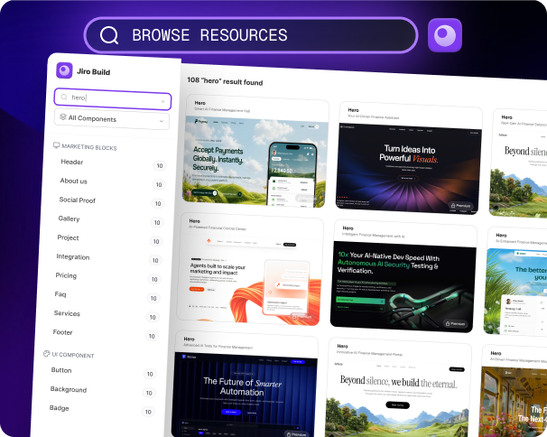
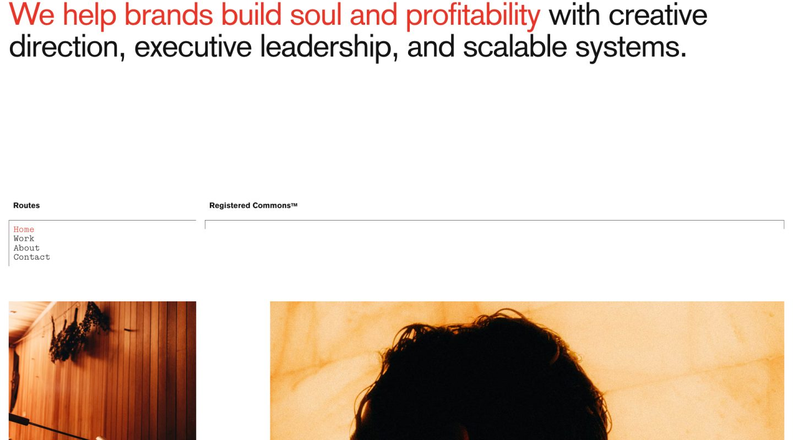

# AI 设计七站清单：Jiro 的代码配方、Minimal Gallery 的结构参考与 3dicons 素材

> 来源：[Tanzil Chowdhury 的七站推荐](https://x.com/iamtanzil_/status/2117951858404913336)。原帖页面显示时间为 2026 年 11 月 4 日 23:07，本文于 11 月 5 日核查。作者个人简介写明正在打造 Jiro，因此这是一份包含自家产品的推荐清单，不是七款工具的独立对照测试。

这份清单里，Landbook、Godly、Font In Logo 和 60fps 都已经出现在近期文章中。新增的 Jiro、Minimal Gallery 和 3dicons，恰好让一个问题更清楚：**参考设计、取得实现材料、补齐视觉资产，是三件不同的事。**

原帖称它们是一整套 AI 设计工具。更准确地说，这是偏向网页视觉制作的一组资源入口；业务逻辑、数据、权限和上线验收，仍要另外完成。

## 1. 七个入口，按交付物分工

| 入口 | 主要用途 | 不应顺手推导出的结论 |
|---|---|---|
| [Jiro](https://jiro.build/) | 设计提示词、组件与整页模板，实现材料入口 | 有预览就能匿名取得完整代码，或跨工具必然完全复现 |
| [Landbook](https://land-book.com/) | 网站与落地页的结构参考 | 被收录的网站都附带可复用源码 |
| [Godly](https://godly.website/) | 原帖中的视觉参考入口，目前转向 Recent | 仍是一套独立于 Recent 的画廊 |
| [Minimal Gallery](https://minimal.gallery/) | 按类型、平台查找网站，另设模板与工具栏目 | 所有收录内容都是免费模板 |
| [Font In Logo](https://www.fontinlogo.com/) | 品牌标志与字体关系参考 | 每个匹配都是未经修改的原字体，且已获商用授权 |
| [60fps](https://60fps.design/) | 应用界面的交互与动态参考 | 一张截图足以说明完整交互 |
| [3dicons](https://3dicons.co/) | 3D 图标、渲染图与材质编辑相关资源 | 全站服务免费，或者每张 PNG 都是可编辑模型 |

前两篇已经讨论[五站的参考分工](../2026-11-05/2026-11-05-ai-design-five-reference-sites.md)，以及[字体证据和 Godly 跳转](../2026-11-05/2026-11-05-ai-design-eight-sites-studio-fonts.md)。本篇集中补上三个新入口，不把重合部分再算成新发现。

## 2. Jiro：比一句风格描述更具体，但完整代码有访问门槛

Jiro 首页当前宣称拥有 **1,454+ 个模板与组件**，并说明提示词包含组件代码和设计指令。这个数量混合了区块与整页，不是已经盘点过的 1,454 个独立完整网站。[Jiro 首页](https://jiro.build/)

*官方说明图，展示按 Header、Pricing、FAQ 等类别挑选资源的思路；不是本文连接编辑器后的截图，也不代表当前目录的完整数量。*

它有用的地方，在于缩小 Agent 猜测的范围。“做一个有高级感的主页”几乎没有实现约束；一份包含结构、代码与效果要求的材料，至少能给出更明确的起点。实际能节省多少修改，需要在自己的工程中验证。

本次打开了 [Miles 品牌设计师落地页](https://jiro.build/templates/portfolio/brand-marketing-designer-landing-page-miles)，能看到运行中的页面预览。点击 **View Code** 后，界面出现 **Sign up to see the code**，要求创建免费账号或登录。因此，本文没有取得完整模板代码，也没有核验它的依赖、许可或可维护性。页面上露出的短代码片段，不能当作完整模板已公开的证据。

首页还声称，同一提示词放进不同 AI builder，会得到相同代码、动画和结果。**这属于供应方的复现承诺，不是本次测试结论。** 即便输入包含代码，模型版本、依赖、资源路径和后续修改也可能影响交付；要证明一致，仍需固定输入与环境做对照。

## 3. MCP 减少搬运，不代表无需账号

Jiro 已公布面向 Claude Code、Codex、Cursor 等客户端的 MCP 接入说明，采用支持 OAuth 的 Streamable HTTP，服务器地址是 `https://mcp.jiro.build`。公开流程要求批准登录；“无需 API key”不等于匿名访问。[Jiro MCP 文档](https://jiro.build/mcp)

这条路径解决的是“怎样把库里的材料送进编辑器”，不是自动解决工程集成。接入前仍要确认账号能访问哪些资源、计量与许可怎样约定；接入后仍要检查新增依赖、样式冲突和第三方素材。本文只阅读了说明，没有修改本机配置、授权 MCP 或调用其工具。

## 4. Minimal Gallery：把审美参考拆成结构决定

Minimal Gallery 是网站策展入口，公开页面区分 **Websites、Templates、Tools**，并提供网站类型与平台分类。这种分类适合先按任务找参考，而不是只追逐一种视觉风格。[Minimal Gallery](https://minimal.gallery/)

*来源条目署名 Direction, design & development：Roko Gabrilo。这里保存的是画廊提供的桌面截图，不是本文制作的页面，也不附带复制设计、图片或代码的许可。*[收录页](https://minimal.gallery/registered-commons/)

这张图可观察到，大段标题承担主要信息，红色强调只作用于部分文字；下方通过细线、导航与图像分区组织页面。可以借鉴的是明确的层级和有限的强调，而不是把“大字、留白”机械套在所有产品上。

对后台、编辑器或高频操作工具来说，删掉必要信息会增加寻找成本。看参考时更值得问：哪些内容被优先看到？下一步动作是否明确？换成真实长度的中文后，结构还成立吗？这些是本文建议的观察方法，不是 Minimal Gallery 自动提供的评测结果。

## 5. 3dicons：免费库、模型文件与付费编辑器要分开

原帖将 3dicons 简称为免费 3D 图标。具体到官方 **V1 collection**，页面列出 **122 个图标、1,464 张渲染图**，标注 **CC0**，并列出 Blender、FBX 和 PNG 文件类型。这里的渲染数量不能当成独立模型数量；本次也没有下载整包逐个检查文件。[V1 集合](https://3dicons.co/collection/b68cf8-v1)

*Realvjy / Vijay Verma 的 V1 图标示例；集合页标注 CC0。此处保存的是 200 × 200 的 WebP 预览，不是 Blender 或 FBX 模型。*

这个区别会影响用法：只需给网页补一张图标，可以使用合适分辨率的渲染图；如果要改变相机、几何或真正放进 3D 场景，则要检查对应模型文件，不能拿 PNG 当模型。

当前站点也有 Free / Pro 编辑器方案。公开说明写明，Free 的 PNG 导出最高 800px，Pro 最高 4096px，并提供高级材质、纹理等能力。因此，应把 **V1 的 CC0 标注、免费编辑范围与 Pro 权益**分别判断，不能概括成“全站全部免费”。[编辑器方案](https://3dicons.co/pro)

挑选素材时，统一光向、视角和材质通常比堆积更多图标更重要。这是视觉整合建议，不是采用同一素材库就会自动获得的效果。

## 6. 更实用的组合：每个来源只负责一个决定

可以把七站清单收敛成四步：

1. **先确定信息结构。** 从画廊选少量同类业务参考，记录借鉴的层级、导航或内容顺序。
2. **再选实现起点。** 需要 Jiro 的代码或提示词时，先确认访问权限、依赖和许可，再让 Agent 适配现有工程。
3. **补齐字体和图标。** 保留来源与授权记录，区分字体匹配、渲染图片和模型文件。
4. **用真实内容验收。** 检查长文案、中文字体、手机布局、键盘操作、减少动态效果、加载失败与空状态；业务后端另行验收。

原帖中的 Godly，本次打开时仍被重定向到 `recent.design/?ref=godly`，因此不应再与 Recent 当作两个独立资源池。其余重合站点的详细边界见前篇。

这份清单值得保留，但价值不在“七个网站包办设计”，而在于减少三类不确定性：页面应该怎样组织、实现从哪里开始、视觉素材怎样取得。**参考和代码可以加速起稿，真实内容与工程验收决定能否交付。**

本次核查范围为原帖、公开页面、模板预览和代码访问提示；未播放成功原帖视频，未注册、付款、下载完整代码包或模型包，也未执行跨 AI 工具复现测试。配图来源与访问记录见 [SOURCES.md](imgs/ai-design-seven-sites-jiro-assets/SOURCES.md)。
