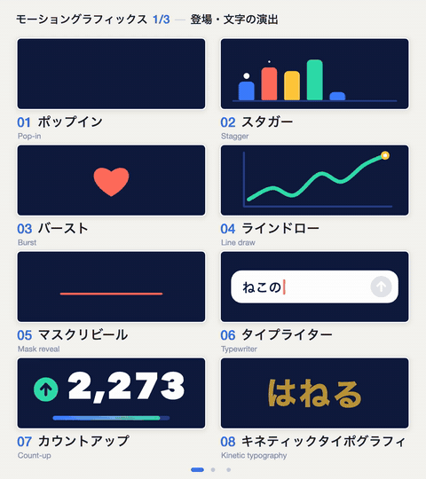
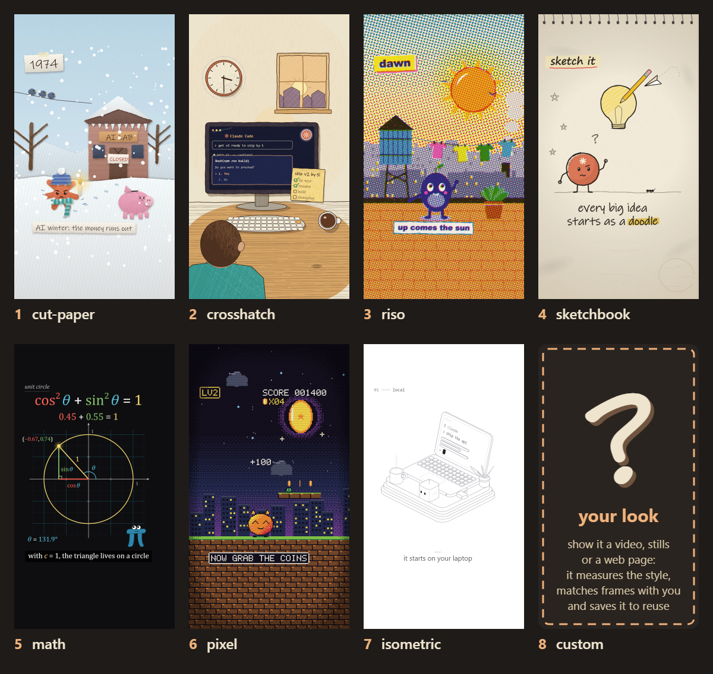
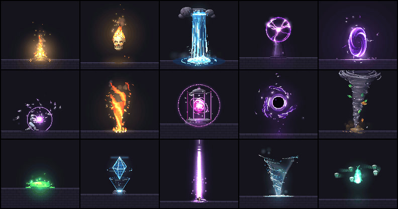

# Choosing Among Ten Claude Video and Motion Repositories

> Source: [Leo's ten-project list](https://x.com/double_burger_2/status/2117904522987376880), displayed as published November 4, 2026. Reviewed November 5 against pinned repository snapshots. Recommendations in the post are not treated as independently measured results. Revisions and verification details are in [SOURCES.md](imgs/claude-motion-ten-repo-selection/SOURCES.md).

Making video with Claude can mean several different things: finding the name of a movement, maintaining a visual style, explaining a difficult concept, or rendering an approved storyboard. Those jobs do not require interchangeable tools.

Unlike our earlier [eight-repository map](../2026-10-21/2026-10-21-opus55-video-eight-repo-production-map-en.md), this follow-up focuses on choosing between **design principles, motion vocabulary, reusable effects, and production workflows**.

## 1. Compare Deliverables First

| Project and verified entry | What it supplies | Where it fits |
|---|---|---|
| [Lemo-Opuscar](https://github.com/lemomo-ai/lemo-opuscar) | Style specifications, directing guidance, rendering/audio tools, demonstrations | A broader code-based film workflow |
| [Anatomy](https://github.com/wheresryan22/anatomy) | Isometric geometry, interactive explanations, inspection tools | Building an explanatory object |
| [Motion Design Skill](https://github.com/LottieFiles/motion-design-skill) | Timing, easing, emotion, choreography principles | Deciding why and how things move |
| [pixelfx](https://github.com/patch-gg/pixelfx) | Pixel-effect code, sprite-sheet export, authoring skill | Effect assets, not whole-film storytelling |
| [onetake](https://github.com/feitangyuan/onetake) | Continuous transitions, camera/motion library, verification | Product films with carried visual continuity |
| [huashu-art-motion](https://github.com/alchaincyf/huashu-art-motion) | Art recipes, explainer grammars, runtime, QA | Art animation and explainers |
| [Animate](https://github.com/cth9191/animate) | Story, look, storyboard approvals and Canvas production tools | Shorts needing early creative approval |
| [mg-styles-15](https://github.com/Vincentwei1021/mg-styles-15) | Prompts, source, and films for fifteen main-series styles | Studying complete MG examples |
| [vibe-knowledge-film](https://github.com/HeyChengC/vibe-knowledge-film) | Silent-explainer method, project scaffold, renderer | Showing causal explanations visually |
| [Motion Prompt](https://github.com/showheyohtaki/motion-prompt) | Named moves, examples, specifications, selection skill | Turning vague requests into precise directions |

Many projects use an agent to write scenes and timing, a browser to draw frames, and FFmpeg to encode them. That shared direction does not establish a common project format. Anatomy primarily produces interactive figures, pixelfx supplies effect modules, and Motion Design Skill does not provide a complete film renderer.

## 2. Corrections to the Original List

The post's Anatomy and Animate links point only to `github.com/anatomy` and `github.com/animate`; its mg-styles-15 link stops at the GitHub homepage. The table supplies verified candidates. Anatomy and mg-styles-15 also match our earlier source records; Animate was matched through its name, description, and official README, not through a complete repository link in the post.

More importantly, **Motion Prompt is not a fifteen-style collection of ten-second films**. Its pinned catalog contains 192 elements in eight packs of twenty-four, covering motion, cameras, UI, web effects, photography, and related vocabulary. That is a different deliverable from mg-styles-15. [Pinned Motion Prompt revision](https://github.com/showheyohtaki/motion-prompt/tree/7819d3879eb7d5a1475c11c001bedffb5cab64af)

Counts also need dates. Lemo's current README lists 66 styles; our earlier 43- and 51-style articles describe older snapshots. Huashu now describes 36 art recipes, with a separate SVG example beyond its 35 Canvas scenes. A historical overview image is not a complete capability inventory. [Lemo snapshot](https://github.com/lemomo-ai/lemo-opuscar/tree/bebbbe1aa92a3cb4bb6f83500e61b23a17d1aa00), [Huashu snapshot](https://github.com/alchaincyf/huashu-art-motion/tree/8a0d7d72ca65fcce6f8ba82c4a6c8dfe35b8422c)

## 3. Principles and Vocabulary Solve Different Problems

LottieFiles' Motion Design Skill starts with emotional intent, motion personality, primary properties, duration, easing, staging, and supporting movement. It helps decide why an animation exists, independently of the implementation system. Installing it does not create a storyboard, soundtrack, or MP4 pipeline. [Core skill](https://github.com/LottieFiles/motion-design-skill/blob/f9a8a041b85185ee4881b3471d3415e939aac772/skills/motion-design/SKILL.md)

Motion Prompt addresses the vocabulary gap. Its gallery connects names with moving examples, specifications, and reference code, which an agent can adapt to an existing project.

*Shohei Ohtaki / Motion Prompt, original GIF from the pinned revision; not generated for this review.*

“Reveal the title upward through a mask over 0.6 seconds, staggering the lines” is easier to evaluate than “make it more premium.” Principles guide the choice; vocabulary communicates it. Neither replaces production or viewing the result. The post's suggestion that installing a particular skill improves rhythm was not backed by a reproducible comparison.

## 4. Approve Cheap Decisions Before Expensive Production

Animate places three approvals before animation: the story beats, two to four look frames, and the storyboard. Its seven built-in styles share production tools; the eighth slot in its overview means a custom look developed from references, not an eighth ready-made pack. [Animate README](https://github.com/cth9191/animate/blob/7e5eb56feb2dd573f890e1b7b34748af43d58263/README.md)

*cth9191 / Animate, existing style examples. “Custom” means developing a new look from references.*

vibe-knowledge-film emphasizes whether viewers understand what they see: establish facts and a storyboard, make roughly thirty seconds, then expand after review. Its skill explicitly targets silent, 16:9, subtitle-led knowledge films, not general talking-head production. [Production protocol](https://github.com/HeyChengC/vibe-knowledge-film/blob/62d51508aad00003dc6209afa80c4b5dc540de59/SKILL.md)

Both put narrative and visual approval before lengthy animation. Glowing lines can accompany a concept without explaining it. The workflow still depends on an agent and a person actually checking facts, reviewing frames, and making revisions.

Lemo and Huashu are useful for studying reusable style systems. mg-styles-15 is useful for dissecting how a complete example connects images, audio, and timing through `renderAt(t)`. Repeating a prompt does not reproduce the same project, and fonts or numerical-library versions can affect results. [MG reproduction notes](https://github.com/Vincentwei1021/mg-styles-15/blob/49052d80bfaf9fa8412cc9710530e5e95a3b8d8c/README.md)

## 5. Three Specialized Layers

**pixelfx is the effects layer.** Excluding twenty `_lib.js` helpers, its tree contains 244 effect modules. It supports recoloring, mirroring, and sprite sheets with frame metadata. Some effects are time functions; others use fixed-step simulation rather than the same rendering mechanism. [Implementation overview](https://github.com/patch-gg/pixelfx/blob/a84159688af3ca37a4be05a0d422b94451b2e24e/README.md)

*Patch / pixelfx; extracted at 1.5 seconds from the official montage GIF. A still illustrates asset types, not motion quality.*

**Anatomy is the explanatory-object layer.** SVG, WebGL, and an experimental 3D path connect structures, parts, and states. An interactive figure is not automatically a narrated, scored film; it needs integration into a wider production project. [Anatomy README](https://github.com/wheresryan22/anatomy/blob/1482e8469b0a9e0d8cc18ea2740a01423d29ae80/README.md)

**onetake is a continuity method.** Elements and camera motion carry one beat into the next: a prompt field can become an interface, then a different composition. It includes motion functions and rendering/verification scripts. Its carry score is a project-specific metric, not a standardized aesthetic rating, and passing mathematical tests does not establish convincing storytelling. [Motion tests](https://github.com/feitangyuan/onetake/blob/abb6d17279cdc749e27e99aa534a062d8fd01ced/scripts/test_motion.js), [film checks](https://github.com/feitangyuan/onetake/blob/abb6d17279cdc749e27e99aa534a062d8fd01ced/scripts/verify_promo.py)

## 6. Readable, Reproducible, and Commercially Reusable Are Different

onetake's public version uses **PolyForm Noncommercial 1.0.0**. Its README separates commercial licensing and states that public cases include films and breakdowns, **not their complete source code**. Public GitHub access should not be treated as MIT permission for client work. [License and case scope](https://github.com/feitangyuan/onetake/blob/abb6d17279cdc749e27e99aa534a062d8fd01ced/README.md)

Other repositories also distinguish code from assets. Lemo separately licenses its code and demonstration films, with specific voice-track exclusions. Huashu excludes some character artwork and demonstration material from MIT. pixelfx has a font exception. vibe-knowledge-film reserves third-party reference-film scripts and visual designs. Learning a method is not permission to publish its sample under your own name; pinned sources are listed in the source record.

“Made with Claude” should also be decomposed. The model plans and codes; images can combine procedural drawing, supplied assets, 3D rendering, and real source material. Lemo now includes an Edit & Documentary group, so code-based production does not imply that every work excludes external assets. Switching agents does not guarantee equivalent output either; some projects explicitly tune their methods for Claude.

## 7. Start with One Missing Capability

| Your immediate gap | A useful starting point |
|---|---|
| Naming the movement you want | Motion Prompt |
| Motion feels noisy or lacks hierarchy | Motion Design Skill |
| Studying a complete style/render project | mg-styles-15, then Lemo or Huashu |
| Approving story, look, and storyboard first | Animate |
| Silent knowledge films | vibe-knowledge-film |
| Pixel-effect assets | pixelfx |
| Interactive technical explanations | Anatomy |
| Continuous product films | onetake, after checking licensing |

This is an interpretation of the inspected deliverables, not a tool ranking. Start with one subject, one style, and approximately ten seconds. Inspect frames, transitions, audio, text, repeat rendering, and full playback before expanding. Installing all ten skills can introduce competing production rules rather than solve a specific problem.

This review checked pinned documentation and trees for all ten projects and selected implementation paths. Motion Prompt's 192 entries and pixelfx's 244 effect files were checked structurally. onetake's `node scripts/test_motion.js` returned `ALL PASS`. No skills were installed, no new Claude film was commissioned, and no end-to-end reproduction of all ten systems was performed. Figure provenance and licensing are recorded in [SOURCES.md](imgs/claude-motion-ten-repo-selection/SOURCES.md).
