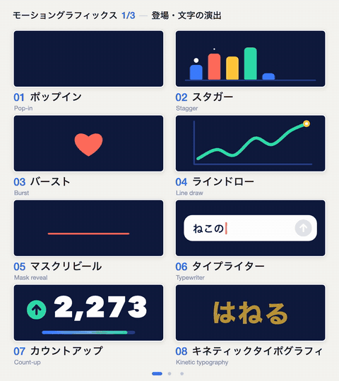
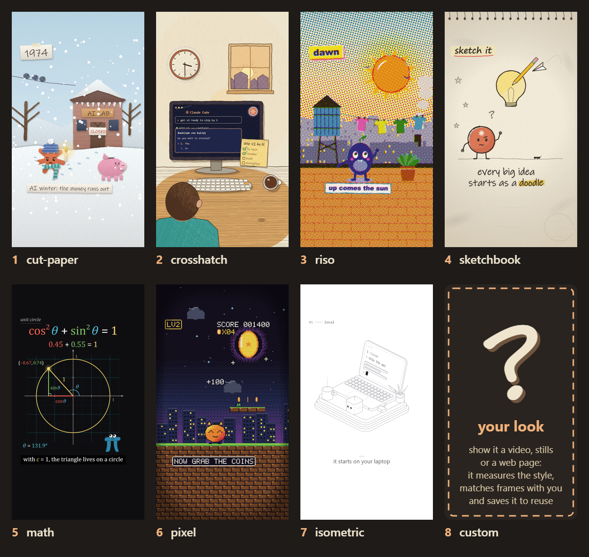
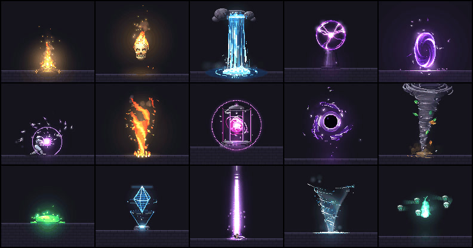

# Claude 视频十库选型：动效原则、风格库与可渲染工程的区别

> 来源：[Leo 的十项目清单](https://x.com/double_burger_2/status/2117904522987376880)，页面显示发布于 2026 年 11 月 4 日。核查日期：11 月 5 日。本文重新检查十个对应项目的固定源码快照，不把原帖推荐语当作独立效果评测；提交与核查记录见 [SOURCES.md](imgs/claude-motion-ten-repo-selection/SOURCES.md)。

“用 Claude 做视频”下面，其实藏着几种不同需求：不知道怎么描述一个动作、不知道怎样统一画风、需要解释一个复杂概念，或者已经有分镜，只差把工程渲染成片。它们需要的工具并不相同。

Leo 的这份清单值得保存，但十项不是十个可互换的视频生成器。和我们此前的[八库源码地图](../2026-10-21/2026-10-21-opus55-video-eight-repo-production-map.md)相比，这次更适合沿着**设计原则、动作词汇、可复用素材和制作流程**来选，而不是继续堆工具名。

## 1. 先看交付物，再看风格名称

| 项目与核实入口 | 实际提供什么 | 适合放在哪一步 |
|---|---|---|
| [Lemo-Opuscar](https://github.com/lemomo-ai/lemo-opuscar) | 风格规范、导演方法、渲染与音频工具、样片 | 建立较完整的代码制片流程 |
| [Anatomy](https://github.com/wheresryan22/anatomy) | 等距几何工具、交互图示与检查脚本 | 把概念做成可操作的解释对象 |
| [Motion Design Skill](https://github.com/LottieFiles/motion-design-skill) | 节奏、缓动、情绪与多元素编排原则 | 写代码前确定动作意图 |
| [pixelfx](https://github.com/patch-gg/pixelfx) | 像素效果代码、精灵图导出与创作 Skill | 制作特效素材，而非整片叙事 |
| [onetake](https://github.com/feitangyuan/onetake) | 连贯转场、镜头、动作库与验证脚本 | 产品发布片和连续镜头动效 |
| [huashu-art-motion](https://github.com/alchaincyf/huashu-art-motion) | 艺术配方、解说语法、运行时与 QA | 艺术动画及讲解片制作 |
| [Animate](https://github.com/cth9191/animate) | 故事、风格帧、分镜确认与 Canvas 出片工具 | 需要先确认叙事和画风的短片 |
| [mg-styles-15](https://github.com/Vincentwei1021/mg-styles-15) | 15 种主系列风格的提示词、源码与成片 | 拆解完整 MG 样例 |
| [vibe-knowledge-film](https://github.com/HeyChengC/vibe-knowledge-film) | 无旁白知识片的方法、工程骨架与渲染器 | 用画面演示因果关系 |
| [Motion Prompt](https://github.com/showheyohtaki/motion-prompt) | 动作术语、运动示例、规格与选取 Skill | 把“我想要这种感觉”变成具体指令 |

很多项目的路径是 Agent 编写场景与时间线，再由浏览器逐帧画图、FFmpeg 编码。但不能把这个共同方向理解成统一格式：Anatomy 首先交付交互图，pixelfx 首先交付效果模块，Motion Design Skill 则不自带整片渲染器。

## 2. 原帖有几处需要修正

第一，原帖给 Anatomy 和 Animate 的链接只有 `github.com/anatomy`、`github.com/animate`，mg-styles-15 的链接甚至只到 GitHub 首页。上表补充了可核对的入口；其中 Anatomy 与 mg-styles-15 也有我们之前文章的来源记录，Animate 依据名称、描述与其官方 README 匹配，不能假装这些完整路径原本就在帖子里。

第二，**Motion Prompt 不是原帖所说的“15 种 MG 风格、每种一支十秒片”**。固定版本的 `api/v1/catalog.json` 实际有 192 项，分为 8 组，每组 24 项，覆盖动效、运镜、UI、网页效果、摄影等。这和 mg-styles-15 的定位不同。[Motion Prompt 固定版本](https://github.com/showheyohtaki/motion-prompt/tree/7819d3879eb7d5a1475c11c001bedffb5cab64af)

第三，旧数字要带日期。Lemo-Opuscar 当前 README 标注 66 种风格；此前两篇记录的 43 和 51 是旧快照。huashu-art-motion 现有 36 种艺术配方，其中 35 个 Canvas 场景外另有独立 SVG 示例；不能把“35 格总览”当成所有输出能力的完整清单。[Lemo 快照](https://github.com/lemomo-ai/lemo-opuscar/tree/bebbbe1aa92a3cb4bb6f83500e61b23a17d1aa00)、[Huashu 快照](https://github.com/alchaincyf/huashu-art-motion/tree/8a0d7d72ca65fcce6f8ba82c4a6c8dfe35b8422c)

这些更正不是否定清单价值，而是避免把不同层次的材料装成同一种工具。

## 3. 原则和词汇，解决的是两种问题

LottieFiles 的 Motion Design Skill 以实现无关的设计原则为主：先明确观众应当感受到什么，再确定运动个性、主要属性、时长、缓动、视觉主角和次级动作。它能帮助审视“为什么要动”，但不等于安装后就有分镜、音频和 MP4 导出。[核心 Skill](https://github.com/LottieFiles/motion-design-skill/blob/f9a8a041b85185ee4881b3471d3415e939aac772/skills/motion-design/SKILL.md)

Motion Prompt 则解决“不知道这个动作叫什么”。它把名称、示例、规格和参考代码关联起来，用户可先在画廊选择，再让 Agent 按项目现有技术路线实现。

*来源：Shohei Ohtaki / Motion Prompt，固定版本原始 GIF；不是本文生成的样片。*

比如“标题从下方遮罩揭示，持续 0.6 秒，各行错峰进入”，就比“更高级一点”更容易验证。原则帮助选择，词汇帮助表达，两者都不能代替整片制作和观看验收。原帖关于“先装某项，节奏会更稳”的说法，没有给出可复现对照，本文不把它当性能结论。

## 4. 真正昂贵的步骤之前，先确认什么

Animate 的一个实用设计，是把确认放在动画制作前：故事节奏表、两至四张风格帧、逐段分镜依次确认，再进入构建和交付。它有七套内置画风，所谓第八格是用户自己的参考风格，不是另一个现成风格包。[Animate README](https://github.com/cth9191/animate/blob/7e5eb56feb2dd573f890e1b7b34748af43d58263/README.md)

*来源：cth9191 / Animate，固定版本风格示例图；“custom”表示按参考开发新画风。*

vibe-knowledge-film 把确认重点放在“观众到底能不能理解”：先做事实表和分镜，再制作约 30 秒样片，确认后才铺全片。其 Skill 明确限定无旁白、16:9 的字幕知识片；它不是任何口播视频都适用的通用模板。[制作规范](https://github.com/HeyChengC/vibe-knowledge-film/blob/62d51508aad00003dc6209afa80c4b5dc540de59/SKILL.md)

这两项共同提醒我们：代码运行之前，要先确认故事、视觉语言和解释方式。把抽象词配成发光线条，即使动起来也可能没有解释任何事情。Skill 给了流程，实际事实核对、用户确认和修改仍需要 Agent 与人执行。

Lemo 和 Huashu 更适合研究风格如何形成长期制作方法；mg-styles-15 则适合拆开某支完整样例，学习画面、声音和时间接口怎样连接。它使用 `renderAt(t)`，但同一提示词不保证再次产生同一工程，字体与数值库版本也会影响复现。[MG 样例说明](https://github.com/Vincentwei1021/mg-styles-15/blob/49052d80bfaf9fa8412cc9710530e5e95a3b8d8c/README.md)

## 5. 三种专项能力，不要当作整片生成

**pixelfx 是效果层。** 本次按目录核对，排除 20 个 `_lib.js` 辅助文件后，确有 244 个效果模块。它可以改色、镜像、导出带帧信息的精灵图；部分效果是时间函数，部分使用固定步长模拟，不是全部都采用同一种绘制机制。[实现与使用](https://github.com/patch-gg/pixelfx/blob/a84159688af3ca37a4be05a0d422b94451b2e24e/README.md)

*来源：Patch / pixelfx；从官方总览 GIF 第 1.5 秒提取，仅用于展示素材类型，静帧不能证明运动质量。*

**Anatomy 是解释对象层。** 它把概念映射为可操作的等距结构，用 SVG、WebGL 和实验性 3D 路径表现部件与状态。能旋转、能拆解，并不自动等于已经有讲稿、配乐和成片渲染；需要把它接进更大的制作工程。[Anatomy README](https://github.com/wheresryan22/anatomy/blob/1482e8469b0a9e0d8cc18ea2740a01423d29ae80/README.md)

**onetake 是连续性方法。** 它要求镜头与视觉元素接住上一个段落：例如输入框展开成界面，再重排为下一种构图。库中有动作函数、渲染和验证脚本，但其 carry score 是项目自定义的连续性指标，不是行业公认的审美分数。数学测试通过也不能证明一支片子的叙事自然。[动作测试](https://github.com/feitangyuan/onetake/blob/abb6d17279cdc749e27e99aa534a062d8fd01ced/scripts/test_motion.js)、[成片检查](https://github.com/feitangyuan/onetake/blob/abb6d17279cdc749e27e99aa534a062d8fd01ced/scripts/verify_promo.py)

## 6. 能看源码、能复现和能商用，是三道门

onetake 的公开版采用 **PolyForm Noncommercial 1.0.0**；README 明确把商业使用另行授权，且公开案例提供成片与拆解，**不含影片完整源码**。不能因为 GitHub 可访问，就按 MIT 工具来接商业项目。[许可与案例范围](https://github.com/feitangyuan/onetake/blob/abb6d17279cdc749e27e99aa534a062d8fd01ced/README.md)

其他项目也有资产边界：Lemo 将代码与样片分别说明许可，并排除特定声音轨；Huashu 的部分角色形象和示范内容不随 MIT 放开；pixelfx 的字体有例外；vibe-knowledge-film 明确保留第三方参考片字幕与画面设计的版权。**可学习方法，不代表可以把样片直接换成自己的署名。** 各固定版本的出处和许可链接列在来源记录中。

“Claude 做的”同样需要拆开看。模型负责规划和编码，画面可能来自程序绘制、用户素材、三维渲染或真实资料的组合。Lemo 当前已有 Edit & Documentary 分组，更不能从“代码制片”推出“任何作品都不含外部素材”。换用其他 Coding Agent 也不自动保证同等效果；有的项目明确以 Claude 的工作方式调校。

## 7. 按一个缺口选工具，先做十秒试片

| 当前缺口 | 适合先研究的入口 |
|---|---|
| 不知道动作叫什么 | Motion Prompt |
| 动画太乱、主次不清 | Motion Design Skill |
| 想学习完整风格与渲染工程 | mg-styles-15，再看 Lemo 或 Huashu |
| 想先确认故事、风格和分镜 | Animate |
| 做无旁白知识片 | vibe-knowledge-film |
| 做像素效果素材 | pixelfx |
| 做可交互技术解释 | Anatomy |
| 做连续镜头产品片 | onetake，先确认许可 |

这是按已读交付物作出的选型判断，不是十项工具的排名。先用一个主题、一种风格做约十秒测试，检查静帧、转场、声音、文字、重复渲染与完整播放，再考虑扩展。不要同时安装十套 Skill，让互相不同的规范竞争同一个项目。

本次完成十个仓库的固定版本说明与目录检查，并抽查关键实现；核对了 Motion Prompt 的 192 项目录与 pixelfx 的 244 个效果文件，运行 onetake 的 `node scripts/test_motion.js`，结果为 `ALL PASS`。没有安装这些 Skill，也没有用 Claude 新生成样片、跑完十套渲染或验证宣传效果。配图均来自项目原有示例，授权与处理方式见 [SOURCES.md](imgs/claude-motion-ten-repo-selection/SOURCES.md)。
