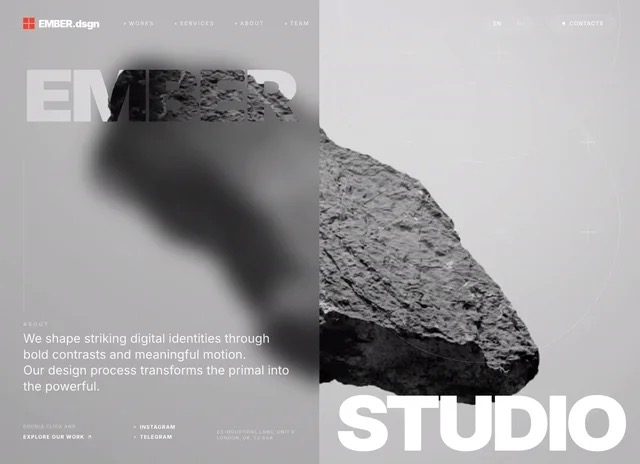
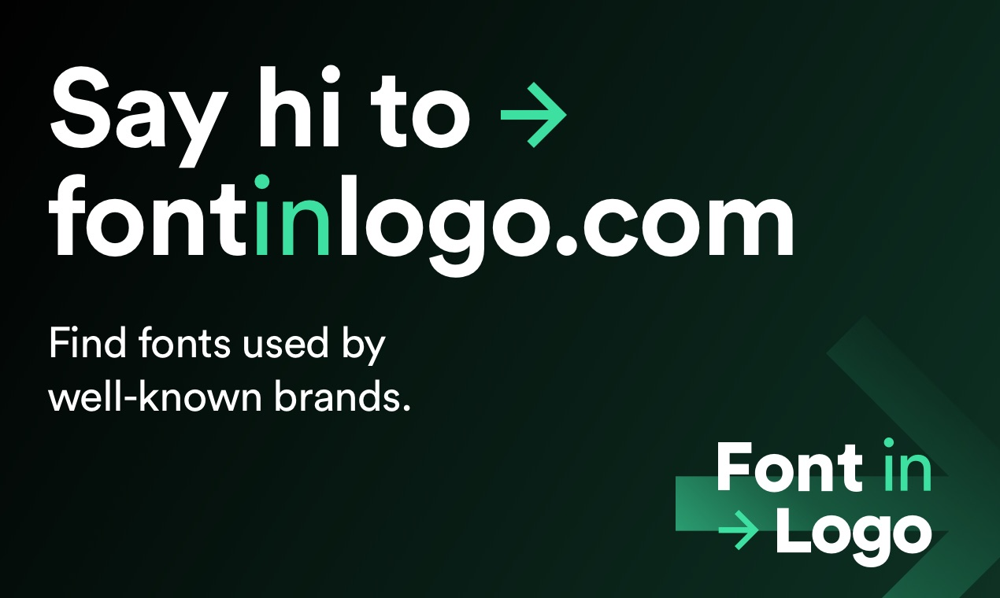

# Eight AI Design Links Revisited: Studio, Font References, and Godly's Redirect

> Source: [Abida Jule's eight-site list](https://x.com/I_am_Aiabir/status/2118180756698923263), displayed as published November 5, 2026. Checked the same day. This article separates recommendations, provider descriptions, and observed behavior; it does not treat relative-price or instant-shipping claims as measured results.

Four entries overlap directly with our [five-site design-reference guide](2026-11-05-ai-design-five-reference-sites-en.md): Landbook, Recent, Landdding, and 60fps. The useful additions are more specific: **MotionSites now has a direct customization service called Studio; font matches require evidence labels; and Godly redirects to Recent.**

## 1. Eight Names, Different Deliverables

| Entry | Observed role | Important distinction |
|---|---|---|
| [MotionSites Studio](https://studio.motionsites.ai/) | Chat-led website customization, media creation, code delivery | Generating, exporting, and deploying are separate steps |
| [MotionSites](https://motionsites.ai/) | Website/section prompts and visual examples | A reference library is not an accepted business application |
| [Landbook](https://land-book.com/) | Filtered website-design gallery | A screenshot is not template source |
| [Recent](https://recent.design/) | Curated web, interface, branding, and motion work | Inspiration does not supply reusable components automatically |
| [Landdding](https://landdding.com/) | Landing-page and template references | Platform, purchase, and license need separate checks |
| [Font In Logo](https://www.fontinlogo.com/) | Brand/font relationships and text previews | Original, modified, and approximate fonts differ |
| [Godly](https://godly.website/) | Currently redirects to Recent | Not another independent current gallery |
| [60fps](https://60fps.design/) | Application interactions and motion details | Study the process, not only the final frame |

This classifies outputs rather than ranking quality. It does not imply that every entry builds, deploys, or maintains websites.

## 2. MotionSites and Studio Occupy Different Stages

Our [July MotionSites article](../2026-07-25/2026-07-25-motionsites-ai-prompt-gallery-en.md) examined the prompt library. The main site still presents prepared prompts and page/section examples. Studio's customization service should be evaluated separately. [Main site](https://motionsites.ai/)

*Converted to JPEG from the public preview. This is not a generated result from this review or evidence of prompt-level reproducibility.*

Studio offers entry points for describing a website, starting from a design, or restyling an existing site. It advertises brand-specific images, video, chat revisions, copy, and full-code downloads. These public controls and descriptions were inspected; no generation job was submitted and no backend was audited. [Studio](https://studio.motionsites.ai/), [service details](https://studio.motionsites.ai/pricing)

*Brand artwork, not proof of generated-site or code quality.*

The FAQ establishes an important boundary: **hosting and domain setup are not included**. Users download their code and host it elsewhere. The provider also says users own their sites and can download full code without an extra charge. Those statements do not replace inspecting the actual export, dependencies, or third-party rights.

The post's “800+” claim was not independently inventoried. No deduplicated catalog established whether it counts sites, sections, or other assets, so it should not become a verified claim of eight hundred separate 3D websites.

## 3. “Cheaper Than Lovable” Needs a Matched Workload

On November 5, Studio displayed a **$25 monthly launch price** for Starter, with a **$25 AI budget and five design customizations per month**. AI work consumes the budget; exhaustion requires upgrading or waiting for renewal. An unlimited design count on another plan does not mean unlimited inference or revisions. [Studio pricing and FAQ](https://studio.motionsites.ai/pricing)

Lovable's official explanation instead describes credits spanning building, Cloud, and in-app AI, with consumption varying by operation, feature, and plan. [Official pricing explanation](https://lovable.dev/pricing)

Subscription dollars and another platform's credits cannot establish the cost of the same accepted website. A useful comparison would hold the brief and quality target steady, then include revisions, media, fonts, hosting, domains, backend needs, and the ability to run and maintain exported code.

Neither service was purchased or tested on a matched task here. The relative-price claim remains unverified, and the displayed promotion is a dated snapshot, not a durable quote or fixed per-site cost.

## 4. Font In Logo: Classify the Relationship Before Asking for a Match

Font In Logo adds typography to the list, but its results do not all claim the same relationship to a brand. Its current homepage distinguishes verified matches, based-on designs, modifications, closest alternatives, community suggestions, and community-designed approximations. [Font In Logo](https://www.fontinlogo.com/)

*The positioning does not independently verify every match. No font was downloaded and no trademark-use permission was obtained.*

Verified is the site's own evidence label. Modified means the lettering has changed; closest means an alternative rather than an exact match. Likewise, a famous-title example should not automatically be treated as authoritative documentation of the original lettering.

For a website, record the font's intended job: distinctive headings, readable body copy, numerals, multilingual coverage, and fallback behavior. A customized logo treatment is not automatically a body typeface. Finding a name is also not permission for commercial use or web embedding; confirm the applicable terms with the font provider.

## 5. Godly Is Not Another Independent Awards Database

Opening `godly.website` reached `https://recent.design/?ref=godly`; ordinary HTTP checks also confirmed redirection. Recent's own introduction says it replaces Godly and extends beyond website inspiration. [Recent's description](https://recent.design/info)

The post's shorthand “award websites” therefore does not establish a separately operating database with award evidence for every entry. Curation, popularity, and a documented award are different signals.

Use the overlapping resources by task: Landbook and Landdding for structure, Recent for broader visual direction, and 60fps for triggers and transitions. Their roles are covered in the [earlier guide](2026-11-05-ai-design-five-reference-sites-en.md), rather than being presented here as entirely new discoveries.

## 6. Give Each Reference One Decision

A practical sequence is to establish hierarchy from galleries, select fonts and motion references, then choose between a prompt-led implementation and Studio's customization service. Running, deployment, and realistic-content acceptance remain separate work.

A brief can specify one source for hierarchy, an authorized font with the necessary language coverage, and another source for expandable details with keyboard and reduced-motion support. Validate real text on mobile before export. This is editorial workflow advice, not an automation shared by these websites.

The review covered the post, public pages, Studio pricing and two FAQs, and Godly's destination. No account was created, payment made, file uploaded, site generated, source export downloaded, or font installed. Production usability was not tested. Figure provenance and limitations are in [SOURCES.md](imgs/ai-design-eight-sites-studio-fonts/SOURCES.md).
