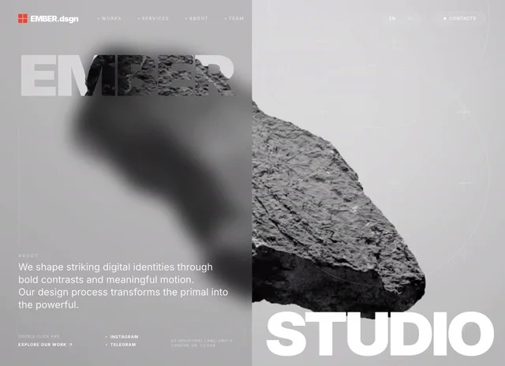
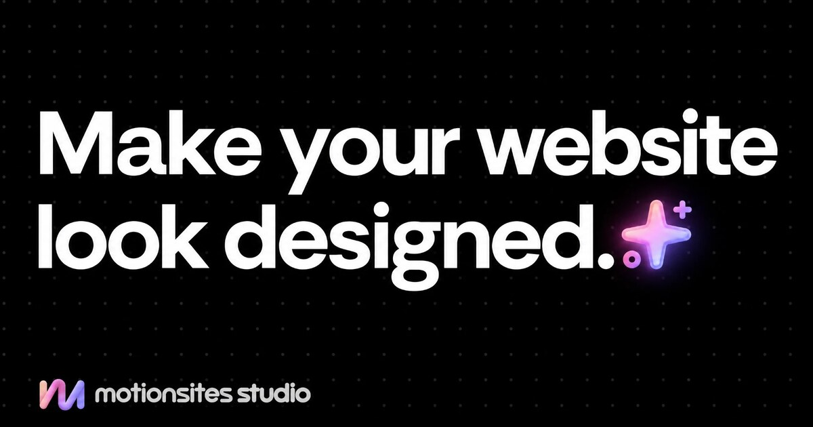
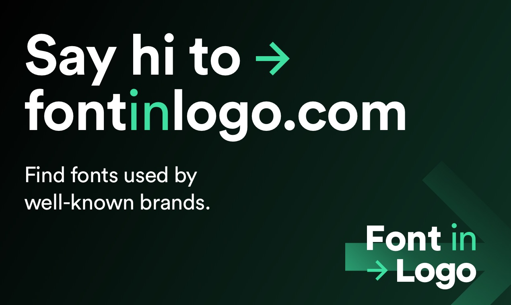

# AI 设计八站再核查：Studio 不是提示词库，Godly 已转向 Recent

> 来源：[Abida Jule 的八站清单](https://x.com/I_am_Aiabir/status/2118180756698923263)，页面显示发布于 2026 年 11 月 5 日，本文同日核查。下文区分原帖推荐语、站点公开说明与实际观察，不把“更便宜”“复制就能上线”等表述当作独立测试结果。

这份清单与刚整理过的[五个设计参考网站](2026-11-05-ai-design-five-reference-sites.md)有四项直接重合：Landbook、Recent、Landdding 和 60fps。因此，更值得补充的不是再次介绍一遍画廊，而是三个变化：**MotionSites 多了直接做站的 Studio；字体查询需要区分证据等级；Godly 已不再是独立目的地。**

## 1. 八个名字，不是八个同类工具

| 原帖入口 | 核查到的角色 | 使用前应分清什么 |
|---|---|---|
| [MotionSites Studio](https://studio.motionsites.ai/) | 从设计出发，经聊天定制网站、制作媒体并交付代码的服务 | 提示词生成、代码交付和网站部署不是同一步 |
| [MotionSites](https://motionsites.ai/) | 网站与区块的设计提示词、样例及背景入口 | 参考库不是已经验收的业务系统 |
| [Landbook](https://land-book.com/) | 可按行业、风格与平台等条件筛选的网站画廊 | 截图和模板源码是不同材料 |
| [Recent](https://recent.design/) | 覆盖网页、界面、品牌、动态作品的策展信息流 | 挑选视觉方向，不是自动取得组件 |
| [Landdding](https://landdding.com/) | 落地页与网站模板参考 | 模板平台、可购买内容和使用许可要单独确认 |
| [Font In Logo](https://www.fontinlogo.com/) | 品牌标志与字体关系的查询、分类和文字预览 | 原字体、修改字体与近似字体不能混为一谈 |
| [Godly](https://godly.website/) | 当前跳转到 Recent | 不能作为另一套独立现存画廊重复计数 |
| [60fps](https://60fps.design/) | 应用交互与动态细节参考 | 要看状态与过程，不只看结束截图 |

这张表按交付物分类，不是质量排名，也不意味着它们都能生成、部署或维护网站。

## 2. MotionSites 与 Studio，处在不同的工作环节

我们在[7 月的 MotionSites 文章](../2026-07-25/2026-07-25-motionsites-ai-prompt-gallery.md)中记录的是设计提示词库。当前主站仍以现成 Prompt、整页和区块示例为主要入口；这和 Studio 的聊天定制服务需要分开讨论。[MotionSites 主站](https://motionsites.ai/)

*来自主站公开样例预览，转换为 JPEG 用于说明视觉参考类型；不是本文生成的网站，也不能证明复制提示词即可复现。*

Studio 首页允许描述网站、从设计开始或重塑已有网站的外观，并宣称可制作适合品牌的图片、视频与页面代码。其定价页将聊天修改、品牌文案和完整代码下载列入服务说明。本文看到了这些公开入口，没有提交生成任务或审计其后台实现。[Studio](https://studio.motionsites.ai/)、[服务说明](https://studio.motionsites.ai/pricing)

*这张图是品牌宣传图，不是生成效果或代码质量的证据。*

更关键的边界在 FAQ：**Studio 不提供网站托管，也不配置域名；用户下载代码后自行选择部署位置。** 它同时说明用户可以下载完整代码、所提供的内容仍归用户。后者是服务方的公开说明，不能替代检查具体导出包、第三方素材权利和依赖条件。

原帖提到“800+”网站与动效区块，本次没有获得可去重、可复核的完整目录，不能据此写成已验证的八百个独立 3D 网站。这里应保留为原帖规模声明，而非盘点结果。

## 3. “比 Lovable 便宜”，缺少同口径的成本证明

11 月 5 日，Studio 定价页显示 Starter 推广价为 **每月 $25**，页面写有 **$25 AI 预算、每月可定制 5 个设计**。AI 工作会消耗预算，用完后需要升级或等待续费刷新。其他方案即使显示设计数量不限，也不能理解成推理与修改无限。[Studio 定价与 FAQ](https://studio.motionsites.ai/pricing)

Lovable 当前官方说明采用 credits，并区分构建、Cloud 和应用内 AI 等用途；不同操作、功能与方案的计量并不等价。[Lovable 官方定价说明](https://lovable.dev/pricing)

因此，不能把一个服务的订阅金额、另一个服务的 credits，直接换算成“做同一网站谁更省”。更合理的比较应包括：

- 同一份 brief 和相近的交付质量；
- 初稿之后的修改轮次及其消耗；
- 图片、视频、字体等额外成本；
- 托管、域名、后端与上线维护；
- 导出后别人能否在干净环境继续运行和修改。

本文没有购买两边服务，也没有完成同题生成对照，因此不确认原帖的相对价格结论。页面价格是当天快照，不是长期报价，更不是每个网站的固定制作成本。

## 4. Font In Logo：先判断字体关系，再谈“同款”

Font In Logo 给这份清单补上了字体维度，但不能把每条结果都理解为“这个品牌实际使用的原始字体”。其当前首页会区分 Verified、Based On、Modified、The Closest Font、Community Suggestion，以及社区基于标志设计的字体等关系。[Font In Logo](https://www.fontinlogo.com/)

*图中的定位描述不代表所有匹配都已独立核验；本文没有下载字体或取得品牌标志使用授权。*

这些标签很重要：Verified 是站方的核验标记；Modified 表示品牌字形经过调整；Closest 只是在推荐近似选择。首页的著名影视和游戏字样栏目，也不能仅凭标题就当作完整的品牌字体来源证明。

实际做网站时，更值得记录的是字体的用途：标题是否需要特征鲜明，正文是否适合长时间阅读，数字与中英文是否覆盖完整，缺字时怎样回退。Logo 的定制字形并不自动适合正文；查到字体名称也不等于已经取得网页嵌入或商业使用许可。应回到字体提供方确认具体授权。

## 5. Godly 不是另一套独立的“获奖网站库”

本次直接打开 `godly.website`，浏览器最终地址为 `https://recent.design/?ref=godly`；普通 HTTP 检查也观察到重定向。Recent 自己的介绍页明确说，它接替了 Godly，并把策展范围扩展到网站以外。[Recent 介绍](https://recent.design/info)

所以，原帖把 Godly 概括为“award websites”，至少不能据此推导出一个当前独立运营、逐项带正式奖项凭据的数据库。选入画廊、编辑喜欢、受到传播和取得某个奖项，是不同的证据。

其余四个熟悉入口仍可按任务使用：Landbook、Landdding 研究页面结构；Recent 看跨媒介方向；60fps 看触发、过渡和最终状态。它们的详细分工已在[前篇](2026-11-05-ai-design-five-reference-sites.md)整理，这里不重复当作八项全新发现。

## 6. 更实用的组合，是一个来源对应一个决定

可以把这份清单压缩成一条工作顺序：先用画廊确定信息组织，再选字体与动态参考；需要 Prompt 就读 MotionSites，需要聊天定制与代码交付再评估 Studio。最后独立完成运行、部署和真实内容验收。

交给 Agent 的资料不必多，但应说明每个来源负责什么。例如：“参考 A 的信息层级，采用一套已获授权、支持中文的字体；按 B 的详情展开逻辑实现键盘与减少动态效果；先用真实长度文字检查手机，再考虑导出部署。”这是本文的工作流建议，不是这些站点共同提供的自动化功能。

本次核查了原帖、公开页面、Studio 定价与两项 FAQ，以及 Godly 跳转；没有注册、付款、上传文件、生成网站、下载代码或字体，也没有验证任何平台的生产可用性。三张配图仅作来源说明，详细记录见 [SOURCES.md](imgs/ai-design-eight-sites-studio-fonts/SOURCES.md)。
