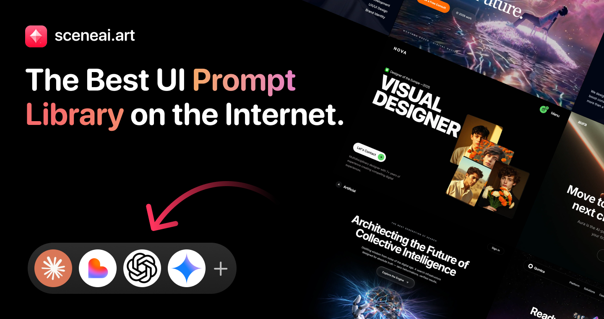
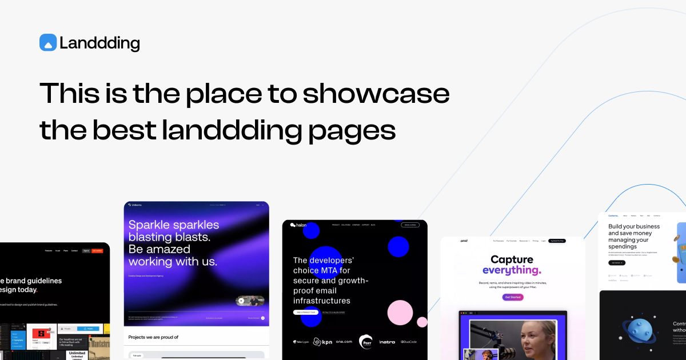
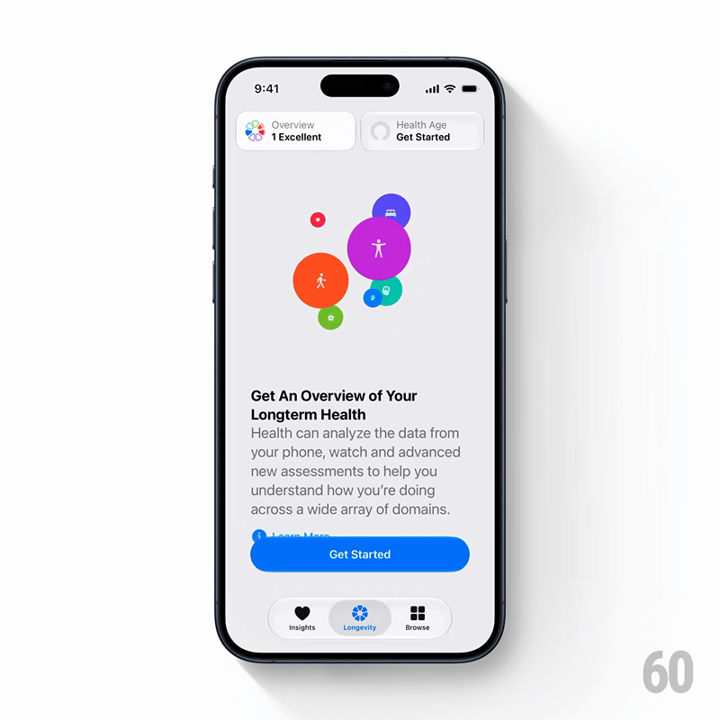

# Five Design Reference Sites for Turning AI Inspiration into a Buildable Brief

> Source: [Ahmed's five-site list](https://x.com/ahmedscen/status/2117965365192151421), displayed as published November 5, 2026. Public pages were checked that day. The author's profile identifies him as SceneAI's maker, so the recommendation includes his own product rather than constituting an independent comparison.

An AI design request often fails before generation begins. “Make it more premium” does not say whether the problem is information hierarchy, composition, or feedback after a click. More decoration can arrive without a better product.

These five sites provide different kinds of references, not five equivalent AI website builders. Their useful role is helping turn a visual intention into something an agent can implement and a person can evaluate.

## 1. Choose the Kind of Reference

| Site | Observed positioning | What to study |
|---|---|---|
| [SceneAI](https://sceneai.art/) | Prompts for sections and landing pages, plus background assets | How a visual direction becomes a prompt |
| [Landbook](https://land-book.com/) | Filtered website gallery with section, mobile, and motion areas | Hierarchy and page organization |
| [60fps](https://60fps.design/) | Mobile and web interaction examples | Triggers, transitions, and settled states |
| [Recent](https://recent.design/) | Curated design, web, interface, branding, and other work | Broader visual direction |
| [Landdding](https://landdding.com/) | Landing-page and template references with category/platform context | Comparing complete pages for related businesses |

They can complement one another, but every project does not need all five. Identify the missing input first: structure, visual language, motion, or wording.

## 2. SceneAI: Prompt References Are Not Production Acceptance

SceneAI exposes previews and Copy Prompt controls, alongside gradient and animated-background categories. One hero preview was opened during this review, showing a description of the cursor, light, and subject. Successful retrieval of the complete prompt was not verified, and no code was generated from it. [Homepage](https://sceneai.art/)



*Official promotional image, not a website generated for this review. Superlatives in the artwork are the provider's claims.*

Its useful lesson is describing elements and their relationships precisely. A real product still needs actual copy, data lengths, narrow-screen behavior, and failure states; an attractive hero description does not validate those.

Monthly and lifetime plans exist, so a visible copy button should not be taken to mean all content is free. Published licensing distinguishes assets and premium prompts and restricts standalone resale or redistribution. Check the applicable plan and current terms for actual use. No purchase or premium extraction occurred here. [Plans](https://sceneai.art/pricing), [license](https://sceneai.art/license)

## 3. Landbook and Landdding: Compare Structure, Not Only Heroes

Landbook filters include industry, style, site type, typography, color, and platform. Landdding pairs landing-page and template references with category and platform context. Together, they can help narrow a broad search into comparable business pages. [Landbook](https://land-book.com/), [Landdding](https://landdding.com/)



*An illustration of its curation focus, not evidence that these sites were run, purchased, or supplied as source projects.*

Record what question a page answers first, where it supplies evidence, and what information precedes its main action. A headline treatment or palette does not retain its value automatically in a different business context.

A Webflow or Framer label is also not a component ready for another stack. Screenshots, templates, source code, and licenses are separate deliverables.

## 4. 60fps: Specify the Transition, Not Just Its Final Image

60fps emphasizes interaction references: the initial state, the triggering action, the movement, and where it settles. A static design reference often omits that sequence. [Library](https://60fps.design/)



*A case-page video poster, not an interface built here. A still cannot establish the complete motion.*

Its MCP page lists shot search, keyframe details, motion breakdowns, and code tools. The provider describes compile-checked SwiftUI for some motion and presents MCP as a separate plan. **Those are provider claims; no MCP connection or generated-code test was performed here.** [MCP documentation](https://60fps.design/mcp)

For implementation, preserve the trigger-to-settlement sequence and add cancellation, repeated activation, and reduced-motion behavior. An image of the final state cannot specify the whole interaction.

## 5. Recent: Look Beyond Website Front Pages

Recent currently separates design, launch videos, websites, social-preview images, app screenshots, and app icons, with tools and skills elsewhere in navigation. Its own description frames it as a broader curated feed of design and digital work. [Homepage](https://recent.design/), [about](https://recent.design/info)

It is useful when direction is still open: how typography, imagery, spacing, and movement fit together. Inspiration is not yet a specification, however. Choose a primary direction and identify one contribution from each reference rather than combining every striking detail.

## 6. Turn Bookmarks into a Small Brief

The following is this article's suggested workflow, not a shared automatic feature of the five services:

1. State the audience, primary task, and real content requirements.
2. Choose one to three references for structure, visuals, or interaction.
3. Say exactly what to borrow, using your own authorized branding, images, and copy.
4. Specify narrow screens, loading, empty data, errors, long text, keyboard focus, and reduced motion.
5. Build one section with realistic content before expanding the page.

A useful request might be:

```text
Build a project-status page for existing customers.
Use reference A for hierarchy, not its branding, images, or copy.
Use reference B for detail expansion, with keyboard and reduced-motion support.
Start with the list, empty-data, and failed-loading states.
Check real-length project names on mobile and desktop.
```

This is easier to evaluate than “copy this website.” The services supply prompts, examples, or visual direction; business constraints, permissions, implementation, and usability remain responsibilities of the actual project.

This review covered the post, public site documentation, and one SceneAI preview. No accounts were created, plans purchased, paid MCP connected, template projects downloaded, or comparative generation tests run. The three figures are public promotional previews or a case poster, not a freely redistributable template pack. See [SOURCES.md](imgs/ai-design-five-reference-sites/SOURCES.md) for provenance and limitations.
