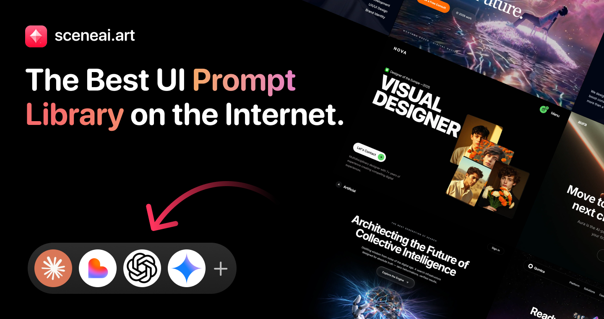
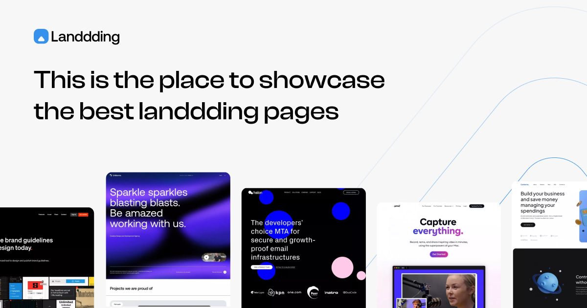
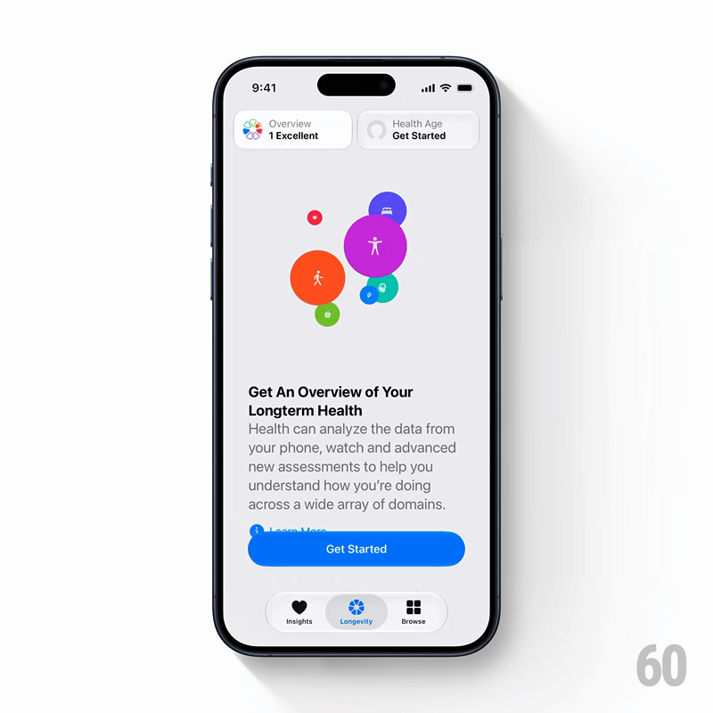

# 五个 AI 设计参考网站：从找灵感到写出可执行的设计要求

> 来源：[Ahmed 的五站推荐帖](https://x.com/ahmedscen/status/2117965365192151421)，页面显示发布于 2026 年 11 月 5 日。本文同日核查各站公开页面。原帖作者简介自述是 SceneAI 的制作人，因此这是一份包含自家产品的推荐，不是独立横向评测。

让 AI 做设计，常见的问题不是缺少生成按钮，而是不知道怎样说明“我想要的那个样子”：是整页的信息顺序、某个区块的排版，还是按钮按下后的反馈？一句“更高级一点”，很容易换来更大的标题、更多装饰，却没有解决实际需求。

Ahmed 推荐的五个网站可以充当参考入口，但它们不是五个同类 AI 建站器。更有用的读法，是区分各自提供的证据，再把参考转成 Agent 可以执行、用户可以检查的要求。

## 1. 五个网站，分别看什么

| 网站 | 核查到的定位 | 最值得带走的参考 |
|---|---|---|
| [SceneAI](https://sceneai.art/) | 页面区块、落地页提示词及背景素材库 | 构图如何被描述成提示词 |
| [Landbook](https://land-book.com/) | 分类筛选的网站设计画廊，也有区块、移动端和动效入口 | 页面层级、信息组织和不同类型网站的结构 |
| [60fps](https://60fps.design/) | 移动与网页应用的交互、动画案例库 | 操作如何触发变化，以及变化怎样结束 |
| [Recent](https://recent.design/) | 覆盖设计作品、网站、界面、品牌等的策展信息流 | 不局限于落地页的视觉方向 |
| [Landdding](https://landdding.com/) | 落地页与网站模板参考，提供分类与平台线索 | 同类业务的整页组织与设计比较 |

这五类参考可以互补，但没有必要每次全部使用。先确定缺的是页面结构、视觉方向、动作细节还是提示词表达，再选一个入口。

## 2. SceneAI：把视觉方向写成提示词，但不是生产验收

SceneAI 公开页面有作品预览和 Copy Prompt 入口，另设渐变与动态背景分类。本次打开了一个 Hero 预览，能读到它如何描述光标、光线与主体的关系；但没有核验复制按钮是否实际取得完整 Prompt，更没有用它生成代码。[官网](https://sceneai.art/)



*官方社交预览图，不是本文生成的网站。图中的“最佳”等措辞属于站方宣传，不是本文结论。*

它适合学习如何把“感觉”拆成元素、位置与交互描述。真正用于产品时，还要补上真实文案、数据长度、手机布局和错误状态。一个好看的 Hero 描述，不包含这些后续工作的验收结果。

站点设有月度与终身付费方案，不能因为看到 Copy Prompt 就认为所有内容免费。许可页面也区分资产、提示词与高级内容，限制独立转售和再分发；实际使用应按所购方案与当前条款确认。本文没有购买或提取高级内容。[方案](https://sceneai.art/pricing)、[许可说明](https://sceneai.art/license)

## 3. Landbook 与 Landdding：用来比较结构，而不只是收藏首屏

Landbook 的筛选包含行业、风格、网站类型、字体、颜色和平台。这样可以把问题从“好看的网站”缩小成“同类业务怎样安排信息”。Landdding 则把落地页、模板、分类和建站平台线索放在一起，适合再找一组对照。[Landbook](https://land-book.com/)、[Landdding](https://landdding.com/)



*用于说明其网站策展定位；不是本文逐页运行、购买或取得源码的证明。*

看这两类画廊时，可以记录三件事：页面先回答用户哪个问题，在哪个位置给出证据，以及主要动作前还缺什么信息。同一个大标题和配色，放到不同业务上未必仍然有效。

作品旁出现 Webflow、Framer 等平台标签，也不等于拿到了能直接搬进自己技术栈的组件。截图、模板、源代码和模板许可是四种不同材料，需要分别确认。

## 4. 60fps：静态参考之外，还要知道状态怎样变化

60fps 的价值在于交互过程：一个组件从什么状态开始、由什么操作触发、运动经过哪些阶段、最后停在哪里。这些信息通常不在一张漂亮的截图里。[案例库](https://60fps.design/)



*来自该站案例页的视频封面，仅说明案例呈现；不是本文制作的界面，也不能以静帧验证完整动画。*

站点还有面向 Agent 的 MCP 页面，列出检索案例、取得关键帧详情、动作拆解和代码等工具。它宣称部分 SwiftUI 代码经过编译检查，并将 MCP 作为独立方案说明。**这些是服务方的功能声明，本文没有连接 MCP 或验证其代码生成结果。**[MCP 说明](https://60fps.design/mcp)

把动态参考交给 Agent 时，应保留“触发—起点—运动—落点”的顺序，再补上取消、重复触发和减少动态效果时的行为。只给一张结束画面，无法规定整个过程。

## 5. Recent：视觉方向不必全部来自网站首页

Recent 的当前导航包括设计、发布视频、网站、OG 分享图、应用截图和图标，另有工具与 Skills。其介绍页称自己是跨设计作品、网站和数字产品的策展信息流，因此不宜只把它理解成另一个落地页列表。[首页](https://recent.design/)、[站点介绍](https://recent.design/info)

它适合在方向尚未明确时观察字体、图像、留白和动态表达如何配合。但灵感本身仍不是可执行要求。将几个不同作品的抢眼元素全部叠加，容易得到不统一的结果；更好的做法是先选一个主要方向，再说明每个参考只借鉴哪一项。

## 6. 把收藏变成一份小而具体的 Brief

下面是本文根据这些资源分工作出的使用建议，不是五站已经自动提供的一项共同功能：

1. **先写任务。** 页面服务谁，用户最重要的动作是什么，需要哪些真实内容。
2. **选一到三个参考。** 分别负责结构、视觉或交互，不要求一个网站同时解决全部问题。
3. **写出借鉴范围。** 例如采用 A 的信息顺序、B 的插图比例、C 的展开反馈；品牌、图片与文案使用自己的授权材料。
4. **补齐状态。** 除正常展示外，明确窄屏、加载、空数据、失败、长文字、键盘焦点与减少动态效果。
5. **先做一个区块。** 用真实内容运行，检查后再扩成整页，而不是一次生成很多看似完整的页面。

可以这样交给 Agent：

```text
做一个供现有客户查询项目进度的页面。
参考 A 的信息层级，不采用它的品牌、图片和文案。
参考 B 的详情展开过程，补充键盘操作与减少动态效果。
先实现列表、空数据和加载失败三种状态。
用真实长度的项目名称检查手机和桌面布局。
```

这比“照这个网站做一份”多写几句话，却让结果更容易验收。五个网站提供的是提示词、案例或设计方向；业务约束、素材授权、实现质量和可用性仍要在自己的项目里解决。

本次核查范围是原帖、五站公开资料及一次 SceneAI 预览检查，没有注册、购买、接入付费 MCP、下载模板工程或做五站生成效果对照。三张配图均为官方公开预览或案例封面，不是可随意再分发的模板包。来源与限制见 [SOURCES.md](imgs/ai-design-five-reference-sites/SOURCES.md)。
