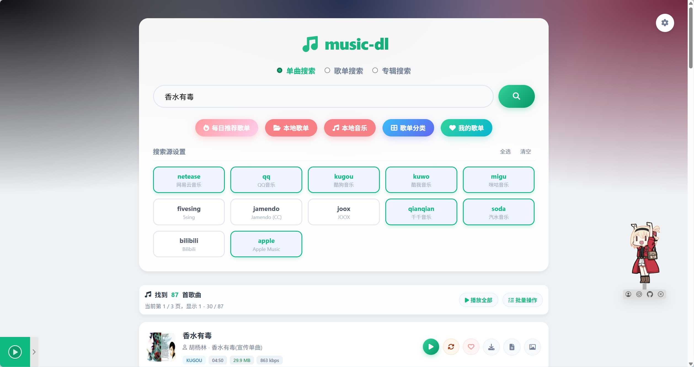
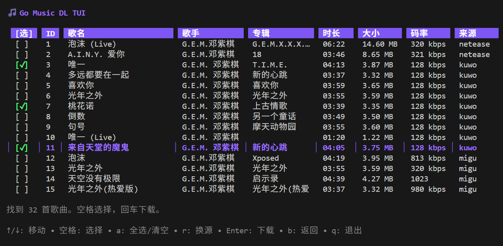

# Go Music DL: Multi-Source Search, Local Music, and an Agent-Controlled Player

> Source: [guohuiyuan/go-music-dl](https://github.com/guohuiyuan/go-music-dl). This review covers [v1.1.4](https://github.com/guohuiyuan/go-music-dl/releases/tag/v1.1.4), published November 5, 2026, and its source revision `d5e7749`. Reviewed November 6.

**Go Music DL is a self-hosted music tool, not a new music catalog.** It combines discovery across providers with playback, downloads, and a local library. The more interesting change in v1.1.4 is a set of command and state endpoints. An agent can control this application without taking over the desktop or simulating clicks.

## One Search Box, Different Providers Underneath

The project has web and terminal interfaces and publishes desktop and mobile builds. The web interface lets users select providers and search songs, playlists, or albums. The Go core delegates to provider implementations, largely through `music-lib`, and normalizes results into shared models. The song-source list has **12 external entries plus `local`**. Playlists, albums, and charts use separate source lists. A source's presence in the song picker does not imply feature parity. [Provider routing](https://github.com/guohuiyuan/go-music-dl/blob/d5e7749772e932a15c8fc9ab75ebdfacd446b557/core/service.go)

*Upstream README illustration. Its search results are not from this review.*

Results identify candidate versions, not files or guaranteed quality. For source switching, the code uses title, artist, and duration when available, then checks candidate playability. This can find a usable alternative; it cannot establish that two tracks share the same master. For editing work, listen for live versions, remasters, and excerpts before substituting a track. [Search and source-switching code](https://github.com/guohuiyuan/go-music-dl/blob/d5e7749772e932a15c8fc9ab75ebdfacd446b557/internal/web/music.go)

*The terminal view shows provider, duration, and bitrate. These fields help compare candidates but do not verify the resulting file.*

## Finding a Track Is Not the Same as Getting the Full Audio

| Stage | What it establishes |
|---|---|
| Search hit | The provider returned a record, not necessarily access to full audio |
| Stream resolution | The integration returned playable audio or a preview, subject to upstream behavior and access |
| Saved file | Version, actual codec, duration, and decodability still need checking |

The project documents an effective Cookie requirement for QQ downloads. The pinned Apple Music adapter's built-in `GetDownloadURL` returns a **preview**, not a full catalog download. Soda Music has a preview fallback when the full track is unavailable through its supported path. These are documented or source-observed boundaries, not measured provider success rates. [Provider matrix](https://github.com/guohuiyuan/go-music-dl/blob/d5e7749772e932a15c8fc9ab75ebdfacd446b557/README.md#支持平台) · [Apple Music adapter](https://github.com/guohuiyuan/music-lib/blob/7cc4467b4e30/apple/apple.go#L416)

For audio you are authorized to obtain, the tool can template filenames, write LRC sidecars, optionally embed lyrics or cover art, and synchronize through WebDAV when configured. Some paths buffer or process the audio rather than simply streaming it through. Playlist downloads skip existing local tracks and entries without required identifiers, reporting skipped items. **An accepted queue item is not a saved file.** [Download code](https://github.com/guohuiyuan/go-music-dl/blob/d5e7749772e932a15c8fc9ab75ebdfacd446b557/core/download.go) · [Playlist queue handler](https://github.com/guohuiyuan/go-music-dl/blob/d5e7749772e932a15c8fc9ab75ebdfacd446b557/internal/web/download_container.go)

## How the Agent Controls an Open Player

The `/music/api/ai/index` and `llms.txt` endpoints describe the available operations. Existing search, playlist, and download routes are reused; some return rendered pages rather than dedicated JSON responses. The new control surface is HTTP, not an embedded conversational model or MCP server. [API index implementation](https://github.com/guohuiyuan/go-music-dl/blob/d5e7749772e932a15c8fc9ab75ebdfacd446b557/internal/web/ai_api.go)

1. The open page subscribes to Server-Sent Events through `EventSource`, using its `client_id`.
2. An agent can read online state, identify the track by `source` and `id`, and send playback, pause, seek, or volume commands.
3. The service dispatches to the selected client. It can infer the target with one connected client; with several and no target, it returns `409 ambiguous_client` rather than broadcasting.
4. The page executes the command and reports the current track, position, `playing`, and errors. The agent checks the selected client's state to confirm the outcome.

**`202 Accepted` means the server accepted the command for dispatch. It does not prove that audio started.** Autoplay restrictions or stream failures can still intervene. Check track identity and advancing position in the target player's subsequent reports. With no connected player, the control route returns `409 player_not_connected`. [Server control](https://github.com/guohuiyuan/go-music-dl/blob/d5e7749772e932a15c8fc9ab75ebdfacd446b557/internal/web/ai_player.go) · [Browser event handling](https://github.com/guohuiyuan/go-music-dl/blob/d5e7749772e932a15c8fc9ab75ebdfacd446b557/internal/web/templates/static/js/app.js#L7087)

## Protect the Service and Keep Media Rights Separate

In this revision, the player routes are in the ordinary web group, outside administrator authentication for settings. The write header and origin checks are not caller credentials. The regular web startup path does not set a loopback-only bind; the embedded desktop path explicitly specifies `127.0.0.1`. **Do not expose the service directly to the public internet.** Limit network access and protect event streams, state reads, and writes for remote use. Keep provider Cookies, configuration data, and setup tokens private. [Routing and listener](https://github.com/guohuiyuan/go-music-dl/blob/d5e7749772e932a15c8fc9ab75ebdfacd446b557/internal/web/server.go#L522) · [Write checks](https://github.com/guohuiyuan/go-music-dl/blob/d5e7749772e932a15c8fc9ab75ebdfacd446b557/internal/web/write_guard.go)

The project's [AGPL-3.0 license](https://github.com/guohuiyuan/go-music-dl/blob/d5e7749772e932a15c8fc9ab75ebdfacd446b557/LICENSE) covers the software, not permission to use songs, lyrics, or cover art. For video work, the tool is useful for discovery, version comparison, and managing authorized files. Being able to play or save an asset does not establish permission to release it in a film. See the [six-source sound workflow](../2026-10-26/2026-10-26-ai-video-six-audio-sources-en.md) for production-oriented source tracking.

## What Was Verified

On Apple Silicon macOS with Go 1.26.3, **22 upstream AI API tests and 14 selected source-switching and download tests** passed at the pinned revision, counting top-level tests. They covered targeted delivery, rejection of ambiguous commands, state readback, skipped invalid entries, Range handling, and preservation of existing lyric sidecars. These checks used test doubles, loopback HTTP, and temporary files. No release package was installed, no provider account was connected, and no live music download or browser playback was verified. [Reproduction commands and image provenance](imgs/go-music-dl-multisource-player/SOURCES.md)

For music users, the appeal is comparing sources while keeping a local library. For agent developers, the reusable idea is smaller: **make the command, target, and observed outcome independently inspectable.** That is how an application can distinguish a request to play a song from evidence that it started playing.
