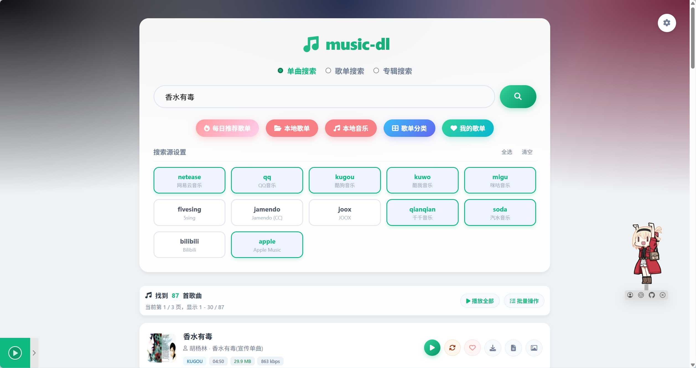
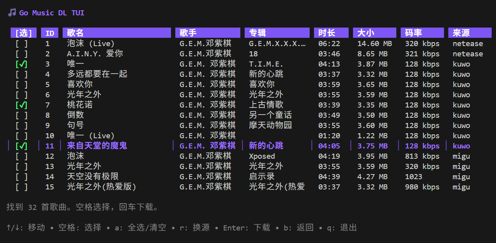

# Go Music DL：多平台找歌、整理本地音乐，还能让 Agent 控制播放器

> 来源：[guohuiyuan/go-music-dl](https://github.com/guohuiyuan/go-music-dl)。本文以 2026 年 11 月 5 日发布的 [v1.1.4](https://github.com/guohuiyuan/go-music-dl/releases/tag/v1.1.4) 和对应源码 `d5e7749` 为准，核查于 11 月 6 日。

**Go Music DL 是一个自托管音乐工具，不是新的曲库。** 它把多个平台的搜索、试听和下载入口与本地文件放到同一界面。v1.1.4 更值得关注的变化是：应用给 Agent 暴露了播放器的命令和状态接口，Agent 能控制这个播放器，不用接管桌面或模拟点击。

## 1. 一个搜索入口，后面仍是不同的音源

项目提供 Web 和终端 TUI，也发布桌面和移动端构建。Web 界面可以在单曲、歌单、专辑之间切换，选择来源后并发搜索。Go 核心将请求分给 `music-lib` 等来源实现，并用统一的歌曲模型处理结果。源码的单曲列表有 **12 个外部来源加 `local`**；歌单、专辑、榜单各有单独的支持列表，不是每个音源都有同样的能力。[来源路由与能力列表](https://github.com/guohuiyuan/go-music-dl/blob/d5e7749772e932a15c8fc9ab75ebdfacd446b557/core/service.go)

*上游 README 的 Web 示例。画面中的搜索结果是项目展示，不是本文实测得到的曲目。*

搜索返回的是候选版本，不是可下载文件，也不保证最好的音质。换源时，代码会依据歌名、歌手和可用的时长信息筛选，再对候选做可播检查。这个机制适合找替代音源，不能确认它是同一张母带。剪辑时尤其要防止现场版、重制版或试听片段被当成原版。[搜索、换源和下载处理](https://github.com/guohuiyuan/go-music-dl/blob/d5e7749772e932a15c8fc9ab75ebdfacd446b557/internal/web/music.go)

*终端列表保留来源、时长和码率，适合比较候选；列表数据不能替代对实际音频文件的检查。*

## 2. 搜得到、能取流、拿到完整文件，是三道关

| 检查对象 | 在这套工具里意味着什么 |
|---|---|
| 搜索结果 | 平台返回了曲目条目，不代表当前请求有权限获取完整音频 |
| 播放或下载解析 | 对应来源能返回可用音频或试听；账号状态、地区和上游变化都可能影响结果 |
| 已保存文件 | 还需验证版本、实际编码、时长和完整解码，不能只看扩展名或下载按钮 |

两个具体边界：项目文档注明 QQ 音乐下载需要有效 Cookie；Apple Music 在固定版本的内置 `GetDownloadURL` 路径返回的是 **preview**，不是完整曲库下载。汽水音乐则有取不到完整音频时回退公开试听的路径。本文未使用平台账号，不把源码分支当成各平台当前成功率。[平台差异表](https://github.com/guohuiyuan/go-music-dl/blob/d5e7749772e932a15c8fc9ab75ebdfacd446b557/README.md#支持平台) · [Apple Music 依赖实现](https://github.com/guohuiyuan/music-lib/blob/7cc4467b4e30/apple/apple.go#L416)

对于已有授权的音频，下载之后的整理也有用：可按来源、歌名和专辑等字段命名，生成同名 LRC，按需嵌入歌词或封面，或者配置 WebDAV 同步。默认流式路径和需要加工、保存或同步的分支应分开看，不能认为所有请求都只是透传。歌单批量入队会跳过已有本地曲目和缺少关键标识的条目，并报告跳过情况；**入队不等于落盘**。[下载及元数据处理](https://github.com/guohuiyuan/go-music-dl/blob/d5e7749772e932a15c8fc9ab75ebdfacd446b557/core/download.go) · [歌单入队实现](https://github.com/guohuiyuan/go-music-dl/blob/d5e7749772e932a15c8fc9ab75ebdfacd446b557/internal/web/download_container.go)

## 3. Agent 是怎么控制已经打开的播放器的？

应用提供 `/music/api/ai/index` 和 `llms.txt` 供调用方发现接口。搜索、歌单和下载继续复用原有 Web 路由，有些结果是页面而非专用 JSON。新增的是一组 **HTTP 播放器控制接口**，不是内置聊天模型，也不是 MCP 服务。[接口索引实现](https://github.com/guohuiyuan/go-music-dl/blob/d5e7749772e932a15c8fc9ab75ebdfacd446b557/internal/web/ai_api.go)

1. 页面通过 `EventSource` 连接 SSE 事件流，以 `client_id` 标识当前播放器。
2. Agent 查询在线状态，选定歌曲的 `source` 和 `id`，再提交点播或暂停、跳转、音量等控制命令。
3. 服务端将命令投递到目标客户端。只有一个在线客户端时可自动定向；多客户端未指定目标时会返回 `409 ambiguous_client`，不会让所有页面一起切歌。
4. 页面执行命令，再上报当前曲目、位置、`playing` 与错误状态。Agent 读取目标客户端的状态来确认结果。

这里最重要的区别是 **`202 Accepted` 只代表服务端接受投递，不代表音乐已经响起**。浏览器可能拦截自动播放，音频也可能加载失败。调用方应核对目标客户端、曲目和后续进度，不能只读上一条命令。未连接播放器时，服务端会返回 `409 player_not_connected`。[服务端控制逻辑](https://github.com/guohuiyuan/go-music-dl/blob/d5e7749772e932a15c8fc9ab75ebdfacd446b557/internal/web/ai_player.go) · [页面事件与状态上报](https://github.com/guohuiyuan/go-music-dl/blob/d5e7749772e932a15c8fc9ab75ebdfacd446b557/internal/web/templates/static/js/app.js#L7087)

## 4. 自托管不等于只监听本机，开源也不等于音乐可商用

这一版的播放器接口挂在普通 Web 路由组，未经过管理设置使用的管理员鉴权。写入有 `X-Requested-With` 和来源检查，但这些不是身份凭据。普通 Web 启动路径没有设置仅本机监听的地址；内嵌桌面模式才显式指定 `127.0.0.1`。**不要直接把服务暴露到公网**，远程使用应限制网络可达性，并保护包括 SSE、状态读取和写入在内的路由。平台 Cookie、配置库与启动令牌不应外发。[路由与监听](https://github.com/guohuiyuan/go-music-dl/blob/d5e7749772e932a15c8fc9ab75ebdfacd446b557/internal/web/server.go#L522) · [写入检查](https://github.com/guohuiyuan/go-music-dl/blob/d5e7749772e932a15c8fc9ab75ebdfacd446b557/internal/web/write_guard.go)

项目的 [AGPL-3.0](https://github.com/guohuiyuan/go-music-dl/blob/d5e7749772e932a15c8fc9ab75ebdfacd446b557/LICENSE) 是软件许可证，不是曲目、歌词或封面的使用授权。做视频时，可以把它用作找参考、核对版本和整理已获授权音频的工具；能听、能保存和能放进公开发行的作品，应分别核实。对正式配乐的选源与记录，可以接着看[六站声音工作流](../2026-10-26/2026-10-26-ai-video-six-audio-sources.md)。

## 5. 这次核查到哪一步

在 Apple Silicon macOS、Go 1.26.3 上，固定源码跑过两组项目自带测试：**22 项 AI 接口测试**、**14 项换源和下载处理相关测试**，按顶层测试计。覆盖了多客户端定向、缺少目标时拒绝、状态回读、无效曲目跳过、Range 请求和 LRC 文件保留。使用的是测试替身、回环 HTTP 和临时文件，未安装发行包、登录平台、播放或下载在线歌曲，也没有做真实浏览器播放验收。[复现命令与图片来源](imgs/go-music-dl-multisource-player/SOURCES.md)

我的判断：它适合想统一比较音乐来源、管理本地文件的人。对 Agent 产品而言，最值得借鉴的不是多接几个站，而是**把命令、目标和结果做成可检查的接口**。这样，“替我放这首”才有办法区别于“已提交播放请求”。
