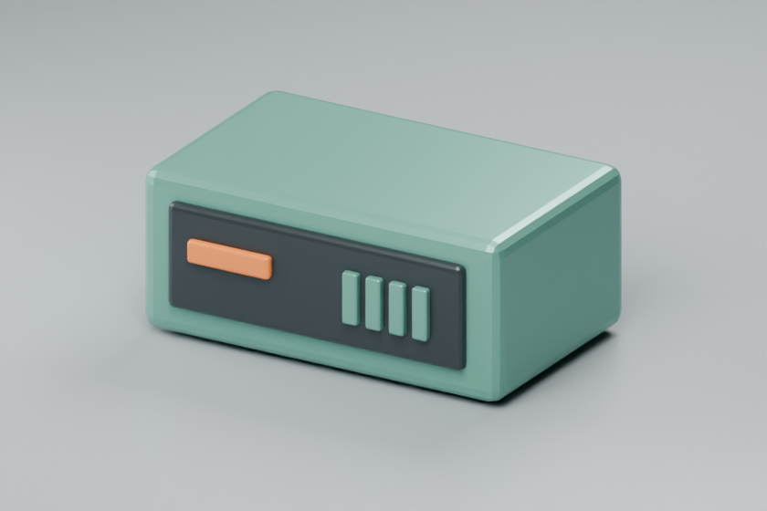

# Blender Skills: What 94 Agent Playbooks Add to Blender MCP

> [中文](2026-11-06-blender-skills-production-workflows.md) · [Submitted fork](https://github.com/donghaozhang/blender-skills) · [Upstream repository](https://github.com/arjun988/blender-skills) · [Project site](https://blender-skills.vercel.app/)

Asking an agent to make a sci-fi prop in Blender is easy. Checking what it hands back is harder. A bevel that looks good in a preview may not be in the exported mesh, and a successful import tells you little about scale, materials, or collision. **Blender Skills puts those easily missed decisions into the agent's workflow.** It is neither a new 3D generation model nor an alternative to Blender.

I reviewed the [November 6, 2026 snapshot](https://github.com/arjun988/blender-skills/tree/904f095d8f36a6e72adaebb08d07f884a074743d). It contains 94 `SKILL.md` files and 175 reference files. The Claude and Cursor skill directories match. Those are counts of written instructions, not 94 new Blender commands.

## The playbook, the connection, and the application

| Layer | What it does |
|---|---|
| **Blender Skills** | Helps the agent select instructions by asset type, art direction, and deliverable, and tells it what to check at each stage. |
| **MCP for Blender** | Gives the agent a way to inspect and operate a connected Blender instance, including through Python. The exact tools depend on the installed version. |
| **Blender** | Stores meshes and materials, evaluates modifiers, renders, and exports. Blender Python can do these things without MCP. |

The [director skill](https://github.com/arjun988/blender-skills/blob/904f095d8f36a6e72adaebb08d07f884a074743d/.claude/skills/blender-director/SKILL.md) turns a request into a production brief and picks relevant playbooks. For a close-up hard-surface prop intended for Godot, that could mean modeling, UVs and materials, optimization, export, then review. A PSX horror brief can bring in guidance for that look. The director is a set of routing and production instructions, not a separate model running in the background. A style playbook does not automatically apply a particular effect.

If Codex or Claude can already operate Blender through MCP or scripts, installing these files does not confer a new modeling capability. It gives you a reusable answer to questions you would otherwise put in the prompt each time: who checks the triangle budget, when to review the preview, and which file to check at handoff. The files don't enforce compliance, and there's no controlled comparison here to say how much faster they make the work.

## Match the camera and silhouette first

The [reference-matching guide](https://github.com/arjun988/blender-skills/blob/904f095d8f36a6e72adaebb08d07f884a074743d/.claude/skills/references/reference-image-match.md) has a useful order of operations: analyze the reference, align the camera, inspect the broad silhouette and proportions, then work on detail, materials, and lighting. For an industrial relay, getting the enclosure proportions, panel placement, and perspective right will usually save more rework than adding screws at the outset. With only one front view, the back and real dimensions are still inferred.

The same separation applies to delivery. The [Godot guide](https://github.com/arjun988/blender-skills/blob/904f095d8f36a6e72adaebb08d07f884a074743d/.claude/skills/godot-export/SKILL.md) calls for checking scale, materials, and applicable clips and collision in the target engine. The [QA guide](https://github.com/arjun988/blender-skills/blob/904f095d8f36a6e72adaebb08d07f884a074743d/.claude/skills/qa-review/SKILL.md) asks for an explicit ship or no-ship decision. These are instructions to carry out, not automated acceptance tests shipped with the repository.

## A Mac test: one preview, two different GLBs

I built this simple prop with Python in Blender 5.1.2 for this article. It is not an upstream demo or a result generated through MCP or the skills. Both exports contained just the prop, without the camera, lights, or stage. After resetting Blender to an empty scene for each import, both GLBs returned the same seven meshes and three materials. The geometry differed:

| Export setting | Triangles after import | Mesh written to the file |
|---|---:|---|
| `export_apply=False` | 84 | Base geometry, without the evaluated bevels |
| `export_apply=True` | 1,316 | Geometry with the evaluated bevels |

The image shows the beveled source scene. It cannot tell you which GLB was handed over, and both files import successfully. If you need the rounded edges within a real-time budget, count triangles in the deliverable and decide whether to reduce bevel segments, bake the detail, or keep the geometry. Keep the editable `.blend`: importing the GLB won't restore its modifiers. This test did not cover Godot import, textures, animation, or end-to-end agent execution. The [script and reproduction notes](imgs/blender-skills-production-workflows/SOURCES.md) are available alongside the image.

## On a Mac, check the launcher and the active tools

The snapshot's [MCP configuration](https://github.com/arjun988/blender-skills/blob/904f095d8f36a6e72adaebb08d07f884a074743d/.mcp.json) uses Windows' `cmd /c`, so it cannot be copied as-is to macOS. Follow the separate [MCP for Blender setup instructions](https://github.com/ahujasid/mcp-for-blender#codex). The legacy `uvx blender-mcp` launcher is still supported; the package rename does not by itself make it obsolete. Likewise, the skills refer to `get_viewport_screenshot` while the current MCP documentation describes `look`. Check the tools the client actually registers.

Permissions matter more than the launcher. The [add-on documentation](https://github.com/ahujasid/mcp-for-blender#safe-mode) describes an unauthenticated, unencrypted socket with Python execution available by default. Keep it local, and start with an empty scene and a separate output directory rather than connecting an in-progress production scene.

I'd start with one prop and a reference image, loading just the director, hard-surface, export, and QA guidance. Ask for a preview from an agreed angle, an editable source, a GLB opened in the target engine, and a note on triangle count and failed checks. See whether the playbooks help the agent miss fewer things before adopting more of them.
