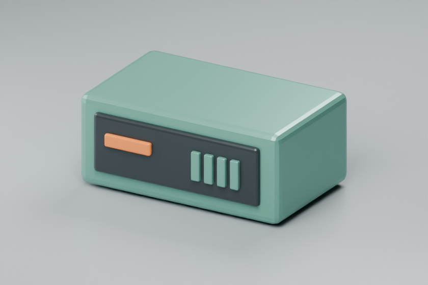

# Blender Skills：94 份 Agent 工作指南，怎样和 Blender MCP 分工？

> [English](2026-11-06-blender-skills-production-workflows-en.md) · [用户提供的 fork](https://github.com/donghaozhang/blender-skills) · [上游项目](https://github.com/arjun988/blender-skills) · [官网](https://blender-skills.vercel.app/)

让 Agent 在 Blender 里做一个科幻道具并不难描述，难的是交付：预览有倒角，不代表导出的游戏模型也有；导入成功，不代表材质、比例和碰撞都符合要求。**Blender Skills 最有用的地方，是把这些容易被略过的决定写进 Agent 的工作流程。** 它不是新的 3D 生成模型，也不是 Blender 的替代品。

本文检查的是 2026 年 11 月 6 日的[代码快照](https://github.com/arjun988/blender-skills/tree/904f095d8f36a6e72adaebb08d07f884a074743d)。实数得到 94 个 `SKILL.md` 和 175 份参考文件，Claude 与 Cursor 两套目录中的内容相同。这个数字指工作指南，不是新增了 94 个 Blender 命令。

## Skill 定流程，MCP 通工具，Blender 做资产

| 层 | 做什么 |
|---|---|
| **Blender Skills** | 根据资产类型、风格和交付要求选择指南，提醒 Agent 按阶段做检查。 |
| **MCP for Blender** | 让 Agent 调用已连接的 Blender、读场景并执行 Python，具体能力看安装版本。 |
| **Blender** | 真正保存网格和材质、计算修改器、渲染及导出；这些工作也可以直接用 Blender Python 完成。 |

[导演 Skill](https://github.com/arjun988/blender-skills/blob/904f095d8f36a6e72adaebb08d07f884a074743d/.claude/skills/blender-director/SKILL.md)负责把需求整理成制作简报，再挑相关指南。例如，一个给 Godot 用的近景硬表面道具，可以按硬表面建模、UV 和材质、资产优化、导出及审查的顺序走。要做 PSX 恐怖风，再参考那个风格的指南。这里的“导演”是给 Agent 的分工和判断规则，不代表后台另跑了一个导演模型，风格指南也不会自动生成固定效果。

如果你已经能让 Codex 或 Claude 通过 MCP 或脚本操作 Blender，这套库并没有给 Agent 一种新的建模能力。它的增量是让同样的要求不必每次重写：谁先确认三角面预算，何时看预览，交付时检查哪个文件。它不能保证 Agent 照做，也没有对照实验能告诉我们比直接下指令快多少。

## 有参考图，先对机位和轮廓

[参考图匹配指南](https://github.com/arjun988/blender-skills/blob/904f095d8f36a6e72adaebb08d07f884a074743d/.claude/skills/references/reference-image-match.md)给出的顺序很实用：先分析参考、对齐相机，再检查大轮廓和比例，最后处理细节、材质和光线。做一个工业继电器，先确认外壳长宽比、面板位置和透视，通常比一上来加螺丝更能减少返工。只有一张正面参考时，背面和真实尺寸仍是推断，不是测出来的。

同样，导出指南和审查指南把“预览能看”和“资产能交”拆开了。[Godot 指南](https://github.com/arjun988/blender-skills/blob/904f095d8f36a6e72adaebb08d07f884a074743d/.claude/skills/godot-export/SKILL.md)要求导入目标引擎再查尺度、材质和适用的动画、碰撞；[QA 指南](https://github.com/arjun988/blender-skills/blob/904f095d8f36a6e72adaebb08d07f884a074743d/.claude/skills/qa-review/SKILL.md)则要求明确给出是否可交付的判断。这些是 Agent 应执行的检查，并不是仓库自带的自动验收。

## Mac 小实验：同一个预览，两份不同的 GLB

这是为本文用 Blender 5.1.2 和 Python 制作的简单道具，不是上游宣传图，也没有通过 MCP 或 Skill 生成。两次都只导出道具，不带相机、布光和地面。每次重置为空场景后导回 GLB，都找到了相同的 7 个网格和 3 种材质，但几何并不一样：

| 导出设置 | 回读三角面数 | 实际写入的网格 |
|---|---:|---|
| `export_apply=False` | 84 | 基础几何，未包含倒角修改器的结果 |
| `export_apply=True` | 1,316 | 包含计算后的倒角几何 |

图上看到的是源场景中带倒角的版本。若只看它，分辨不出最后交出去的是哪份 GLB；若只看导入日志，两份都能成功。要保留圆角还要满足实时预算，得对真正交付的文件数面，再决定改倒角段数、烘焙还是保留几何。原始 `.blend` 仍是可修改的源文件；把 GLB 导回来不会恢复修改器。这里没做 Godot 导入、纹理或动画测试，也没测试 Agent 端到端执行。[脚本和复现说明](imgs/blender-skills-production-workflows/SOURCES.md)公开可查。

## Mac 上试用，先确认启动方式和工具名单

这个快照里的 [MCP 配置](https://github.com/arjun988/blender-skills/blob/904f095d8f36a6e72adaebb08d07f884a074743d/.mcp.json)用的是 Windows 的 `cmd /c`，不能原样复制到 macOS。应以独立的 [MCP for Blender 安装说明](https://github.com/ahujasid/mcp-for-blender#codex)为准。旧的 `uvx blender-mcp` 启动命令仍有兼容支持，不必把命令改名误判成旧包已失效。指南里出现的 `get_viewport_screenshot` 与当前 MCP 文档中的 `look` 也说明，接通以后应以客户端实际注册的工具为准。

更要留意的是权限：[插件文档](https://github.com/ahujasid/mcp-for-blender#safe-mode)说明其套接字没有认证或加密，默认可执行 Python。试用时保持本机连接，用空场景和独立输出目录，不要一上来连着正在工作的生产场景。

我会从一个带参考图的道具开始，只加载导演、硬表面、导出和 QA 相关指南。验收要求很简单：固定角度的预览、一份可编辑的源文件、一份目标引擎实际读过的 GLB，再外加三角面数和未通过项。先看这套指南能不能少漏掉一项检查，再决定值不值得引入更多 Skill。
