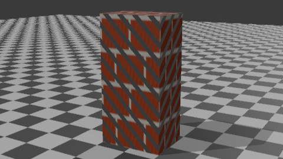
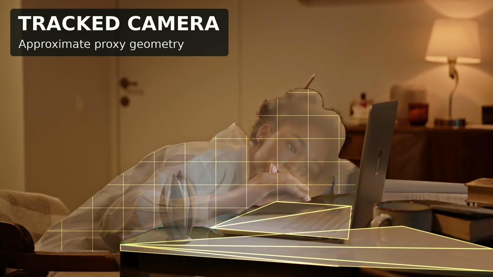
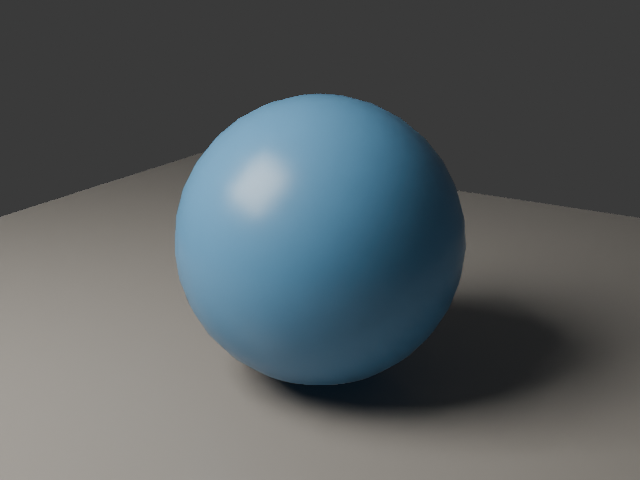
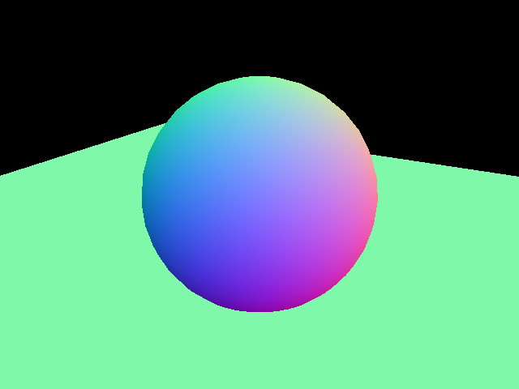

# Vork: Let Agents Write the Scene and Render the Shot on a GPU

> Sources: [Requested fork](https://github.com/donghaozhang/vork) · [Voyager upstream](https://github.com/voyager-so/vork) · [v0.1.0 release](https://github.com/voyager-so/vork/releases/tag/v0.1.0). Released November 7, 2026 in Melbourne; reviewed November 8. Both repositories' `main` branches pointed to `44188ba` at review time. Local tests used the official Apple Silicon archive.

**Vork is a 3D and VFX renderer an agent can drive, not a video generation model.** The agent specifies geometry, camera, lights, and materials; Vork renders the scene. The agent can inspect the preview and revise a camera, a light, or a GPU program without asking a video model to regenerate the whole clip. Think of it as a programmable shot backend rather than an interactive DCC editor.

## Use Scene Data for Ordinary Shots and Programs for Unusual Effects

Scenes use JSON, which can also be authored through Python or TypeScript SDKs. Scene content and render settings are separate. `std/previs` is for checking framing and motion; `std/draft` and `std/final` use more elaborate lighting, and `std/path` uses path tracing. The default approach combines raster visibility with hardware ray-traced lighting. More samples can reduce noise, but cannot recover transport omitted by a profile. [Render profiles](https://github.com/voyager-so/vork/blob/44188ba/docs/help/profiles.md)

Rust handles scene parsing, scheduling, and I/O; Slang programs run on the GPU. A basic scene can use built-in materials. For unusual shots, a scene can supply programs for surfaces, camera rays, light propagation, simulation, or compositing. In the black hole example, the scene program supplies the curved light paths as a numerical approximation rather than relying on a built-in black hole effect. [Program interface](https://github.com/voyager-so/vork/blob/44188ba/docs/help/programs.md) · [Black hole example](https://github.com/voyager-so/vork/tree/44188ba/examples/black-hole)

*The bundled example ran locally. The floor uses inline Slang; the stripes come from a separate Slang file. This verifies a small custom-material scene, not complex VFX performance.*

## Live-Action VFX Still Needs Plate Preparation

Voyager's luminous seed example starts with live footage. Its preparation uses OpenCV-assisted tracking, SAM 2.1 mattes, and Depth Anything V2 estimates. A camera solve and proxy geometry place the rendered object on the desk and support shadows, spill, and occlusion. A single-view depth proxy is not a scan and does not automatically solve lens distortion, rolling shutter, or hidden geometry. [Split Seed recipe](https://github.com/voyager-so/vork/tree/44188ba/examples/vfx-artifact)

| Upstream: tracked camera and approximate proxies | Upstream: later relighting and composite |
|---|---|
|  |  |

*Voyager demonstration stills, not local reproductions. Plate by Ron Lach / Pexels, [original video](https://www.pexels.com/video/tired-woman-sleeping-on-the-table-7983323/), modified under the [Pexels License](https://www.pexels.com/license/); no endorsement by the performer is implied. The recipe teaches the base insertion. The right still includes later relighting and compositing.*

Vork can handle rendering and compositing **after tracking**. This example does not establish automatic tracking, reconstruction, or a replacement for an entire post-production pipeline. Check for object drift, hand occlusion errors, and implausible reflections across frames, not just in one finished still.

## What Actually Ran on This Mac

On a **Mac mini M4 Pro with 48 GB and macOS 26.6.2**, we verified the arm64 archive and ran it from a temporary directory without installing it on the system path. The binary reported `vork 0.1.0 (commit 558c214f96e1; API v2)` and selected Metal. Its embedded revision, public release tag, reviewed documentation, and upstream benchmark build are separate identifiers.

The Mac archive targets Apple Silicon and its bundled Slang toolchain targets macOS 26. Printing the version on an older system would not establish shader compilation. The Windows/Linux packages target NVIDIA GPUs with hardware ray tracing; we did not test those platforms. [Installation requirements](https://github.com/voyager-so/vork/blob/44188ba/README.md#install)

| Check | Local result |
|---|---|
| Sphere, ground, and light | One scene produced 640 × 480 PNGs with `std/previs` and `std/final` |
| Control passes | The final render also wrote depth, view normals, object indices, camera JSON, and metadata |
| Custom shading | Bundled `programs.json` produced a 480 × 270 PNG using inline and file-based Slang materials |
| Short animation | `animated-light.json` produced a 320 × 180 H.264 clip at 12 fps; all six frames decoded and had different frame hashes |

| Local final color | Local view normals from the same frame |
|---|---|
|  |  |

The value of the passes is alignment: camera, depth, normals, and object regions come from the same scene as the color render. The object index needs the sidecar's node mapping, and depth PNG values need the recorded unit scale. Multilayer EXR, transparent ProRes, and motion vectors are documented but **were not tested in this Mac run**. [Output conventions](https://github.com/voyager-so/vork/blob/44188ba/docs/help/outputs.md) · [Reproduction and image credits](imgs/vork-agent-3d-vfx/SOURCES.md)

## Read the Timings with the Quality and Setup Costs Attached

Voyager's NVIDIA L4 record shows **1.14–2.32×** versus retained EEVEE timings for a set of 1080p animations under the default final profile. Sampling, denoising, quality, and timing boundaries differ. Two earlier path-traced still comparisons with Cycles went the other way. For the million-bird skim, the roughly 97-second movie-command median excludes roughly 244 seconds of setup and 166 seconds of scene warmup. The Blender bird numbers are projections from sparse frames, not measured movies. The project also documents that its current Blender helper fails in camera preparation. [Recorded results](https://github.com/voyager-so/vork/blob/44188ba/benchmarks/RESULTS.md) · [Rerun limitations](https://github.com/voyager-so/vork/blob/44188ba/benchmarks/README.md)

Compare the same assets, camera, and acceptable quality. Measure cold setup, interactive revision, and delivery separately, and retain failures. This preview warns and ignores fog and participating media. Heavy scenes and dense transparency can still fail. The Blender bridge translates selected scene elements rather than guaranteeing arbitrary `.blend` parity. [Preview limits](https://github.com/voyager-so/vork/blob/44188ba/docs/help/limits.md) · [Blender bridge](https://github.com/voyager-so/vork/tree/44188ba/integrations/blender)

## Start with a Shot, Not a Pipeline Migration

Try a defined camera move, a product turntable, a procedural material, or an insertion with an existing camera track. Keep the scene, programs, asset credits, profile, and passes together. A small successful render is not evidence for volume-heavy shots, whole-DCC migration, or production-scale reliability.

The [preview license](https://github.com/voyager-so/vork/blob/44188ba/LICENSE) is **source-available, not open source**. It allows commercial use, internal modifications, and delivery of finished media under this version's terms. Modified distribution and a hosted rendering service taking other people's scenes or jobs require written permission. The Blender bridge has its own license. An internal production tool and a customer-facing render service need separate evaluation.
