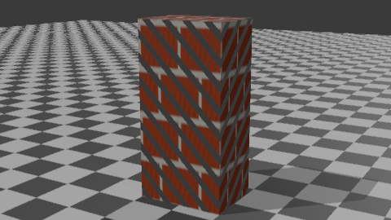
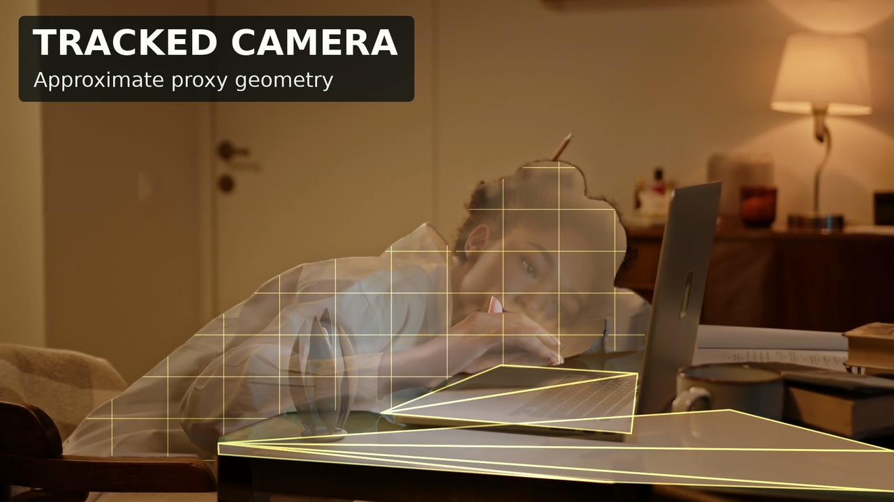
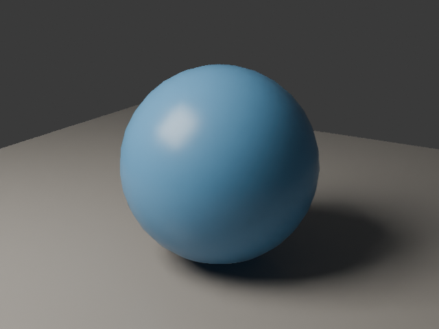
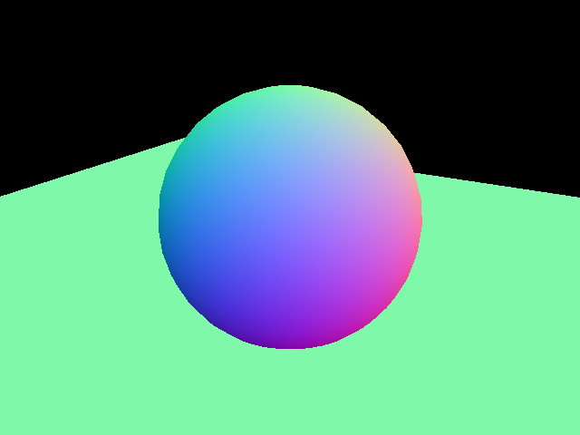

# Vork：让 Agent 写场景和着色器，再用 GPU 渲染 3D 镜头

> 来源：[用户提供的 fork](https://github.com/donghaozhang/vork) · [Voyager 上游](https://github.com/voyager-so/vork) · [v0.1.0 发布](https://github.com/voyager-so/vork/releases/tag/v0.1.0)。发布于 2026 年 11 月 7 日（墨尔本时间），11 月 8 日核查。两个仓库的 `main` 当时均指向 `44188ba`；本地实测使用官方 Apple Silicon 发布包。

**Vork 是给 Agent 调用的 3D/VFX 渲染器，不是视频生成模型。** Agent 写相机、物体、灯光和材质，Vork 按场景渲染；Agent 看预览后，可以只调整镜头、改灯，或改写一段 GPU 程序，不必重新生成整条视频。它更像一个可编程的镜头后端，而不是一个让人点按钮的 DCC 编辑器。

## 1. 普通镜头用场景数据，特殊效果用程序

基础场景是 JSON，也可以用 Python、TypeScript SDK 编写。场景描述与质量配置分开：`std/previs` 适合检查构图和运动，`std/draft`、`std/final` 用于更完整的光照预览或交付，`std/path` 则走路径追踪。默认渲染结合光栅可见性与硬件光线追踪照明；最终配置并不等于完整路径追踪。加采样可以降低噪声，却不能补回该模式省略的光传输。[渲染配置](https://github.com/voyager-so/vork/blob/44188ba/docs/help/profiles.md)

Rust 侧负责场景解析、调度与 I/O，Slang 程序在 GPU 上运行。简单布景可以全用内置材质；需要特殊镜头时，场景可接入自定义表面着色、相机射线、光传播、计算模拟或合成程序。官方黑洞示例把弯曲光路写在场景程序里，是数值近似，不是内核自带的黑洞功能。[程序接口](https://github.com/voyager-so/vork/blob/44188ba/docs/help/programs.md) · [黑洞示例](https://github.com/voyager-so/vork/tree/44188ba/examples/black-hole)

*本机运行发布包内置示例。地面用内联 Slang 程序，物体的条纹来自外部 Slang 文件。该图证明小型自定义材质场景可运行，不验证复杂特效。*

## 2. 实拍合成：渲染器负责插入物，准备工作仍在外面

官方桌面发光种子的例子，使用真实视频作底片。制作方用 OpenCV 辅助跟踪、SAM 2.1 生成遮罩、Depth Anything V2 提供近似深度，再用相机和代理几何把渲染物固定在桌面。阴影、光溢出和遮挡参与合成。单视角深度代理不是扫描，镜头畸变、滚动快门和隐藏几何也没有因此自动解决。[Split Seed 制作说明](https://github.com/voyager-so/vork/tree/44188ba/examples/vfx-artifact)

| 上游：相机跟踪与近似几何 | 上游：后续重打光与合成 |
|---|---|
|  |  |

*均为 Voyager 示例图，不是本文复刻。底片：Ron Lach / Pexels，[原视频](https://www.pexels.com/video/tired-woman-sleeping-on-the-table-7983323/)，依 [Pexels 许可](https://www.pexels.com/license/) 修改，不代表出镜者背书。仓库配方演示基础插入，右图包含后续调光与合成。*

这说明 Vork 可以承担 **跟踪之后的渲染与合成**，不能据此当作一键跟踪、自动重建或替代整个后期流程。实际验收应看物体是否滑动、手部遮挡是否穿帮、反光是否贴合，并逐帧看关键交互，而不是只看一张成品截图。

## 3. 在这台 Mac 上实际跑通了什么

在 **Mac mini M4 Pro、48 GB、macOS 26.6.2** 上，校验官方 arm64 压缩包后直接运行，没有安装到系统路径。发布包报告 `vork 0.1.0 (commit 558c214f96e1; API v2)`，诊断选择 Metal。这个二进制自报提交与公开 tag、文档 HEAD 和下述跑分构建要分别记录，不能混用。

Mac 发布包要求 Apple Silicon；随包 Slang 的部署目标是 macOS 26，不能用旧系统上能打印版本号来证明能编译场景程序。Windows/Linux 发布包则面向具备硬件光追能力的 NVIDIA GPU，本文未在这两个平台实测。[安装与硬件要求](https://github.com/voyager-so/vork/blob/44188ba/README.md#install)

| 检查 | 本机结果 |
|---|---|
| 球体、地面与灯光 | 同一场景成功输出 `std/previs` 和 `std/final` 的 640 × 480 PNG |
| 控制通道 | 同次 final 导出深度、视空间法线、对象索引 PNG，以及相机和元数据 JSON |
| 自定义着色 | 内置 `programs.json` 的内联与文件型 Slang 材质生成了 480 × 270 PNG |
| 短动画 | `animated-light.json` 输出 320 × 180、12 fps、6 帧 H.264；全片解码成功，6 个解码帧校验值不同 |

| 本地：正式彩色渲染 | 本地：同帧视空间法线 |
|---|---|
|  |  |

控制通道的价值在于，相机、深度、法线和对象分区与彩色图来自同一场景，不必再从最终画面估计。比如对象索引 PNG 要结合元数据映射到具体节点；深度 PNG 也要用对应的单位换算。多层 EXR、透明 ProRes 和运动向量是文档列出的能力，**不在这次 Mac 实测范围内**。[输出约定](https://github.com/voyager-so/vork/blob/44188ba/docs/help/outputs.md) · [实测复现与素材来源](imgs/vork-agent-3d-vfx/SOURCES.md)

## 4. 速度数字不能脱离画质、冷启动和测试版本

上游 NVIDIA L4 记录里，默认 final 的几组 1080p 动画相对历史 EEVEE 记录为 **1.14–2.32 倍**，但采样、降噪、画质和计时边界不同；另两组较早的 path/Cycles 静帧对比中，Vork 反而更慢。百万鸟 skim 的约 97 秒是渲染命令的中位数，不含约 244 秒的 setup 和 166 秒的场景预热；Blender 鸟群数据是用少量帧推算的绘制耗时，不是完整成片实测。文档还明确指出当前 Blender 对照脚本的相机准备会失败。[上游结果](https://github.com/voyager-so/vork/blob/44188ba/benchmarks/RESULTS.md) · [复测限制](https://github.com/voyager-so/vork/blob/44188ba/benchmarks/README.md)

因此，选型时应该用同一素材、同一相机和同等可接受画质，分别测冷启动、修改后的预览和最终交付，并保留失败项。当前研究预览不支持的雾和参与介质会被忽略并警告；重场景与密集透明仍可能失败。Blender 桥接能转换部分场景、材质和动画，不是任意 `.blend` 原样兼容。[预览限制](https://github.com/voyager-so/vork/blob/44188ba/docs/help/limits.md) · [Blender 桥接](https://github.com/voyager-so/vork/tree/44188ba/integrations/blender)

## 5. 适合从一个镜头试起

先挑 **明确的相机运动、产品转台、程序化材质，或有现成相机跟踪的实拍插入**。交付时把场景、着色器、素材来源、配置和通道一起留存。复杂体积、全套 DCC 工作流迁移或大场景可靠性，不能用这个小样替代验证。

另外，[预览许可证](https://github.com/voyager-so/vork/blob/44188ba/LICENSE)是**源码可见，不是开源许可证**：该版本允许商用和内部修改，允许交付渲染成品，但未经书面许可不得分发修改版，或让其他人提交场景或任务来运营托管渲染服务。Blender 桥接有独立许可证。做内部生产工具和做对外渲染产品，是两件需要分开评估的事。
