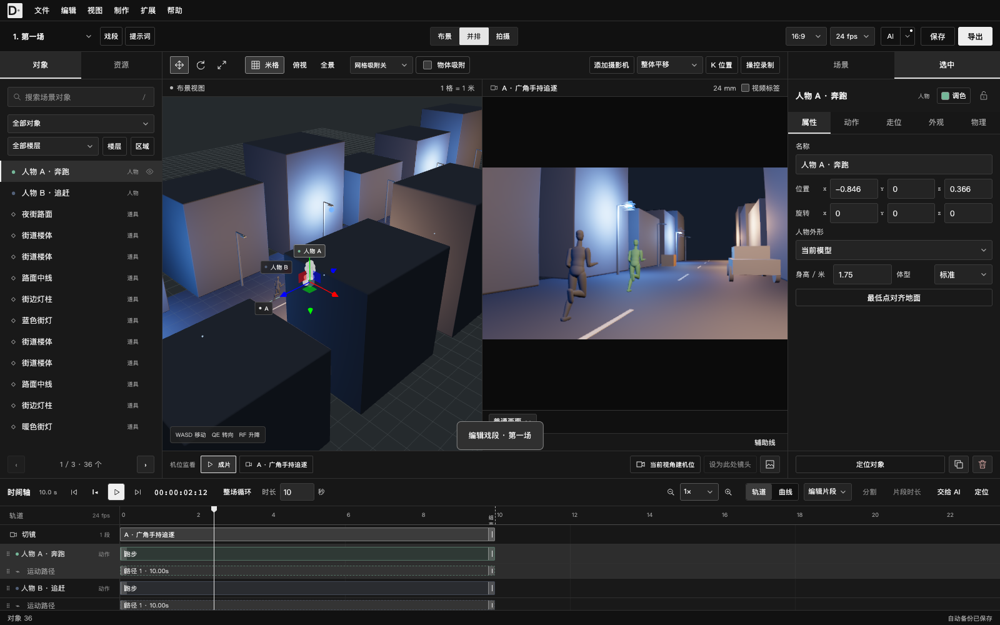
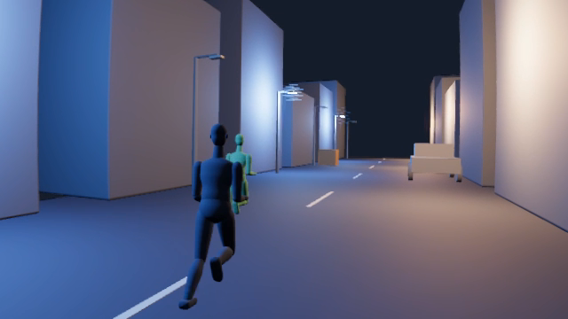
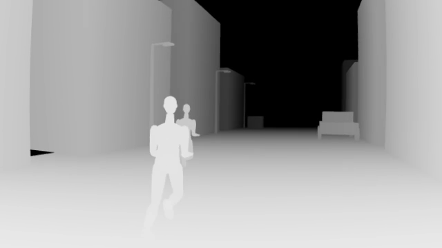
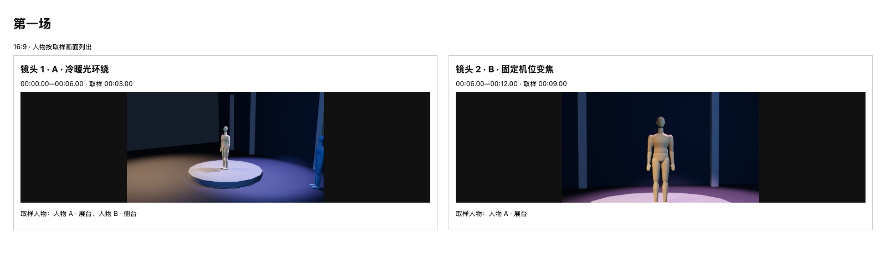

# DirectorDesk: Let Agents Block the Scene Before the Video Model Renders It

> DirectorDesk is an open-source 3D previs editor for arranging characters, movement and cameras, then exporting reference footage, depth video and prompts. Its contribution is an editable, inspectable shot project, not a stronger video-generation model.

- Repository: [donghaozhang/director-desk](https://github.com/donghaozhang/director-desk), a fork of [mangfufu/director-desk](https://github.com/mangfufu/director-desk).
- Release: [v0.5.5.1](https://github.com/mangfufu/director-desk/releases/tag/v0.5.5.1), published November 12, 2026; reviewed November 24, 2026.
- Snapshot: [`45ee609`](https://github.com/donghaozhang/director-desk/tree/45ee60933680955d4a6e05961190660732a551bc). The fork and upstream main resolved to the same commit during this review.
- Verification: a local macOS web build, templates, structured editing, short exports and a contact sheet. No paid model calls or video-reconstruction inference were tested.

*Local test capture: the staging view shows the set, the camera view shows the shot, and separate timeline tracks hold cuts, character actions and movement paths. This is previs, not final AI-generated footage.*

## 1. Moving Decisions Out of the Prompt

“Two people run down a street while the camera follows” leaves many decisions unresolved: who leads, their separation, camera height, tracking distance and the timing of turns.

DirectorDesk places those decisions in objects, paths and timeline clips. Character animation and overall travel are separate; camera position and look-at paths can also be edited independently. A cuts track selects the camera at each moment. A local correction therefore has a specific destination in the project rather than requiring a complete rewrite of the scene description.[ Camera workflow](https://github.com/donghaozhang/director-desk/blob/45ee60933680955d4a6e05961190660732a551bc/skills/director-desk/references/camera.md)

The implementation uses Three.js for rendering, cannon-es for physics and MediaBunny for video output. Built-in people and sets provide a starting point, with external model imports available. Its simplified previs characters need not be literally white: color and lighting can help communicate staging.[ Dependencies and build commands](https://github.com/donghaozhang/director-desk/blob/45ee60933680955d4a6e05961190660732a551bc/package.json)

The useful question is whether a shot communicates the intended action, not whether the mannequin already looks like a finished screen character.

## 2. Color and Depth Communicate Different Things

I exported seconds 0–1 of the Night Street Chase template twice. These decoded frames both come from 0.5 seconds:

| Regular reference | Depth reference |
| --- | --- |
|  |  |

The regular render retains simplified appearance and lighting. The depth material maps camera-space distance to grayscale, with configurable near/far range, inversion and curve. This depth comes from the authored 3D scene; it is not a second model estimating depth from the color footage.[ Depth material implementation](https://github.com/donghaozhang/director-desk/blob/45ee60933680955d4a6e05961190660732a551bc/src/cinematography/depth-video-material.ts)

The grayscale video is limited by grayscale precision and video compression; it is not lossless metric depth data. Producing it does not establish that every video model accepts it as a conditioning input. Input compatibility and adherence must be tested at the receiving model. No downstream generation was evaluated here.

The project also stores separate reference-video and text-only prompts. One accompanies visual material; the other must describe the shot independently. They are different deliverables, not duplicate text files.[ Prompt-writing guidance](https://github.com/donghaozhang/director-desk/blob/45ee60933680955d4a6e05961190660732a551bc/skills/director-desk/references/prompt-writing.md)

## 3. Agents Edit the Project, Not Just the Mouse

The desktop application offers an assistant using a configured model provider and an MCP connection for external clients such as Codex or Claude Code. Its assistant reads a project snapshot, loads the active skill instructions and runs a model/tool loop. The implementation does not establish that these editing abilities come from a newly trained foundation model.[ Assistant implementation](https://github.com/donghaozhang/director-desk/blob/45ee60933680955d4a6e05961190660732a551bc/desktop/ai-host.cjs)

The important engineering lies in the editing contract:

| Mechanism | Purpose |
| --- | --- |
| Selective reads of objects, selection, cuts and production notes | Retrieve relevant context without treating omitted sections as empty |
| `revision` checks | Reject writes based on stale project state |
| `requestId` receipts | Avoid repeating identical requests while their receipts remain cached |
| Batches, optional preflight and undo | Validate and commit related project edits together |
| Edit-location records | Associate changes with scenes, objects and time ranges |

Preflight checks operations and data, not artistic quality, and ordinary edits do not require preflight. Request receipts live in a bounded in-memory cache, not a permanent cross-restart ledger. Library management, local settings and plugin side effects also should not be treated as universally undoable project transactions.[ Shared tool service](https://github.com/donghaozhang/director-desk/blob/45ee60933680955d4a6e05961190660732a551bc/src/automation/service.ts) · [Workflow boundaries](https://github.com/donghaozhang/director-desk/blob/45ee60933680955d4a6e05961190660732a551bc/skills/director-desk/references/online-workflow.md)

Through the web development hook, I exercised this same service: preflight left the project untouched, commit changed a character name, an identical retry returned the same result, an old revision was rejected, and undo restored the name. That validates this small editing path, not desktop MCP transport or an end-to-end natural-language directing task.

Compared with asking an agent to write a one-off animation, DirectorDesk supplies an existing editor, project format and revision rules. Humans and models still make the creative decisions, but revisions have explicit targets.

## 4. Video Reconstruction Has Distinct Tiers

The default lightweight path must not be confused with full scene reconstruction:

| Path | Scope and limits |
| --- | --- |
| MediaPipe Pose Lite, the default | Desktop packages bundle roughly 21 MB of model/WASM resources. It estimates poses, associates people and fits animation. Screen position becomes approximate travel at a fixed reference camera; it does not recover the source set or real camera trajectory. Crossing and occlusion can confuse identities |
| Optional Human3R | A heavier integration documented to recover people, camera and scene geometry. Its current runtime entry requires Windows/Linux x64 and NVIDIA CUDA, with no macOS inference entry |
| Optional FlowHMR | Another external-model integration, with separate runtime and licensing requirements; not the default lightweight capability |

Lightweight output becomes an editable project with animation and paths, allowing character replacement, trimming and retiming. Editability does not establish motion accuracy or a production-ready digital human.[ Lightweight algorithm](https://github.com/donghaozhang/director-desk/blob/45ee60933680955d4a6e05961190660732a551bc/docs/%E8%BD%BB%E9%87%8F%E8%A7%86%E9%A2%91%E5%8F%8D%E6%8E%A8.md) · [Bundled resources](https://github.com/donghaozhang/director-desk/blob/45ee60933680955d4a6e05961190660732a551bc/docs/bundled-lightweight-recognition.md) · [Human3R integration](https://github.com/donghaozhang/director-desk/blob/45ee60933680955d4a6e05961190660732a551bc/docs/video-reconstruction.md) · [FlowHMR integration](https://github.com/donghaozhang/director-desk/blob/45ee60933680955d4a6e05961190660732a551bc/docs/flowhmr-integration.md)

## 5. A Contact Sheet Can Be the Better Handoff

*The exported HTML lists two shots, their intervals and sample times, camera images and sampled characters.*

This is useful for discussing coverage and framing. The implementation samples near the middle of each cut interval, so its character list describes that sample, not proof that an entire shot is free of occlusion, clipping or unwanted exits. Movement still needs playback and, where appropriate, additional checks.[ Sampling logic](https://github.com/donghaozhang/director-desk/blob/45ee60933680955d4a6e05961190660732a551bc/src/production/contact-sheet.ts) · [Contact rendering](https://github.com/donghaozhang/director-desk/blob/45ee60933680955d4a6e05961190660732a551bc/src/production/contact-render.ts)

Existing Blender sets can also be reused. The desktop integration invokes a local Blender 4.2+ process to convert models, cameras and animation without a Blender plugin. Its target is editable previs, not lossless Cycles parity: complex procedural materials, world nodes and animated lights have documented limitations.[ Blender import contract](https://github.com/donghaozhang/director-desk/blob/45ee60933680955d4a6e05961190660732a551bc/docs/blender-import.md)

## 6. What Actually Worked on Mac?

At review time, v0.5.5.1 had Windows and Linux x64 release assets but no macOS DMG. Development documentation provides cross-platform desktop commands and an Apple Silicon packaging entry. A build script is not evidence of a validated Mac installer.[ Release assets](https://github.com/mangfufu/director-desk/releases/tag/v0.5.5.1) · [Platform documentation](https://github.com/donghaozhang/director-desk/blob/45ee60933680955d4a6e05961190660732a551bc/docs/development.md)

This review used macOS, Node.js 25.7.0 and an isolated Chrome session:

- After `npm ci --ignore-scripts`, `npm run build` passed TypeScript, Vite and the repository's release-privacy check. That check is not an independent security audit.
- Built-in templates rendered. Both exported MP4 files were H.264, 640×360, 24 fps, exactly one second and 24 frames; full FFmpeg decoding reported no errors.
- The contact sheet opened as standalone HTML. The limited editing checks described above passed.
- Eight targeted test files passed 31 tests covering editing, cinematography, depth, contact sheets, lightweight pose postprocessing, Blender mapping, MCP connection configuration and file permissions.

**This was not a clean full-suite run.** An additional cross-scene resource test failed because `chair.glb` was absent. Following the prescribed asset-preparation process then failed the pinned SHA-256 check for the downloaded Kenney archive. I did not bypass that check. Electron, MCP transport, actual Blender conversion, MediaPipe/Human3R/FlowHMR inference and long high-resolution exports were not tested.

## 7. Start With One Shot

Try a simple ten-second scene and evaluate three things: whether the spatial relationships read clearly, whether the camera movement works, and whether the receiving video model makes effective use of the reference. The editor lets you revise the first two; the third requires a separate downstream test.

Licensing also has layers. The project's own code is MIT, and its bundled motion notice identifies a Quaternius CC0 source. Human3R has noncommercial restrictions; FlowHMR and SMPL+H files have separate terms. The repository's MIT label does not replace those asset licenses.[ Code license](https://github.com/donghaozhang/director-desk/blob/45ee60933680955d4a6e05961190660732a551bc/LICENSE) · [Motion attribution](https://github.com/donghaozhang/director-desk/blob/45ee60933680955d4a6e05961190660732a551bc/src/animation/library/NOTICE.txt) · [Third-party notices](https://github.com/donghaozhang/director-desk/tree/45ee60933680955d4a6e05961190660732a551bc/desktop/video-reconstruction)

DirectorDesk's useful proposition is concrete: turn an intended shot into something you can inspect, revise and undo before handing references to a generative model. Whether that reduces rework depends on catching spatial and timing problems in previs. It cannot guarantee the final generated footage.

Related: [3D staging and character positioning for AI video](../2026-06-03/2026-06-03-ai-video-3d-director-stage-positioning.md), an earlier Chinese-language workflow article about a different source. This review adds an executable open-source editor and verified exports; it does not identify the two as the same product.
