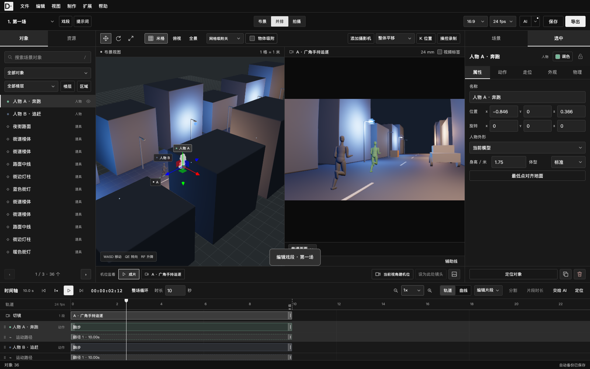
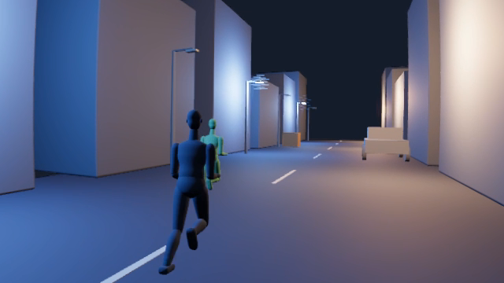
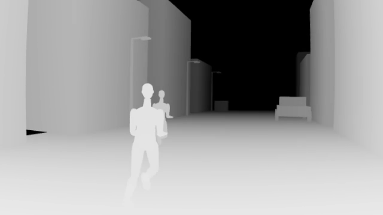
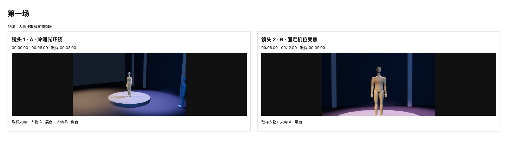

# DirectorDesk：让 Agent 先排好人物和摄影机，再交给视频模型

> DirectorDesk（导演台）是一套开源三维预演编辑器：先搭场景、排动作和机位，再导出普通参考视频、深度视频与配套提示词。它的主要价值是把空间和时间安排变成可修改、可检查的工程，而不是提供一个更强的视频生成模型。

- 项目：[donghaozhang/director-desk](https://github.com/donghaozhang/director-desk)，上游为 [mangfufu/director-desk](https://github.com/mangfufu/director-desk)。
- 版本：[v0.5.5.1](https://github.com/mangfufu/director-desk/releases/tag/v0.5.5.1)，2026-11-12 发布；本文于 2026-11-24 核查。
- 源码快照：[`45ee609`](https://github.com/donghaozhang/director-desk/tree/45ee60933680955d4a6e05961190660732a551bc)。核查时，fork 和上游 main 指向同一提交。
- 验证范围：macOS 本地网页构建、模板预览、结构化编辑接口、短片导出与镜头联系表；没有调用付费模型或测试视频识别推理。

*本文实测截图：左边观察整个布景，右边看摄影机成片视角，下方分别安排切镜、人物动作和运动路径。不是 AI 生成的最终影片。*

## 1. 它把哪些事情从提示词里拿出来了？

“两个人沿街奔跑，摄影机从后方跟拍”仍然留下很多决定：谁在前、相隔多远、摄影机多高、追上去还是保持距离、何时转向。

导演台让这些决定落到三维对象、路径和时间轴上。人物动作与整体走位分开，摄影机机身路径与视线路径也能分别安排；再用切镜轨道决定观众在每个时刻看到哪台摄影机。这些是工程参数，能局部改动，不必每次重新描述整场戏。[镜头与灯光操作说明](https://github.com/donghaozhang/director-desk/blob/45ee60933680955d4a6e05961190660732a551bc/skills/director-desk/references/camera.md)

底层是 Three.js 三维渲染、cannon-es 物理与 MediaBunny 视频输出；内置人形和模板可以直接使用，也支持导入外部模型。这里的“白模”是预演用途的简化角色与布景，并不意味着只有纯白方块。[依赖与构建入口](https://github.com/donghaozhang/director-desk/blob/45ee60933680955d4a6e05961190660732a551bc/package.json)

它适合先回答“这一镜能不能拍清楚”，而不是直接解决角色皮肤、服装细节或最终电影质感。

## 2. 普通视频和深度视频，交出去的是不同信息

我在“夜街追逐”模板中导出了同一段 0–1 秒的两种视频，下面是两条视频在 0.5 秒处的解码帧：

| 普通参考画面 | 同时刻的深度画面 |
| --- | --- |
|  |  |

普通画面保留简化造型、灯光和颜色。深度画面把摄影机空间中的距离映射成灰度，能设置近远范围、反转和曲线；它来自已经搭好的三维场景，不是再调用一个模型从普通视频猜深度。[深度材质实现](https://github.com/donghaozhang/director-desk/blob/45ee60933680955d4a6e05961190660732a551bc/src/cinematography/depth-video-material.ts)

这条灰度视频受灰阶精度和视频压缩影响，不是无损的米制深度数据。它让同一份预演可以交付不同参考，但不能推出“所有视频模型都能直接吃这条深度视频”。接收端是否支持深度条件、参考视频是否会被严格遵守，需要另行验证。本文没有测试任何下游生成模型。

工程还分别保存“参考视频版”和“纯文字版”提示词：前者配合视觉参考说明意图，后者需要独立交代画面与摄影。两份文稿不是同一段话换个文件名。[提示词写作规范](https://github.com/donghaozhang/director-desk/blob/45ee60933680955d4a6e05961190660732a551bc/skills/director-desk/references/prompt-writing.md)

## 3. Agent 的重点是编辑工程，不是接管鼠标

桌面版有两条 AI 入口：内置助手调用用户配置的模型渠道；外部 Codex、Claude Code 等通过 MCP 连接。源码中的内置助手会读取工程快照、加载当前技能说明，再进入模型调用和工具执行循环。没有证据表明这套编辑能力依赖项目自行训练的基础模型。[助手实现](https://github.com/donghaozhang/director-desk/blob/45ee60933680955d4a6e05961190660732a551bc/desktop/ai-host.cjs)

关键在于它给 Agent 准备了专门的操作对象：

| 机制 | 解决什么问题 |
| --- | --- |
| 按需读取对象、选区、切镜和制作资料 | 不必每轮把完整工程塞进上下文；没读取的部分不等于空 |
| `revision` 版本检查 | 人工或其他操作改过工程后，拒绝基于旧状态写入 |
| `requestId` 请求回执 | 对仍保留回执的相同请求重试，避免重复执行 |
| 批量操作、可选预检与历史撤销 | 一组工程修改可以整体验证、提交和撤回 |
| 修改位置记录 | 将变化关联到戏段、对象和时间范围，便于回看 |

这些机制能在共享工具服务中找到实现。不过，预检是数据和操作检查，不是审美验收；普通编辑也并不强制先预检。请求回执存在当前服务的有限内存缓存里，不能当作跨重启、永久有效的去重账本；库管理、本机设置和插件副作用也不能一概当作可撤销工程修改。[共享工具服务](https://github.com/donghaozhang/director-desk/blob/45ee60933680955d4a6e05961190660732a551bc/src/automation/service.ts) · [操作边界](https://github.com/donghaozhang/director-desk/blob/45ee60933680955d4a6e05961190660732a551bc/skills/director-desk/references/online-workflow.md)

我通过网页开发入口调用同一工具服务，验证了预检不写入、提交生效、相同请求返回相同结果、旧 revision 被拒绝，以及撤销恢复原名称。这验证了工程接口，不等于完成了桌面 MCP 连接或自然语言导演任务的端到端测试。

相较于让 Agent 临时写一段三维动画代码，它提供的是现成的导演工作台、工程格式和修改约束。创作判断仍由模型与人承担，但每次返工有了明确落点。

## 4. “视频反推”必须分档理解

不能把 README 中的“视频反推”统称为完整三维重建：

| 路径 | 当前说明与边界 |
| --- | --- |
| 默认轻量识别：MediaPipe Pose Lite | 桌面包内含约 21 MB 模型及 WASM；估计姿态、匹配人物并拟合动作。画面位置近似映射成走位，使用固定参考机位，不恢复原场景或真实相机轨迹；遮挡交叉可能串人 |
| 可选 Human3R | 文档描述恢复人物、相机与场景几何的较重流程；当前运行入口要求 Windows/Linux x64 与 NVIDIA CUDA，不提供 macOS 推理入口 |
| 可选 FlowHMR | 另一条外部模型集成路径，不能和默认轻量能力混为一谈；运行依赖及模型许可须单独核查 |

轻量结果可写成带动画和路径的可编辑工程，再换人物、剪动作、调速度。它并不意味着识别出的动作天然精确，也不是扫描出了可直接用于成片的精细数字人。[轻量识别算法说明](https://github.com/donghaozhang/director-desk/blob/45ee60933680955d4a6e05961190660732a551bc/docs/%E8%BD%BB%E9%87%8F%E8%A7%86%E9%A2%91%E5%8F%8D%E6%8E%A8.md) · [随包资源说明](https://github.com/donghaozhang/director-desk/blob/45ee60933680955d4a6e05961190660732a551bc/docs/bundled-lightweight-recognition.md) · [Human3R 集成](https://github.com/donghaozhang/director-desk/blob/45ee60933680955d4a6e05961190660732a551bc/docs/video-reconstruction.md) · [FlowHMR 集成](https://github.com/donghaozhang/director-desk/blob/45ee60933680955d4a6e05961190660732a551bc/docs/flowhmr-integration.md)

## 5. 最有用的交付，不一定是视频

*“光影舞台”模板导出的 HTML 联系表：两个镜头分别列出时间区间、取样时刻、摄影机画面与取样人物。*

联系表适合讨论镜头顺序、景别和人物是否在画面里。实现按每段切镜区间中部取样，因此上图的“取样人物”只代表那个时刻，不能证明整段没有遮挡、穿模或人物出框。需要看运动关系时仍要播放视频，必要时检查更多时间点。[联系表取样与渲染](https://github.com/donghaozhang/director-desk/blob/45ee60933680955d4a6e05961190660732a551bc/src/production/contact-sheet.ts) · [渲染实现](https://github.com/donghaozhang/director-desk/blob/45ee60933680955d4a6e05961190660732a551bc/src/production/contact-render.ts)

已有 Blender 布景也能复用：桌面版借助本机 Blender 4.2+ 后台转换模型、摄影机和动画，不要求安装 Blender 插件。但它以可编辑预演为目标，复杂程序材质、世界节点和灯光动画等有明确限制，不能把它理解成 Cycles 场景无损迁移。[Blender 导入契约](https://github.com/donghaozhang/director-desk/blob/45ee60933680955d4a6e05961190660732a551bc/docs/blender-import.md)

## 6. Mac 上跑到了哪一步？

核查时 v0.5.5.1 的发布附件提供 Windows 和 Linux x64 包，没有 macOS DMG。开发文档提供跨平台桌面开发命令及 Apple Silicon 打包入口，但“有构建脚本”不等于“有验收过的 Mac 安装包”。[发布附件](https://github.com/mangfufu/director-desk/releases/tag/v0.5.5.1) · [开发与平台说明](https://github.com/donghaozhang/director-desk/blob/45ee60933680955d4a6e05961190660732a551bc/docs/development.md)

本次使用 macOS、Node.js 25.7.0 和隔离 Chrome 会话：

- `npm ci --ignore-scripts` 后，`npm run build` 通过，包括 TypeScript 检查、Vite 构建与项目自带的发布隐私检查；这不是独立安全审计。
- 内置模板正常显示；两条 MP4 均为 H.264、640×360、24 fps、1 秒、24 帧，FFmpeg 完整解码无报错。
- 联系表导出后可作为独立 HTML 打开；结构化编辑的预检、去重、冲突拒绝和撤销通过上述小范围实测。
- 8 个相关测试文件共 31 项通过，覆盖编辑、镜头、深度、联系表、轻量动作后处理、Blender 映射、MCP 连接配置与文件权限。

**没有宣称全套测试通过。** 额外尝试的跨戏段资源测试因缺少 `chair.glb` 失败；随后按项目流程准备素材，下载到的 Kenney 压缩包未通过仓库固定 SHA-256 校验，因此没有绕过校验继续跑全套。也未实测 Electron 桌面、MCP 传输、Blender 真实转换、MediaPipe/Human3R/FlowHMR 推理或长片高分辨率导出。

## 7. 值得怎样试用？

先选一个十秒左右的简单镜头，只验收三件事：人物空间关系是否清楚、镜头运动是否合适、导出的参考是否能被目标视频模型有效利用。前两件事能在导演台里反复修改，第三件事必须在接收端实测。

许可也要分层看：自有代码标 MIT，内置动作库注明 Quaternius CC0 来源；Human3R 有非商业限制，FlowHMR 与 SMPL+H 等文件另有许可，不能用仓库首页的 MIT 代替全部资产条款。[代码许可](https://github.com/donghaozhang/director-desk/blob/45ee60933680955d4a6e05961190660732a551bc/LICENSE) · [动作来源](https://github.com/donghaozhang/director-desk/blob/45ee60933680955d4a6e05961190660732a551bc/src/animation/library/NOTICE.txt) · [第三方许可入口](https://github.com/donghaozhang/director-desk/tree/45ee60933680955d4a6e05961190660732a551bc/desktop/video-reconstruction)

DirectorDesk 最值得关注的是这条工作路径：把“我想拍什么”先变成一份能看、能改、能撤回的镜头工程，再把参考交给生成模型。它能减少哪一类返工，取决于你能否先在预演阶段发现空间和节奏问题；它不能替下游模型保证最终成片。

相关阅读：[AI 视频人物站位控制与三维预演](../2026-06-03/2026-06-03-ai-video-3d-director-stage-positioning.md)。本文补充的是可运行的开源编辑器、工程接口与导出实测，不将两者视为同一个产品。
