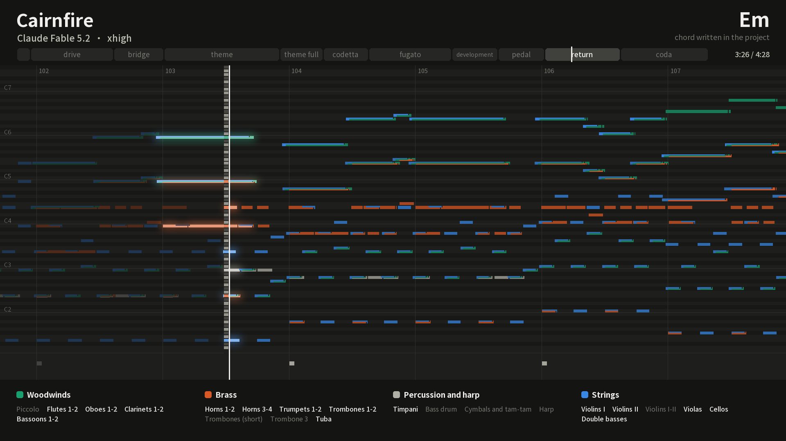

# music-skill: An Agent Workflow for Music You Can Edit Note by Note

> Sources: [Requested fork](https://github.com/donghaozhang/music-skill) · [owoevan-dev upstream](https://github.com/owoevan-dev/music-skill) · [v0.6.0](https://github.com/owoevan-dev/music-skill/releases/tag/v0.6.0). Reviewed November 13, 2026 against the November 12 source snapshot `229892c`, using Melbourne dates. Both repositories pointed to that revision on `main` at review time.

Imagine a director asking to raise the flute note in bar five without touching the piano or drums. That is an awkward edit to make to a finished MP3. `music-skill` instead has the agent write an addressable score and hands it to local instruments to play. **The important deliverables are the editable project, MIDI, and stems, not just the waveform.** It targets instrumental cues, not sung performances or lyrics.

## What the Agent Writes and What the Scripts Do

| Layer | Responsibility |
|---|---|
| Composition | The agent chooses a theme, form, harmony, and instrumentation. A longer cue often uses `compose.py` to write `song.json`. |
| Score review | `review` flags issues such as sustained interval clashes, unresolved nonchord tones, or dense low-register voicings. Intentional tension can stay. |
| Performance | Written pitch and duration are distinct from velocity, timing, and articulation. Sampled parts use SoundFonts and FluidSynth; electronic parts can use built-in synths or optional Surge XT. |
| Delivery | The renderer processes stems, buses, and reverb returns before mastering. It exports MIDI and audio, while `analyze` reports levels, spectrum, and stereo properties. |

There is still AI in the process: the agent composes, sometimes starting from rule-based accompaniment. **The renderer does not call an audio-generation model.** MIDI carries editable musical events, not the complete sample library and mix. Import it into a DAW to arrange with new sounds; keep the project, bank versions, and stems to preserve the rendered production. [Workflow](https://github.com/owoevan-dev/music-skill/blob/229892c/skills/music-production/SKILL.md) · [Project schema](https://github.com/owoevan-dev/music-skill/blob/229892c/skills/music-production/references/schema.md)

*Upstream visualization drawn from the 36-part Cairnfire project, not a locally opened editor. It shows form, pitch, and orchestration.* [Example](https://github.com/owoevan-dev/music-skill/tree/229892c/examples/cairnfire)

## One Note Changes in the Score; the Mix Can Change Beyond It

We reproduced the eight-bar *Porch Light* edit. `revise` changed `flute_b005_n000` in bar five from MIDI pitch **73 (C♯5) to 76 (E5)**. Apart from a revision record, that pitch was the only project change. The onset and three-beat duration stayed fixed. Both MIDI exports read back as 157 notes across five MIDI tracks, including the timing track, with no unclosed notes or stray note-offs. [Before MIDI](imgs/music-skill-editable-score/porch-light-before.mid) · [After MIDI](imgs/music-skill-editable-score/porch-light-after.mid)

**Changing only the flute score does not confine the audio change to one instant.** The renderer caches each part against its dependencies. A pitch edit can reuse the other parts, but the mix is rebuilt, so shared reverb tails and master gain can follow the change. Global tempo or sound changes can invalidate more of the cache. Upstream's Windows A/B records changes to the flute, lead bus, plate return, and master. We verified the project and MIDI edit, **not the audio difference on this Mac**. [Upstream A/B](https://github.com/owoevan-dev/music-skill/tree/229892c/examples/before-after) · [Cache implementation](https://github.com/owoevan-dev/music-skill/blob/229892c/skills/music-production/scripts/musiclib/render.py)

## Game Loops and Picture Edits Benefit from a Written Timeline

The *Skybutton Speedway* project specifies 48 bars of 4/4 at 128 BPM, a **90-second score**. The published MP3 measured **91 seconds**, and the project specifies a one-second tail. The MP3 is an audition, not a substitute for the loop asset. The renderer documents separate WAV/Ogg loop output, a configurable start bar, and folding reverb into the loop start. Optional layers are useful for adaptive intensity, but summing them need not recreate the limited master's level or dynamics. We verified the project settings and decoded the released MP3, not the loop seam or game-engine import. [Example and audio](https://github.com/owoevan-dev/music-skill/tree/229892c/examples/skybutton-speedway) · [Game delivery](https://github.com/owoevan-dev/music-skill/blob/229892c/skills/music-production/references/game-music.md)

For picture, map a reveal, a dialogue passage, and an ending to bars or beats. Ask the agent to plan accents or leave space at those points. A practical pilot is a 20–30 second dialogue cue, delivered with lead, backing, and master, followed by one precise edit. Judge whether it supports the scene and preserves the parts you liked, not whether the review produces zero warnings.

## Verified Scope and Setup Costs

On macOS arm64 with a temporary Python 3.12 environment, **23 repository tests passed**. They covered rebuilding the seven example projects from scripts, the single-note revision, and the self-check without a renderer configuration. Separately, the upstream *Skybutton Speedway* MP3 probed as 48 kHz stereo at 91 seconds and decoded end to end. This checks score reproducibility and the released file's integrity, not local synthesis, mastering, or musical quality. We installed neither the skill into an agent nor FluidSynth, Surge XT, or sample banks. [Reproduction record](imgs/music-skill-editable-score/SOURCES.md)

A full setup needs shell access, Python/NumPy, audio tools, and persistent storage for configuration and banks. Upstream estimates about 1 GB for a small setup and roughly 12 GB of space for everything. Rendering locally does not imply the composing model is offline. The main project is MIT; the Surge host, external tools, samples, and presets have separate terms. Upstream marks the listed demo compositions and recordings CC0. That is not a blanket license for third-party material added to a project. [Installation](https://github.com/owoevan-dev/music-skill/blob/229892c/README.md#install) · [Third-party notices](https://github.com/owoevan-dev/music-skill/blob/229892c/THIRD_PARTY.md)
