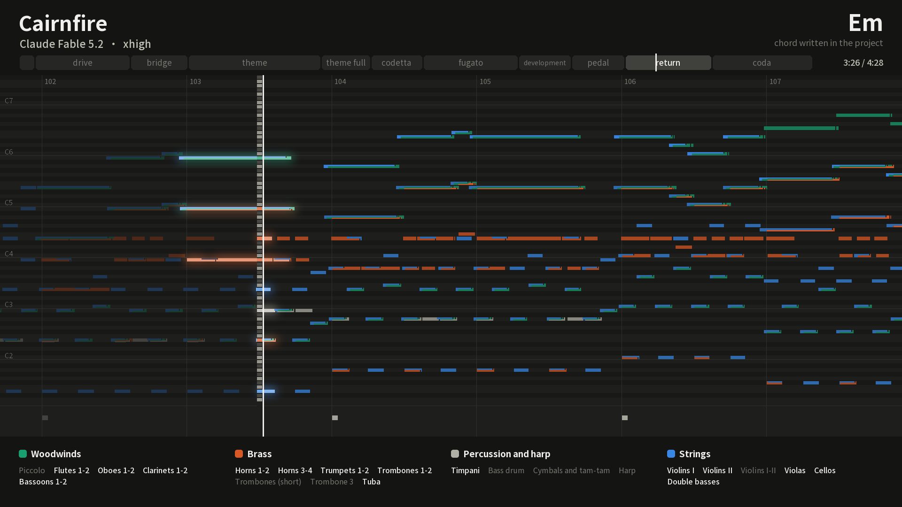

# music-skill：让 Agent 写出可以逐音修改的配乐，而不只交一条音频

> 来源：[用户提供的 fork](https://github.com/donghaozhang/music-skill) · [owoevan-dev 上游](https://github.com/owoevan-dev/music-skill) · [v0.6.0](https://github.com/owoevan-dev/music-skill/releases/tag/v0.6.0)。本文以 11 月 12 日的源码快照 `229892c` 为准，11 月 13 日核查，日期按墨尔本时间。核查时 fork 和上游的 `main` 指向同一提交。

如果导演说“第 5 小节的长笛音抬高一点，钢琴和鼓都别动”，有了成品 MP3 也很难精确修改。`music-skill` 的解法是先让 Agent 写一份能寻址的乐谱，再交给本地合成器演奏。**交付的核心不是一条波形，而是可以继续改的工程、MIDI 和分轨。** 它擅长有明确时长、结构或修改要求的器乐配乐，不做歌手演唱或歌词演绎。

## 1. Agent 负责写什么，脚本负责做什么

| 层 | 工作 |
|---|---|
| 作曲与编排 | Agent 根据 brief 决定主题、段落、和声、配器；长曲通常由 `compose.py` 写成 `song.json` |
| 乐谱检查 | `review` 提示持续冲突音程、未解决的和弦外音、低音区过密等问题；有意的张力不必因为被提示就删除 |
| 演奏与渲染 | 乐谱的音高、时值与演奏时的力度、时序、连奏处理分开。采样轨用 SoundFont/FluidSynth，电子轨可用内置合成器或可选的 Surge XT |
| 混音和交付 | 按工程设置处理 stems、总线和混响返回，再做母带，输出 MIDI、WAV、FLAC、MP3 等文件；`analyze` 提供响度、频谱和声像检查 |

它不是“没有 AI”：作曲决策来自 Agent，鼓和伴奏也可使用规则化的起稿工具。区别是**渲染过程不调用生成音频的模型**。MIDI 保留可编辑音符，但不携带整套采样音色、总线插件或母带处理。想在 DAW 里改写，可导入 MIDI 并重新配器；想保留这一版的音色与混音，应同时交工程、音色版本和音频分轨。[工作流](https://github.com/owoevan-dev/music-skill/blob/229892c/skills/music-production/SKILL.md) · [工程格式](https://github.com/owoevan-dev/music-skill/blob/229892c/skills/music-production/references/schema.md)

*上游从 `Cairnfire` 工程绘制的钢琴卷帘，不是本地打开的编辑器。其工程包含 36 个声部，图中可见分段、音高与配器组织。*[示例工程](https://github.com/owoevan-dev/music-skill/tree/229892c/examples/cairnfire)

## 2. 改一个音：乐谱变化和声音变化要分开看

本次复跑了上游的八小节示例 *Porch Light*。`revise` 将第 5 小节的 `flute_b005_n000` 从 MIDI 音高 **73（C♯5）改成 76（E5）**。除新增修订记录外，工程只改了该音符的音高；起点和三拍时值没变。两份 MIDI 均通过回读，都是 157 个音符、5 个 MIDI 轨（包括时序轨），没有未闭合音符或孤立的结束事件。[改前 MIDI](imgs/music-skill-editable-score/porch-light-before.mid) · [改后 MIDI](imgs/music-skill-editable-score/porch-light-after.mid)

**只改了长笛谱，不等于母带只变一个瞬间。** 渲染器按声部和依赖做缓存；改一个音通常只需重新合成该声部，其他声部可复用，但所有轨道仍会重混，公共混响尾音与母带增益也可能跟着变化。改全局速度、音色或其他共享依赖时，缓存范围也可能变。上游在自己的 Windows 渲染中用 `compare` 观察到长笛、主奏总线、板式混响和母带变化；本次验证的是工程和 MIDI 层，**没有在 Mac 上重跑这组声音差异**。[上游 A/B 记录](https://github.com/owoevan-dev/music-skill/tree/229892c/examples/before-after) · [缓存实现](https://github.com/owoevan-dev/music-skill/blob/229892c/skills/music-production/scripts/musiclib/render.py)

## 3. 游戏循环和视频卡点，价值在可对齐、可返工

*Skybutton Speedway* 是个具体例子：工程设了 48 小节、4/4、128 BPM，正好是 **90 秒乐谱**；上游发布的 MP3 实测为 **91 秒**，工程另设 1 秒尾音。这个 MP3 能试听，却不能代替游戏循环资产。脚本支持从指定小节回环、将混响尾音折回开头，并单独写出带循环点的 WAV/Ogg。还可导出分层配乐；叠加后的电平和动态处理不一定与限幅后的母带相同，需在目标引擎验证。本文确认了工程设置与 MP3 全片可解码，未验证循环文件的接缝或引擎导入。[示例与试听](https://github.com/owoevan-dev/music-skill/tree/229892c/examples/skybutton-speedway) · [游戏交付说明](https://github.com/owoevan-dev/music-skill/blob/229892c/skills/music-production/references/game-music.md)

给短片配乐时，可以先把揭示点、对白段落和结束点换成小节或拍位，让 Agent 在这些位置安排和弦、音色或留白。剪辑变了，就改相应乐句。适合先试一段 20–30 秒的对白配乐，要求交付主奏、伴奏和母带，再做一次精确改音。判断它值不值得用，听的是**音乐有没有托住画面，修改有没有保住原来喜欢的部分**，不是看 `review` 是否零警告。

## 4. 本地能验证什么，部署前还要查什么

在 macOS arm64 的临时 Python 3.12 环境，固定源码的 **23 项仓库测试通过**，包括七首示例的作曲脚本重建工程、单音符修改和无渲染配置的自检。另核对了 *Skybutton Speedway* 的官方 MP3：48 kHz、立体声、91 秒，完整解码无报错。这验证了示例可重建到工程和已发布录音可读，**不等于本机复现了音频渲染、母带或创作质量**。本次没有安装 FluidSynth、Surge XT 或采样库，也没有把 Skill 装进 Agent。[复现记录](imgs/music-skill-editable-score/SOURCES.md)

完整运行需要能执行命令的 Agent、本机 Python/NumPy 与音频工具链，以及能保留的配置和音色目录。上游估计小规模配置约 1 GB、全套预留约 12 GB，具体随安装内容变化。渲染本地运行，不代表写乐谱的 Agent 模型也离线。项目本体是 MIT，Surge host、外部工具、采样和预设各有条款；上游将列出的示例曲与录音标为 CC0，不应推导成所有外加素材或成品自动获得同一授权。[安装说明](https://github.com/owoevan-dev/music-skill/blob/229892c/README.md#install) · [第三方许可](https://github.com/owoevan-dev/music-skill/blob/229892c/THIRD_PARTY.md)
