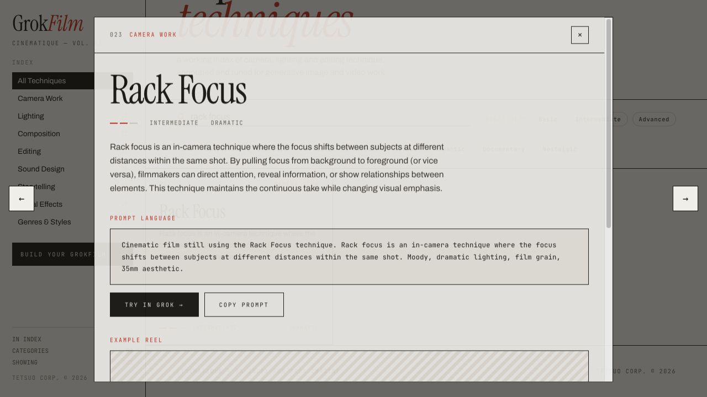
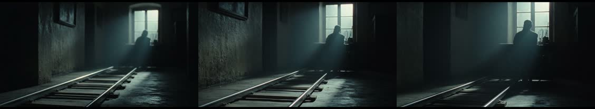
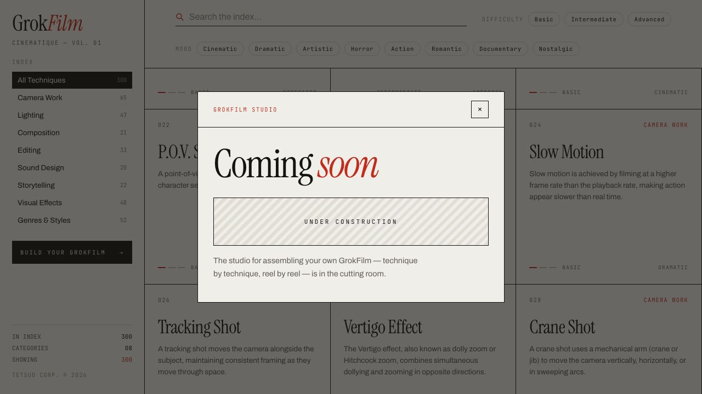

# GrokFilm: Turning a Cinema Technique Index into Testable Shot Prompts

> Source: [GrokFilm's live index](https://grokfilm.app/#index), reviewed November 14, 2026, Melbourne time. This expands our [six-site film-reference workflow](../2026-10-24/2026-10-24-cinematic-reference-to-camera-prompts-en.md) with a catalogue count, an example-reel inspection, and a prompt rewrite.

Suppose the audience needs to notice a key, then discover a person in the doorway. The camera can stay put while focus moves between them. That is a **rack focus**. GrokFilm helps you find that term, understand its purpose, and turn it into useful prompt language. It is not an editor that can pull focus on your footage or a standalone generation model.

## 300 Catalogue Entries, Not 300 Verified Reels

The site credits Tetsuo Corp. and AgenC and identifies its example reels as rendered in Grok Imagine. The loaded index exposes category, difficulty, mood, and keyword filters. Searching for `rack focus` returned one entry. The public [data.js](https://grokfilm.app/data.js) yields these counts:

| Category | Entries | Video link configured |
|---|---:|---:|
| Camera Work | 65 | 16 |
| Lighting | 47 | 1 |
| Composition | 21 | 2 |
| Editing | 33 | 3 |
| Sound Design | 20 | 0 |
| Storytelling | 22 | 1 |
| Visual Effects | 40 | 3 |
| Genres & Styles | 52 | 3 |
| **Total** | **300** | **29** |

**Twenty-nine counts records with a `video` field, not clips individually verified to play.** Rack Focus had a definition and prompt, but its reel was marked Coming Soon. Dolly Shot loaded a video. The index also includes overlapping names such as Vertigo Effect and Dolly Zoom, so the total is not a count of distinct physical operations. A Sound Design category does not make the site an audio editor.

## Rewrite What Has to Happen in Time

*Browser capture. The technique describes a change of focus within a shot, but the template opens as a film-still prompt without specifying focus targets or timing.*

The public page's `buildPrompt` joins the technique name, the opening portion of its definition, and a stock look. Genre entries use a separate template. That is a useful starting point, but it does not know your scene or intended framing. Its dramatic lighting, grain, and 35mm language may not belong in an established look. **These words describe an intent; they are not a focus curve or camera setting.** [Public frontend](https://grokfilm.app/)

Here is an original rewrite for the key scene, not submitted to a generator:

> One continuous shot with a locked camera. Start with the key sharp in the lower-left foreground and the person in the doorway soft. Once the key stops swinging, pull focus smoothly to the person's face and hold on their eyes. Keep the framing and lighting unchanged. No cut, push-in, or zoom.

Now the result can be checked: are the right subjects sharp at the start and end? Does the focus move after the action? Does the camera stay fixed? A whole-frame blur or a cut to a close-up fails that brief. A **match cut**, by contrast, is about the relationship between two shots. Plan the outgoing and incoming frames separately, then align their shape or movement in an editor.

## Inspect the Dolly Reel, Including What Should Stay Out of Frame

*Frames from the upstream [Dolly Shot reel](https://grokfilm.app/media/dolly-shot.mp4), about 0, 3, and 6 seconds from left to right. The main video stream is 752 × 416 at 24 fps, 145 frames. Its video and audio decoded end to end. No new video was generated.*

The figure by the window grows in frame as the track and wall details shift relative to the window. That gives a useful visual check for a move through space. It also exposes an easy-to-miss detail: **the track is visible in the shot.** That may suit an instructional example, but it might be the wrong prop for your scene. Describe a smooth move past foreground objects at fixed focal length with no filming equipment visible, then look for relative movement between foreground and background. The sampled frames cannot establish actual lens settings, and the card does not provide a full generation recipe for reproducing the reel.

## The Index, the Generator, and the Edit Are Separate

The public frontend shows that **Copy Prompt** copies text. **Try in Grok** attempts the same copy, then opens `grok.com/imagine` with the prompt in the query string. That handler does not submit a generation job. We did not open Grok to test prompt prefill, account limits, or output quality. A clipboard operation and opening a URL with a prompt are different: the latter sends the query to the destination.

*Observed after clicking Build your GrokFilm. This entry still shows a placeholder, not an editable timeline, grading controls, or an export workflow.*

Use the index to name **one main technique**, rewrite it around the actual scene, and try it in the target model. Keep the reference, subject, and light fixed while changing one focus or movement instruction. Compare several results where possible so a lucky sample does not get mistaken for a better prompt. The index supplies vocabulary; the shot still needs direction and review.

[Catalogue count, screenshot credits, and media checks](imgs/grokfilm-technique-index/SOURCES.md)
