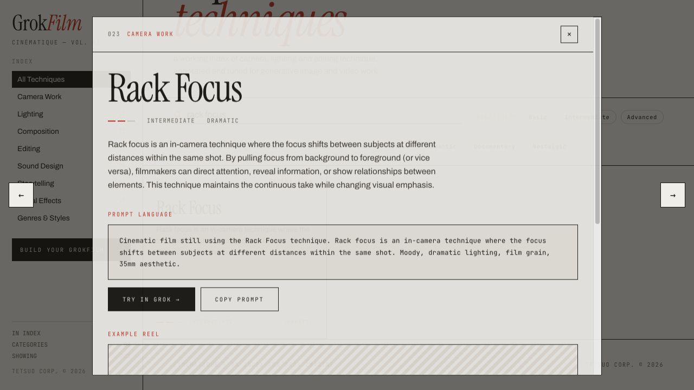
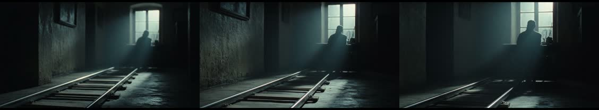
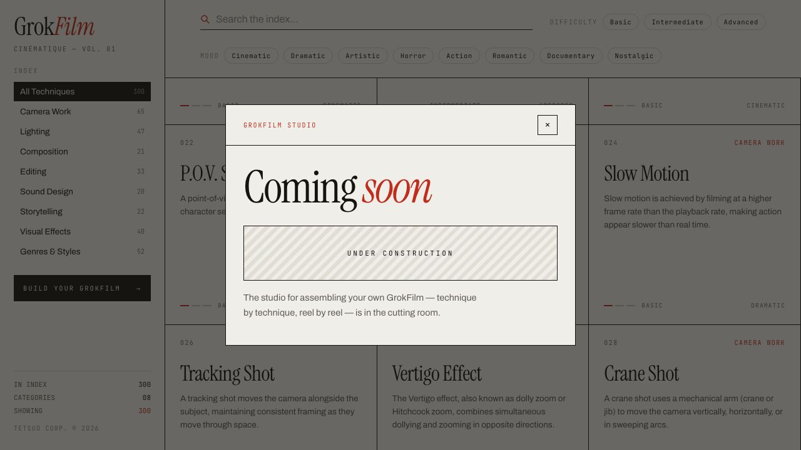

# GrokFilm 实测：300 条电影技法，怎样变成可验收的镜头提示？

> 来源：[GrokFilm 技法索引](https://grokfilm.app/#index)，2026 年 11 月 14 日核查（墨尔本时间）。本文是[六站电影参考工作流](../2026-10-24/2026-10-24-cinematic-reference-to-camera-prompts.md)的单站补充，新增目录盘点、示例抽查与镜头改写练习。

想让观众先看见手上的钥匙，再发现门后有人，不一定要换机位。可以让相机不动，只把焦点从钥匙拉到门后的人。这叫 **Rack Focus（移焦）**。GrokFilm 的用途，就是帮你找到这个词、理解它能解决什么叙事问题，再把它写进生成提示。它不是能在视频里直接拉焦的剪辑台，也不是一个独立的视频生成模型。

## 1. 300 条是目录规模，不是 300 段可播放演示

站点署名 Tetsuo Corp.、标注 Built by AgenC，并将示例归为 Grok Imagine 渲染。浏览器加载后，索引显示 300 条，支持分类、难度、情绪和关键词筛选。实际搜索 `rack focus`，得到一条记录。公开 [data.js](https://grokfilm.app/data.js) 的字段计数如下：

| 分类 | 条目 | 配置视频链接 |
|---|---:|---:|
| 摄影（Camera Work） | 65 | 16 |
| 灯光（Lighting） | 47 | 1 |
| 构图（Composition） | 21 | 2 |
| 剪辑（Editing） | 33 | 3 |
| 声音设计（Sound Design） | 20 | 0 |
| 叙事（Storytelling） | 22 | 1 |
| 视觉效果（Visual Effects） | 40 | 3 |
| 类型与风格（Genres & Styles） | 52 | 3 |
| **合计** | **300** | **29** |

**29 是带 `video` 字段的数量，不是 29 段都已通过播放验收。** Rack Focus 页面有定义和提示词，示例区仍显示 Coming Soon；Dolly Shot 则实际加载了视频。索引也收录了 Vertigo Effect 和 Dolly Zoom 这类互为别名的词，所以 300 条不等于 300 种互不重叠的物理操作。即便分类叫“声音设计”，也不表示这个页面能混音或输出声轨。

## 2. 为什么复制模板后，还要重写镜头动作

*实际浏览器截图。Rack Focus 的说明讲的是同一镜头里的焦点转移，但提示词以电影静帧开头，未指定谁先清楚、何时换焦。*

公开页面的 `buildPrompt` 把条目名称、定义中第一个英文句点前的文字和固定的风格描述拼在一起；类型条目用另一套模板。这个做法适合快速起稿，却没有你的角色、焦点交接时机或目标画幅。默认的戏剧光、颗粒和 35mm 风格也不一定适合已经确定的项目视觉。**它给的是描述词，不是焦距、焦点轨迹或真实相机参数。** [站点前端](https://grokfilm.app/)

下面是针对开头例子的原创改写，未提交生成：

> 一个连续镜头，相机锁定。开始时，画面左下方的钥匙清晰，门内的人虚化。钥匙停止晃动后，焦点平顺地从钥匙拉到门内人的脸，最后停在眼睛上。保持相同构图与灯光，不切镜、不推镜、不变焦。

验收也可以很具体：开头和结尾是否分别看清目标？转焦是否发生在动作之后？相机是否偷跑？如果模型只是把整帧一起模糊，或直接切到脸部近景，就不算这个镜头做对了。反过来，**Match Cut 是两条镜头之间的关系**，通常更适合分别做出尾帧、头帧，再在时间线上对齐形状和运动；词条本身不会替你完成剪辑。

## 3. Dolly 示例值得看，但别把轨道也当成要求

*上游 [Dolly Shot 示例](https://grokfilm.app/media/dolly-shot.mp4)抽帧，左到右约 0、3、6 秒。原视频主轨是 752 × 416、24 fps、145 帧，本次完整解码了视频和音频；不是本文新生成的镜头。*

这三个时刻中，窗边人物变大，近处的轨道和左墙细节相对窗户改变了位置，可用来观察前移和视差。它也提示一个容易忽略的问题：**镜头里出现了轨道。** 这可能适合教学示例，但在讲故事时，地上的轨道往往不是你要的道具。可以改写成“摄影机平稳穿过前景，保持焦距不变，机位和拍摄设备不可见”，再检查前景与背景是否有相对位移。仅靠抽帧不能还原真实镜头参数；站点也没有在该卡片上给出完整生成设置，不能把示例当作照抄模板就能复现的结果。

## 4. GrokFilm 负责找词，生成和剪辑是另外两步

公开前端显示，**Copy Prompt** 复制文本；**Try in Grok** 尝试复制同一文本，再打开 `grok.com/imagine`、把提示词放在查询参数里。这段代码不提交生成任务。此次没有进入 Grok 测试它是否预填、以及生成额度或质量。把自家素材和提示带到外部站点前，也应分清：复制在本地，打开带查询参数的链接会把参数交给目标站点。

*本次实际点击 Build your GrokFilm 的结果。这个入口仍是建设中提示，不是可操作的时间线、调光台或导出工具。*

最省事的用法：**用 GrokFilm 选一个主技法，用自己的场景改写提示，用目标模型出样，再按画面验收。** 对同一个镜头先固定参考图、主体和光线，只换焦点或运镜中的一个要求；有条件就多取几次样，避免把随机差异误判成 Prompt 的功劳。取舍是导演的，生成是模型的，最后一刀仍归剪辑。

[分类计数、截图和视频核查记录](imgs/grokfilm-technique-index/SOURCES.md)
