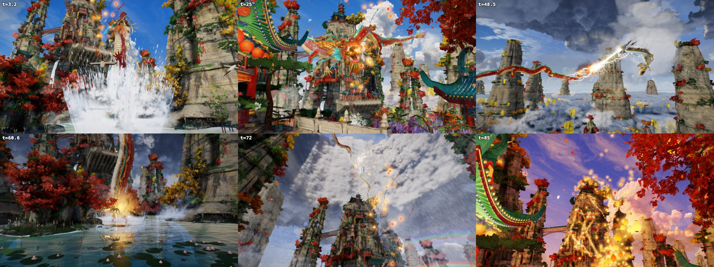

# Dragon of a Thousand Peaks: A 3D Short Film Rendered Live in the Browser

> [中文](2026-11-14-thousand-peaks-procedural-film.md) · [Watch live](https://0xcodez.github.io/thousand-peaks/) · [Upstream source](https://github.com/0xCodez/thousand-peaks) · [Submitted fork](https://github.com/donghaozhang/thousand-peaks) · [v1.0 release](https://github.com/0xCodez/thousand-peaks/releases/tag/v1.0)

A red dragon erupts from a turquoise lake and climbs past a monastery built on a karst pillar. A golden rival emerges from the clouds. They fight down to the lake and back into a storm before the peaks fill with drifting sky lanterns. That's *Dragon of a Thousand Peaks*, a 90-second short told in 20 shots. **The web page isn't playing a movie file. Open the roughly 1.67 MB HTML and the browser builds the valley, dragons, lighting, and sound, then shoots the film from its camera tracks.** The separate MP4 holds the resulting pixels.

## Meshes for the dragons, rules for the valley

“Zero assets” means playback needs no external models, textures, audio, or video. It still needs a renderer. The build inlines **Three.js r180** and 14 source modules in one HTML. At runtime, WebGL2 draws the scene, and the machine still has to generate geometry and bake textures.

Production starts with shared coordinates. The [core module](https://github.com/0xCodez/thousand-peaks/blob/09a8c7e86b31ea7b1446b096de542c7d1994e7b2/src/00_core.js) defines the lake, pillar profiles, and building sites; rocks, halls, bridges, and trees are generated against that layout. Limestone beds, stains, and moss don't need image files. At startup, `K.bake` generates color, normal, and roughness maps on the GPU for the materials to sample.

The [dragon module](https://github.com/0xCodez/thousand-peaks/blob/09a8c7e86b31ea7b1446b096de542c7d1994e7b2/src/50_dragon.js) is effectively a custom deformation system. The head follows an authored path. The code samples backward along the path and resamples by arc length to lay out the spine. It writes that data to a floating-point texture; shaders use it to deform the body and rows of instanced scales. The jaw, breath, and water effects have their own controls. This is procedural mesh animation, not Gaussian splatting, reconstruction from reference images, or a video-generation model running during playback.

## One timeline for the cameras and the sound cues

The edit lives in [`src/02_film.js`](https://github.com/0xCodez/thousand-peaks/blob/09a8c7e86b31ea7b1446b096de542c7d1994e7b2/src/02_film.js), which defines shot cameras, both flight paths, weather curves, and event times. The dive lands at 60.5 seconds. The collision at 69.2 seconds drives a flash, a camera shake, and a sound hit. The [audio module](https://github.com/0xCodez/thousand-peaks/blob/09a8c7e86b31ea7b1446b096de542c7d1994e7b2/src/85_audio.js) synthesizes instruments and effects in Web Workers and mixes them to stereo, without a prerecorded score.

The timeline makes “show me the shot at 25 seconds” a repeatable production request. A debug camera can reframe the scene at that same instant. This is still a set built for a particular film, not a game world built for exploration. When I tried the lake-level debug position from the documentation at 25 seconds, nearby surfaces blocked almost the entire view.

## Mac test: offline frames, but not pixel-identical after every seek

On an Apple M4 Pro with Chrome 157 and Metal, the rebuilt HTML matched the v1.0 release file's SHA-256. With the browser page set to offline, the local file still rendered and accepted the camera override; the probe logged no HTTP(S) requests. I also used the repository tools to synthesize and verify a **90-second, 44.1 kHz stereo WAV** and render seconds 24–26 as a **960×540, 30 fps, 60-frame** MP4 with sound. It decoded without errors in FFmpeg. I did not rerender the full 1080p60 film or test mobile performance.

Two consecutive renders at 25 seconds produced identical PNG bytes. After rendering at 85 seconds and returning to 25, the composition held but the pixels were not identical (about **58.77 dB PSNR**). The render loop caches a sky environment map and rebuilds it as the weather changes, but the test did not isolate the cause of the difference. Seeking works for shot review; pixel-exact regression tests should also control initialization, camera, resolution, and render order. [Reproduction notes and scope](imgs/thousand-peaks-procedural-film/SOURCES.md)

## The production method is the part to borrow

The creator credits a director session and parallel Claude Code teams, and cites [Crimson Loong](https://github.com/ChetasLua/crimson-loong) as inspiration for the single-HTML format. The most useful detail in the [production brief](https://github.com/0xCodez/thousand-peaks/blob/09a8c7e86b31ea7b1446b096de542c7d1994e7b2/docs/GUIDE.md) is **approving one shared frame before building the whole film**. Different teams handled rock, architecture, water, dragons, or sound, but worked from the same world coordinates and event times. Lighting, detail density, and the silhouette of the roof could all be reviewed in the same picture.

To try the approach, start with one five-to-ten-second shot. Give the terrain and character shared coordinates, time one action precisely, and ask the agent for a frame at a fixed timestamp and an excerpt with sound. That makes sense when you expect to reframe, retime, or shoot again on the same set. For simply watching the short, the [release MP4](https://github.com/0xCodez/thousand-peaks/releases/tag/v1.0) is easier; open the HTML or change the shot table to see how the sequence is put together.
