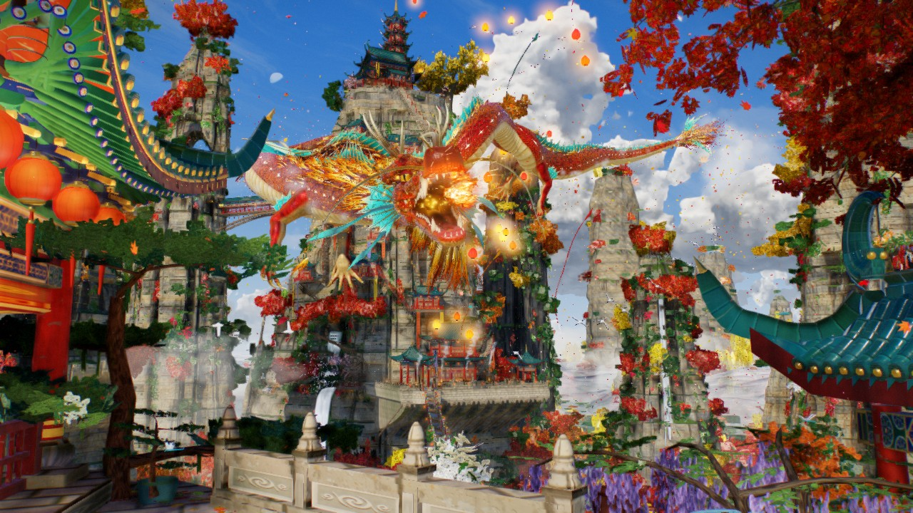
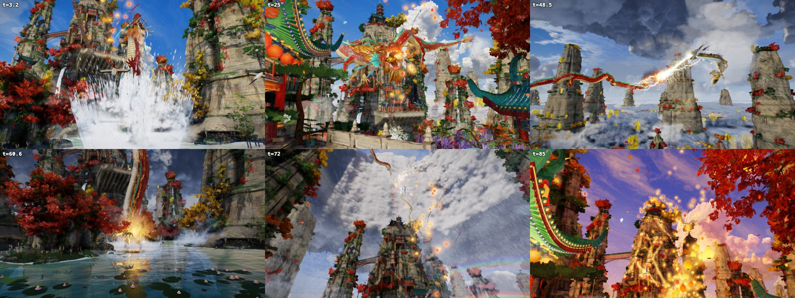

# 千峰之龙：一部不用预录视频、由浏览器现场渲染的 3D 短片

> [English](2026-11-14-thousand-peaks-procedural-film-en.md) · [在线观看](https://0xcodez.github.io/thousand-peaks/) · [上游源码](https://github.com/0xCodez/thousand-peaks) · [所读 fork](https://github.com/donghaozhang/thousand-peaks) · [v1.0 发行版](https://github.com/0xCodez/thousand-peaks/releases/tag/v1.0)

一条红龙冲出碧湖，绕着建在岩柱上的寺院飞升。金龙从云里出现，两条龙打到湖里，再冲进雷暴，最后留下一山升起的天灯。这是《千峰之龙》，一部 90 秒、20 个镜头的短片。**网页不是播放器：打开那份约 1.67 MB 的 HTML，浏览器自己造出山谷、龙、灯光和声音，再按镜头表拍一遍。** MP4 是另一种交付，放进去的是这些镜头渲染后的像素。

## 龙是 3D 网格，山谷靠规则搭出来

“零素材”在这里指播放不需要外置模型、贴图、音频或视频文件，不是没用引擎。构建脚本把 **Three.js r180** 和 14 份源码内联进同一份 HTML；播放需要 WebGL2，程序仍然要在本机生成几何、烘焙贴图并画每一帧。

制作有一个共享的坐标系。[核心模块](https://github.com/0xCodez/thousand-peaks/blob/09a8c7e86b31ea7b1446b096de542c7d1994e7b2/src/00_core.js)定义湖面、岩柱轮廓和建筑落点，山石、楼阁、吊桥和树据此生成。岩石表面的层理、污迹和青苔也不靠照片贴图：`K.bake` 在启动时用 GPU 烘焙颜色、法线和粗糙度贴图，之后由材质采样。

[龙的实现](https://github.com/0xCodez/thousand-peaks/blob/09a8c7e86b31ea7b1446b096de542c7d1994e7b2/src/50_dragon.js)更像给特效镜头手写了一套变形系统：头沿预设路线飞，代码向后采样并按弧长重排成脊柱，把脊柱数据写入浮点纹理，着色器据此变形躯干和成排实例化的鳞片。下颚、吐息和入水效果另有控制。这是程序生成的网格动画，不是高斯泼溅、上传参考图重建 3D，也没有在播放时调用视频生成模型。

## 时间轴既指挥镜头，也给声音打点

剪辑写在 [`src/02_film.js`](https://github.com/0xCodez/thousand-peaks/blob/09a8c7e86b31ea7b1446b096de542c7d1994e7b2/src/02_film.js)：它给出相机位置和朝向、两条龙的路线、天气变化和事件时间。比如 60.5 秒是入水点；69.2 秒的碰撞对应闪光、镜头震动和声音重击。[音频模块](https://github.com/0xCodez/thousand-peaks/blob/09a8c7e86b31ea7b1446b096de542c7d1994e7b2/src/85_audio.js)用 Web Workers 合成乐器和音效，再混成一条立体声轨，不靠预录配乐。

时间轴让「去第 25 秒看这一镜」成为可重复的制作动作。打开调试机位，还能在同一秒换个位置看场景。不过这是为了特定镜头搭的片场，不是供观众自由探索的游戏；机位移到几何内部就可能被遮挡。举例说，项目文档给的湖面调试机位，在我本地第 25 秒的画面几乎被近处表面挡满。

## Mac 实测：能离线抽帧，任意跳帧不等于像素完全一致

我在 Apple M4 Pro、Chrome 157 和 Metal 上重建了 HTML，SHA-256 与 v1.0 发行文件一致。将浏览器页面设为离线后，从本地文件仍可渲染并换机位，探针没记录到 HTTP(S) 请求。另用仓库脚本合成并核对了 **90 秒、44.1 kHz 的立体声 WAV**，把 24–26 秒渲染成一段 **960×540、30 fps、60 帧**的带声 MP4，FFmpeg 解码无报错。没有重渲整部 1080p60，也没测移动端性能。

第 25 秒连续渲染两次，PNG 字节相同。跳到 85 秒再返回 25 秒，构图仍对得上，但像素并非完全一样（PSNR 约 **58.77 dB**）。渲染循环确实会缓存并按天气分档重建天空环境贴图，但本次没有隔离出差异的具体来源。对抽帧审片来说已经很好用；若要做逐像素回归，仍应锁定初始状态、相机、分辨率和渲染顺序。[复现命令与测试边界](imgs/thousand-peaks-procedural-film/SOURCES.md)

## 最值得复用的是制作方法

作者说，影片由一个导演会话协调多组 Claude Code Agent，参考 [Crimson Loong](https://github.com/ChetasLua/crimson-loong) 的单 HTML 思路。[保留的制作简报](https://github.com/0xCodez/thousand-peaks/blob/09a8c7e86b31ea7b1446b096de542c7d1994e7b2/docs/GUIDE.md)里最有用的不是 Agent 数量，而是**先验收同一张画面，再扩展到全片**。各组分管山石、建筑、水、龙或音效，但共用地形坐标和时间事件，不能各自改山峰、桥头和入水点。画面哪里不够亮、景物哪里太稀、屋檐有没有层次，也能在同一张图上指出来。

想借鉴的话，可以先做一个 5–10 秒镜头：让地形和角色共享坐标，设定一个动作的准确时间，要求 Agent 交固定时间的画面和一段带声导出。这个做法适合需要换机位、反复改节拍、保留一套可重拍场景的项目。只想看片，用 [发行版 MP4](https://github.com/0xCodez/thousand-peaks/releases/tag/v1.0) 更省事；想知道镜头怎么搭起来，就打开 HTML 或去改那个镜头的时间表。
