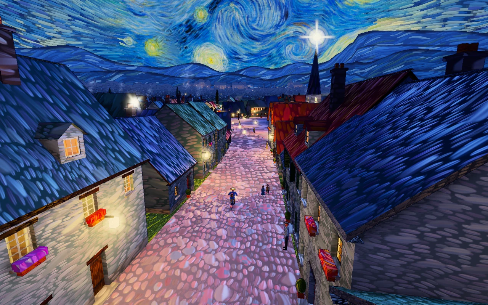
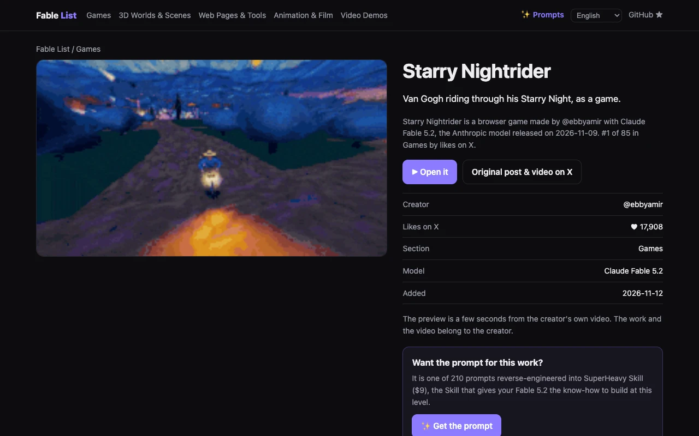

# Awesome Fable 5.2: Which of 298 Examples Can You Play or Rebuild?

> [中文](2026-11-16-awesome-fable-52-works-audit.md) · [GitHub](https://github.com/fengyiqicoder/awesome-fable-5.2) · [Web directory](https://fablelist.000ooo.ooo/) · Reviewed November 16, 2026 (Melbourne)

After seeing a clip of an AI-built game on X, I want to know three things: **Can I play it? Can I inspect the source? Is that the prompt the creator used, or someone else's reconstruction?** Awesome Fable 5.2 gives readers a way back to the work itself. It is a community directory, not a model, engine, or Anthropic evaluation. Anthropic released [Claude Fable 5.2](https://www.anthropic.com/claude-fable-and-mythos-5-2) on November 9; the [submission rules](https://github.com/fengyiqicoder/awesome-fable-5.2/blob/4e1fca34ceb8c146cf1cf46fff8926001c8f3952/CONTRIBUTING.md) rely on public creator attribution, not model logs audited for each work.

## 172 work links do not make 172 playable games

Counting the pinned [`data/works.json`](https://github.com/fengyiqicoder/awesome-fable-5.2/blob/4e1fca34ceb8c146cf1cf46fff8926001c8f3952/data/works.json) yielded **298 records and 195 distinct creator handles** after case normalization. I counted records rather than cards: featured works reappear in the category lists.

| Directory category | Records | What to look for |
|---|---:|---|
| Games | 85 | Controls, feedback, and the play loop |
| 3D worlds and scenes | 38 | Real-time space, cameras, and materials |
| Web pages and tools | 36 | A working feature or interaction prototype |
| Animation and film (listed with source) | 13 | Project files, scenes, or the build procedure |
| Video only | 126 | Clips for discovery, without a separate work link in the record |

The first four categories contain 172 work URLs, including **26 Claude Artifacts and 17 GitHub links**. “Live work” means the directory provides a work or source destination. A page responding, drawing a scene, accepting input, and building from source are separate checks. There is also a preview exception: **297 records point to GIFs in the Git tree; one points to a remote still JPEG**. A path check does not verify that every preview plays.

## Three destinations, three kinds of evidence

**A live build: [Starry Nightrider](https://starrynightrider.com/).** Van Gogh's *The Starry Night* becomes an explorable village. Blue brush strokes cover the sky and roofs; warm windows pick out the streets. My first headless run went nearly black after entry and logged WebGL framebuffer warnings. A fresh tab with the viewport set before loading rendered the scene and let me pedal down the street with `W`. The screenshot above comes from that run, not the directory's GIF. It verifies basic interaction under one desktop setup, not universal compatibility.

**A rebuildable project: [Crimson Loong](https://github.com/ChetasLua/crimson-loong).** Running `python3 tools/build.py` in the creator's repository bundled Three.js and 18 modules into one HTML file, byte-for-byte identical to the checked-in `index.html`. Chrome opened the local build in offline mode and rendered frames at 15 and 50 seconds. That reproduces the **existing code's build and frames**, not the process of generating the same project from a prompt. The film also inspired [Dragon of a Thousand Peaks](../2026-11-14/2026-11-14-thousand-peaks-procedural-film-en.md), covered earlier; they are separate productions.

**A video-only record: [a 3D film about Zeno's paradox](https://x.com/anxuanng/status/2120088745139638375).** The listing has a post and video metadata, but no separate work or source URL. Look there for ideas about visualizing an abstract concept. The entry doesn't give you an editable project or establish how many rounds or hours the creator spent.

## “Get the prompt” may mean reconstruction

The [Starry Nightrider directory entry](https://fablelist.000ooo.ooo/w/starry-nightrider/) separates the live work, original post, and prompt. The curator explicitly describes its prompt as reconstructed. The button opened a preview and purchase page for [SuperHeavy Skill](https://fablelist.000ooo.ooo/prompts/?w=starry-nightrider), listed at **$9** when checked. Other entries mark creator-published prompts and link directly to the posts. **The free directory, a creator's original prompt, and the curator's paid reconstruction** are different things. I did not buy the pack or verify its contents or reproduction claims. The directory's CC0 label is not blanket permission to redistribute linked works, videos, or textures.

I would pick the category closest to the work I need to make, try an interactive example, and find a second example with source. Then record the implementation to borrow and the action that proves it works. For code animation, reproduce a frame at a fixed time, change one camera setting, and export again. Social engagement is useful for discovery. Comparing models still takes the same task, tools, and budget, with failed runs counted too. [Data audit and reproduction notes](imgs/awesome-fable-52-works-audit/SOURCES.md)
