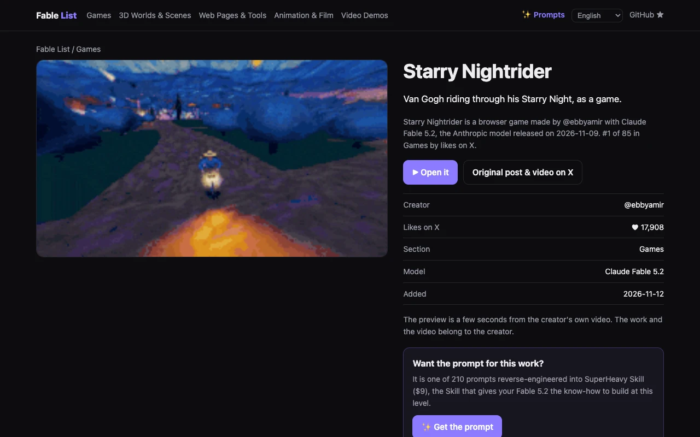

# Awesome Fable 5.2：298 条案例，哪些能试玩，哪些能复跑？

> [English](2026-11-16-awesome-fable-52-works-audit-en.md) · [GitHub](https://github.com/fengyiqicoder/awesome-fable-5.2) · [中文网页目录](https://fablelist.000ooo.ooo/zh/) · 核查：2026 年 11 月 16 日（墨尔本）

在 X 上看完一段 AI 做的游戏，最想问的通常是：**我能打开玩吗？能看到源码吗？那条提示词是作者真的用过，还是后来照着结果写的？** Awesome Fable 5.2 把讨论从一段转发视频带回作品本身。它是社区维护的案例目录，不是模型、引擎，也不是 Anthropic 的评测。Anthropic 于 11 月 9 日发布 [Claude Fable 5.2](https://www.anthropic.com/claude-fable-and-mythos-5-2)；这份目录按[投稿规则](https://github.com/fengyiqicoder/awesome-fable-5.2/blob/4e1fca34ceb8c146cf1cf46fff8926001c8f3952/CONTRIBUTING.md)采信作者公开说明，并没有逐案核验模型调用日志。

## 172 条有作品链接，不是 172 款可玩游戏

我直接统计了固定提交的 [`data/works.json`](https://github.com/fengyiqicoder/awesome-fable-5.2/blob/4e1fca34ceb8c146cf1cf46fff8926001c8f3952/data/works.json)，得到 **298 条记录、195 个去重作者账号**。类别数字不是从 README 首页卡片数推出来的，首页精选和各分类会重复出现。

| 目录分类 | 条目数 | 通常拿来做什么 |
|---|---:|---|
| 游戏 | 85 | 试操作、反馈和玩法循环 |
| 3D 世界与场景 | 38 | 看实时空间、镜头和材质 |
| 网页与工具 | 36 | 看功能或交互原型 |
| 动画与短片（目录标注附源码） | 13 | 追到项目文件，查镜头、场景或构建方式 |
| 只有视频 | 126 | 看片段找方向；记录没有独立作品链接 |

前四类共 172 条有独立链接，其中 **26 条指向 Claude Artifact，17 条指向 GitHub**。因此，“Live work”更适合理解为能点到某个作品或源码入口。链接返回网页、页面真正渲染、功能能操作、源码能构建，都是不同的检查。预览也有例外：**297 条指向 Git 树内的 GIF，1 条是外链静态 JPEG**；文件路径存在不代表我把所有预览都播放了一遍。

## 三个入口，能证明的事不一样

**在线作品：[Starry Nightrider](https://starrynightrider.com/)。** 画作《星夜》成了可以进入的村庄：蓝色笔触覆盖天空和屋顶，暖光把街道勾出来。我的第一次无头浏览器测试进场后近乎黑屏，控制台还报了 WebGL 帧缓冲警告；新开标签页、在加载前固定视口再试，画面成功渲染，按 `W` 后可以沿街前进。上图来自成功的那次，不是榜单 GIF。它验证了一个桌面条件下的基本交互，不代表所有设备兼容。

**可重建项目：[赤龍 Crimson Loong](https://github.com/ChetasLua/crimson-loong)。** 从作者源码运行 `python3 tools/build.py`，能把 Three.js 和 18 个模块打成一份 HTML，结果与仓库的 `index.html` 字节一致。我又让 Chrome 离线打开本地构建文件，抽出了第 15 秒和第 50 秒。这里复现的是**已有源码的构建和画面**，不是把原提示词再喂给 Fable 5.2，指望重新生成相同项目。它也是刚写过的[《千峰之龙》](../2026-11-14/2026-11-14-thousand-peaks-procedural-film.md)参考过的另一部龙片，两者不是同一项目。

**视频条目：[芝诺悖论 3D 短片](https://x.com/anxuanng/status/2120088745139638375)。** 目录给了原帖和视频记录，但没有独立的作品或源码地址。适合带着“如何把抽象概念拍清楚”的问题去看，不能拿这条记录当成可编辑工程，更不能据此核实作者用了几轮提示、跑了多少时间。

## “获取提示词”可能是反推，不是作者原文

[Starry Nightrider 的目录详情](https://fablelist.000ooo.ooo/w/starry-nightrider/)把作品、原帖与提示词分开了。站方明确说该条是从作品反推的，按钮打开的是 [SuperHeavy Skill](https://fablelist.000ooo.ooo/prompts/?w=starry-nightrider) 的预览与购买页，核查时标价 **$9**。目录也会给部分条目标“作者公开的提示词”，直接链接原帖。**免费目录、作者原文、站方反推的付费内容**是三件事。这次没有购买，也没有验证包里的完整内容或复现承诺。仓库的 CC0 标记不等于每个外链作品、视频或贴图都能再分发；看各项目自己的说明。

我的用法是：先按要做的东西选一类，试一个有交互的作品，再找一个有源码的项目，记下可借鉴的实现和验收动作。比如研究代码动画，可以先复现一张固定时间的画面，再试改机位和重新导出。社交热度适合发现案例；要评估模型谁更好，仍得给不同模型相同任务、工具和预算，并把失败的运行也算进去。[数据核对与复现说明](imgs/awesome-fable-52-works-audit/SOURCES.md)
