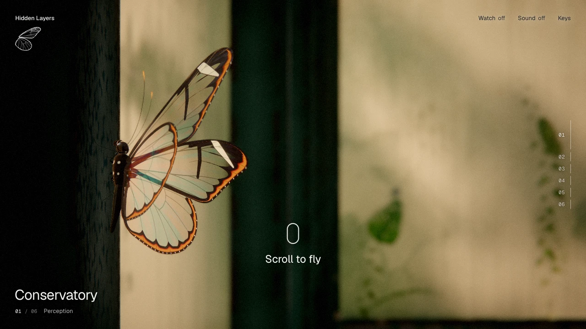
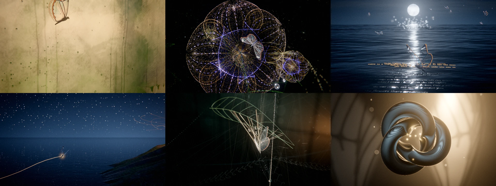
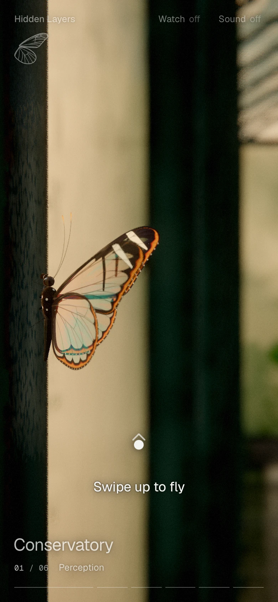

# Fable Butterfly: Six Three.js Worlds That Let You Steer Without Losing the Shot

> [中文](2026-11-16-fable-butterfly-hidden-layers.md) · [Try it live](https://butterfly.kyzo.io/) · [Source](https://github.com/ky-zo/fable-butterfly) · Source snapshot dated November 16, 2026; reviewed November 17 (Melbourne)

*Hidden Layers* doesn't start with a view of the whole world. The camera sits close to fogged glass. A glasswing rests on the window frame. Scroll to fly, move the pointer to guide it sideways. Later come flowers made of particles, open water under moonlight, flight trails around a lamp, fine threads, and a silver chrysalis. **This is neither prerecorded footage nor an open world. The audience controls the pace, the author keeps the framing, and the character gets some freedom inside the shot.**

## One character, six ways to draw it

The Conservatory leads through Latent, Corpus, Descent, and Loom to the chrysalis in Mirror, then back to the glass. The [story notes](https://github.com/ky-zo/fable-butterfly/blob/3f717953b78c36c9d0dc61be04ac55267563c152/docs/ARC.md) frame this as a metaphor for a language model knowing the world through a medium it cannot cross. It isn't a visualization of model internals. The conservatory isn't an asset pack, and the remembered ocean isn't generated by sending data to a model during playback.

The [shared butterfly kit](https://github.com/ky-zo/fable-butterfly/blob/3f717953b78c36c9d0dc61be04ac55267563c152/docs/BUTTERFLY.md) keeps the silhouette, wing veins, and flight pose recognizable. Each world can draw the same structure as a translucent body, particles, or thread instead of inventing a fresh character. Latent updates particles on the GPU; Mirror uses distance-field ray marching. Scene geometry, materials, and sound are generated in code at runtime. Procedural does not mean the deployment is a single HTML file: Vite bundles Three.js, chapter modules, styles, and fonts, and the repository separately includes media for social sharing.

## Scroll for pace, steer for interaction, keep the camera on the story

The [engine](https://github.com/ky-zo/fable-butterfly/blob/3f717953b78c36c9d0dc61be04ac55267563c152/src/core/App.js) organizes each chapter around progress from 0 to 1. The wheel or a vertical swipe moves forward and back. The speed cap is four times the chapter's autoplay pace, and the target can lead by at most 0.9 seconds at that capped speed. Extra input isn't left in a long queue. At a chapter ending, the visitor has to keep scrolling to change scenes rather than skip the ending with one big flick.

In the first chapter, steering toward the shadow, fogged glass, or another butterfly lights a discovery marker on the wing. **None of these discoveries gates progress.** Scrolling alone still gets you to the next chapter. The first chapter's camera follows progress, not the butterfly's steering. That gives the visitor a visible response without throwing away the composition. [Dragon of a Thousand Peaks](../2026-11-14/2026-11-14-thousand-peaks-procedural-film-en.md) looks up a shot by film time; here progress places the camera, while input can change what happens inside the frame.

## What the browser checks showed

I rebuilt the project from its lockfile. The entry HTML and all ten runtime JS/CSS files matched the deployed site byte for byte. The upstream capture tool rendered all six chapters locally. The first chapter's input checks passed **22 assertions with a desktop wheel** and **23 with Chromium touch at 390×844**, covering forward and reverse progress, speed limits, the transition, discoveries, and touch momentum.

The most telling check held progress at about **0.3744** on desktop. Steering moved the butterfly about **16.7 cm** off its path while the reported camera position, rotation, and viewing parameters remained identical. That isn't a performance guarantee for all chapters or devices. I didn't test touch on a physical phone, listen for audio quality, or measure battery use. [Reproduction notes](imgs/fable-butterfly-hidden-layers/SOURCES.md)

## The useful lesson is how the creator reviewed the work

The creator published [42 prompts in chronological order](https://github.com/ky-zo/fable-butterfly/blob/3f717953b78c36c9d0dc61be04ac55267563c152/PROMPTS.md) and described the project as an experiment with Fable 5.2. The record does not show six worlds springing from one sentence. It shows a request to review one world first, the idea of the trapped butterfly, instructions for a third-person camera without shake, and later revisions that restored scrolling, capped speed, and brought back glass wiping. It reveals how the creator directed and revised the work, not a complete run log, verified cost, or attribution of every file to one model.

Borrow the workflow one shot at a time. Give the agent **one character, one scene, and one interaction it can test**. Hold progress fixed and check that the character moves without moving the camera. Then check that a visitor can continue without performing the interaction. Once the first scene passes those checks, other chapters can share the character data, the linear HDR output contract, and the same post-processing. A pretty opening frame is worth having; it doesn't tell you what happens when someone actually touches the controls.
