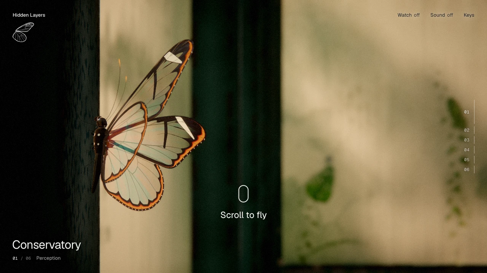
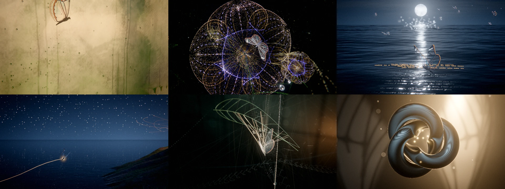
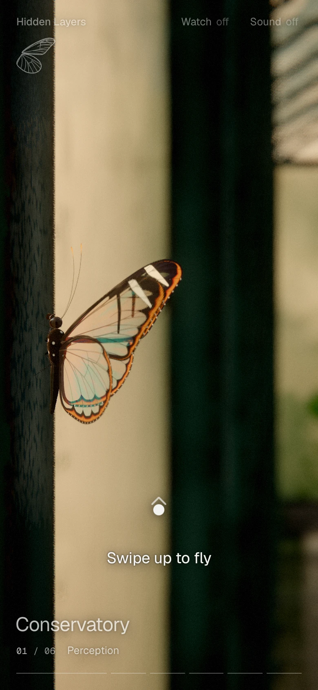

# Fable Butterfly：六个 Three.js 世界，怎样让观众自由飞又不丢镜头？

> [English](2026-11-16-fable-butterfly-hidden-layers-en.md) · [在线体验](https://butterfly.kyzo.io/) · [源码](https://github.com/ky-zo/fable-butterfly) · 2026 年 11 月 16 日公开的代码快照，11 月 17 日核查（墨尔本）

《Hidden Layers》开场不急着给你看整个世界。镜头贴着雾玻璃，一只透翅蝴蝶停在窗框上。滚动才开始飞，移动鼠标可以让它偏向一侧。后面还有粒子构成的花、月光照着的海、绕灯的飞行轨迹、蛛丝般的线和银色的蛹。**它不是一部预录视频，也不是随便往哪飞的开放世界。它把前进速度交给观众，把镜头构图留给作者，再给角色一小块能自由行动的空间。**

## 一个角色，六种画法

六章由温室（Conservatory）起步，经过意义（Latent）、记忆（Corpus）、学习（Descent）和注意（Loom），到最后一章 Mirror 的蛹，再回到玻璃前。按[叙事文档](https://github.com/ky-zo/fable-butterfly/blob/3f717953b78c36c9d0dc61be04ac55267563c152/docs/ARC.md)，这是一种关于语言模型如何隔着媒介认识世界的隐喻，不是对模型内部的真实可视化。温室不是关卡素材包，海上的“记忆”也不是给浏览器输入数据后现场生成的场景。

角色统一靠的是[共用蝴蝶模块](https://github.com/ky-zo/fable-butterfly/blob/3f717953b78c36c9d0dc61be04ac55267563c152/docs/BUTTERFLY.md)：同一套翅膀轮廓、翅脉和拍翅姿态，可以渲成有透光翅膜的立体角色，也能变成粒子或丝线。这样改变的是画法，不是每章重新捏一个主角。Latent 用 GPU 更新粒子，Mirror 有基于距离场的光线步进；场景几何、材质和音效在运行时由代码生成。这里的“程序化”不等于部署只有一份 HTML：项目用 Vite 和 Three.js，构建后有分章 JS、样式和字体资源，仓库也单独放了社交分享图与视频。

## 滚动管节奏，转向管互动，镜头管叙事

[引擎](https://github.com/ky-zo/fable-butterfly/blob/3f717953b78c36c9d0dc61be04ac55267563c152/src/core/App.js)用每章 0–1 的进度来组织旅程。滚轮或纵向滑动往前、往后推进。速度上限是该章自动播放节奏的 4 倍，最多只预接 0.9 秒的全速路程；多余的输入不会积成一长串待播动作。到章末还得继续滚动才换场，不会因为一次猛划就跳过结尾。

第一章又加了一层：观众能把蝴蝶引向影子、雾玻璃或另一只蝴蝶，点亮翅膀上的小标记，但这些都**不是通关门槛**。只滚动也能走到下一章。第一章的相机跟随进度，而非跟随蝴蝶的转向，所以可以做出局部反馈，又不把构好的镜头甩出画面。相比[《千峰之龙》](../2026-11-14/2026-11-14-thousand-peaks-procedural-film.md)用影片时间查镜头，这里多了一个明确的分工：进度决定镜头，观众输入可以改变镜头内发生的事。

## 实测：画面能跑，方向和机位确实分开

我用锁定依赖构建了仓库。入口 HTML 和 10 个运行用的 JS/CSS 文件与线上逐字节一致；六章也都用仓库自带的抽帧工具在本地渲染。第一章的原生输入脚本在桌面滚轮下 **22 项通过**，在 390×844 的 Chromium 触摸模拟下 **23 项通过**，包括正反滚动、速度限制、章末推进、三处发现和触摸惯性。

最能说明设计目的的是固定进度的检查。在桌面样本里，进度停在约 **0.3744** 时，转向让蝴蝶离开预设航线约 **16.7 cm**，脚本读取的相机位置、旋转和视角参数仍完全相同。这不是对所有章节和设备的性能承诺；也没有用真机验证触摸、听感或耗电。[复现记录](imgs/fable-butterfly-hidden-layers/SOURCES.md)

## 真正值得借鉴的是怎么给 Agent 验收

作者公开了 [42 条按时间排序的提示词](https://github.com/ky-zo/fable-butterfly/blob/3f717953b78c36c9d0dc61be04ac55267563c152/PROMPTS.md)，并把项目描述为对 Fable 5.2 的尝试。记录并不是一句话就出六个世界：先要求做一个世界验收，再加上困在温室里的蝴蝶，明确第三人称与镜头不抖，后来又把主交互改回滚动、设限速，补回擦玻璃。它能证明作者怎样提要求和返工，不是完整执行日志，也不能拿来推算成本或证明每一段代码由同一个模型写成。

要复用这套方法，先做**一个主角、一个场景、一个可测试的互动**。例如在固定进度时，让主角能偏航但镜头不动；再验证不互动也能进入下一段。等第一个场景的机位、材质和交互都通过，再让各章复用角色数据、线性 HDR 渲染输出和统一后期。别只验收一张漂亮的首页，记得验收观众实际会做的那一下。
