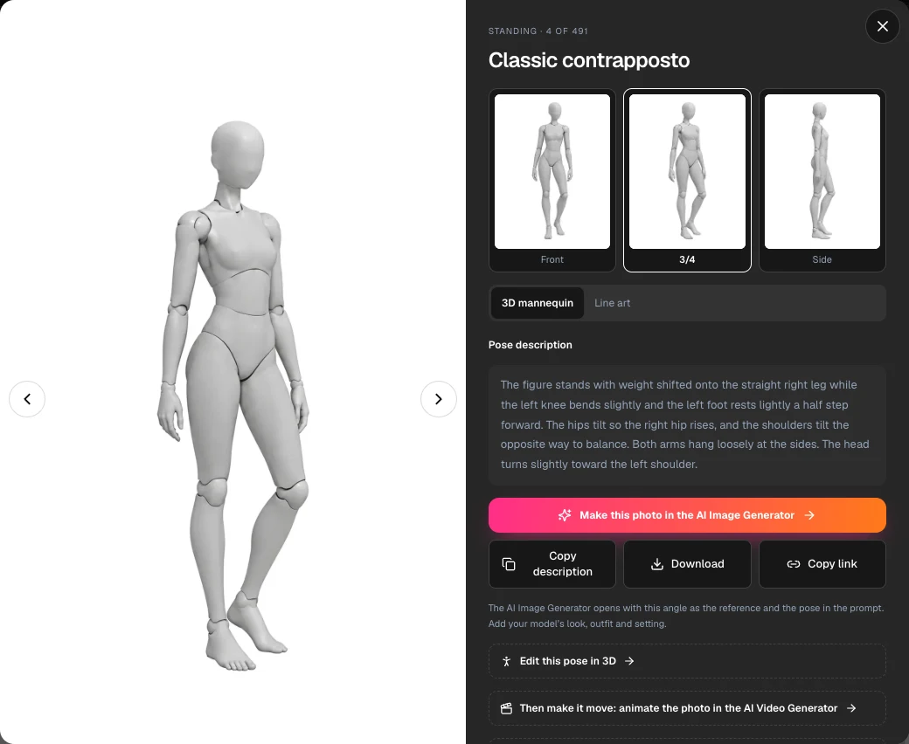
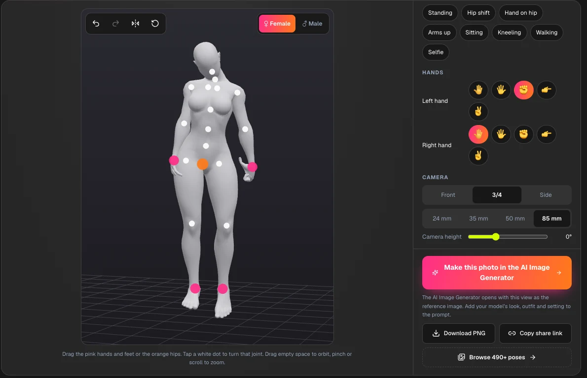

# WaveSpeed AI Pose Gallery: Pick a Pose, Reframe It, Then Generate

> [中文](2026-11-16-wavespeed-ai-pose-gallery.md) · [Official gallery](https://wavespeed.ai/free-tools/ai-pose-gallery) · Reviewed November 16, 2026 (Melbourne)

“Put the weight on the right leg, bend the left knee, and tilt the shoulders against the hips.” That describes a stance, but not whether it will read on camera. A front view makes the shoulder and hip lines easier to compare. A side view shows how far forward the foot is, but the nearer hand can hide the farther one. WaveSpeed's [AI Pose Gallery](https://wavespeed.ai/free-tools/ai-pose-gallery) separates **choosing a pose, choosing a view, and sending it to an image model**. A separate 3D editor lets you change the pose before you send it.

This is WaveSpeed's own service, not the [Chinese edition of the Japanese reference gallery](../2026-10-28/2026-10-28-ai-pose-gallery-zh-reference-audit-en.md) covered earlier. Both offer multi-angle downloads. The difference worth looking at here is how the reference reaches the generator and which presets can be edited.

## 491 poses, not 2,946 different actions

The page showed **491 poses and 2,946 images** when checked. Each pose is presented from three angles (front, three-quarter, side), in two styles (grey mannequin and line art). Categories and search cover standing, fashion, seated poses, sports, dance, and two-person references. Three still views are not an animation. “3D mannequin” names the rendered style; it isn't a 3D model download.

In a signed-out desktop browser, I searched for `contrapposto` and opened the [classic weight-shift stance](https://wavespeed.ai/free-tools/ai-pose-gallery?pose=standing-contrapposto&view=three-quarter). All six combinations decoded. The download button saved the side line art as a **900×1200 WebP**, while the detail preview loaded a **1200×1600** CDN version. This was one sampled pose, not an audit of the whole gallery.

The mannequin helps with volume, balance, and occlusion. The line art is useful for markup or as a regular image reference where the model accepts one. Neither is an OpenPose skeleton or a depth map. For a pipeline that expects a specific control map, check the target model or use a tool that exports the right format. [PoseMy.Art's feature page](https://posemy.art/features/) explicitly lists OpenPose, Depth, Canny, and Normals.

## The same card can start a generation or a new composition

**Send the reference directly.** The gallery link to [AI Image Generator](https://wavespeed.ai/image-generator) carried the selected image URL and a prefilled prompt, and the destination loaded the reference. Switching the angle or style changed the supplied image. The default text adds a smartphone aesthetic and natural lighting to the pose description. Rewrite those style cues if you want a studio portrait, a film still, or an illustration. The handoff is an image and text, not a command that locks joints. I did not run a model or measure pose adherence.

**Change the mannequin or camera first.** The separate [AI Pose Generator](https://wavespeed.ai/free-tools/ai-pose-generator) loaded this preset as an editable mannequin with a reference overlay. I entered from the three-quarter gallery view, but the editor opened with Front selected. Loading a pose does not necessarily load the gallery camera. I set the editor to three-quarter, 85 mm, and a left fist, then exported a **900×1200 PNG**. Opening the editing-state link in a fresh tab highlighted Front again, but the two PNG downloads were byte-identical. Hand over the exported frame and the link; don't rely on the highlighted camera button alone.

According to the editor FAQ, most single-person poses have an editable starting point, while two-person poses open as references only. Export renders the current view; it doesn't reconstruct the original mesh from the gallery image. For turns, walks, or dances, use the still gallery for a key pose or opening frame. If timing and rhythm matter, look for a separate clip, such as those in [AI Motion Gallery](https://wavespeed.ai/free-tools/ai-motion-gallery), and test how well the video model follows it.

## Keep the reference before spending credits

Start with one full-body shot. Use the mannequin to settle balance and camera placement, add a separate character reference if needed, and specify wardrobe, setting, and lighting in writing. Then check the output in this order: are the feet planted, did left and right swap, and do the shoulders and hips still tilt as intended? Judge the face and finish after that. If the reference hides the important gesture, try a different view before retrying the same prompt.

The [gallery FAQ](https://wavespeed.ai/free-tools/ai-pose-gallery) says browsing, copying descriptions, and downloading do not require an account; image generation uses credits. WaveSpeed says the gallery images can serve as personal or commercial references, but asks users not to resell them as a standalone pose pack. This review illustrates the interface without mirroring the library or making claims about rights to generated outputs. [Verification notes](imgs/wavespeed-ai-pose-gallery/SOURCES.md)
