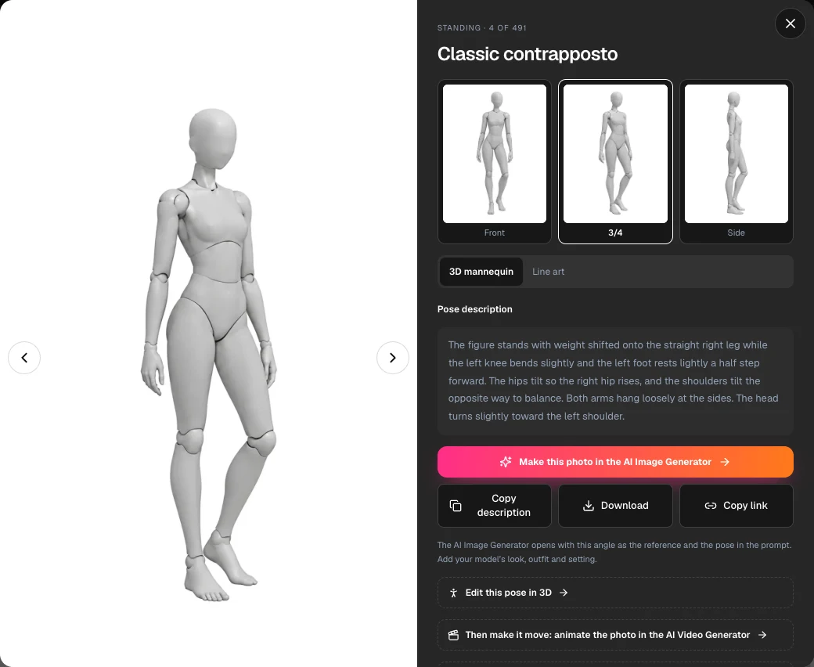
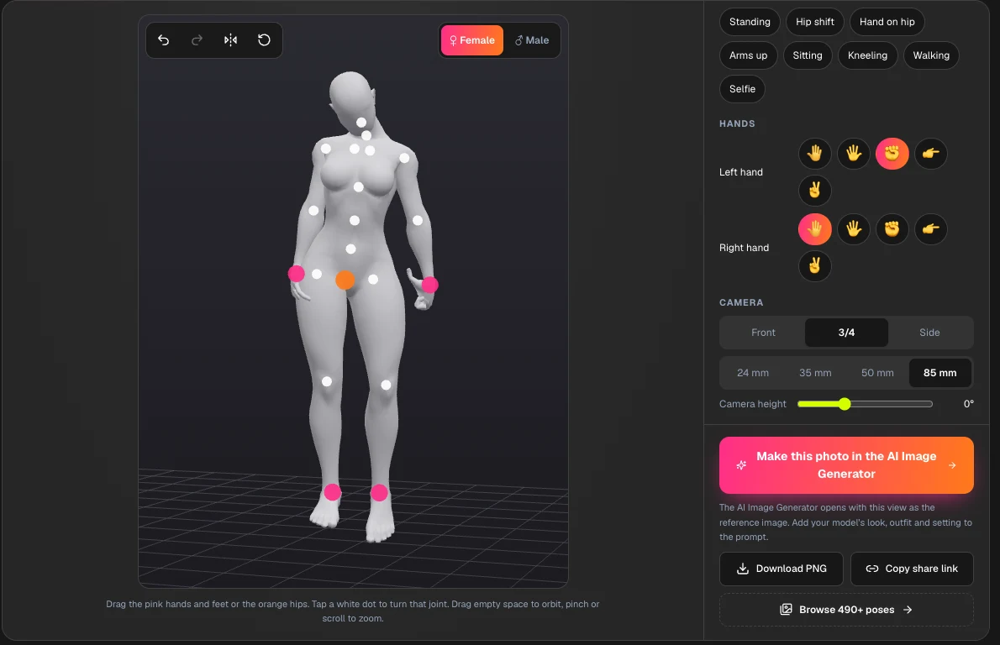

# WaveSpeed AI Pose Gallery：从找姿势，到摆好机位再生图

> [English](2026-11-16-wavespeed-ai-pose-gallery-en.md) · [原站](https://wavespeed.ai/free-tools/ai-pose-gallery) · 核查日期：2026 年 11 月 16 日（墨尔本）

“人物重心放在右腿，左膝微弯，肩线和胯线向相反方向倾斜。”这句话描述的是一个动作，却没决定镜头里能不能看清动作。正面容易看两个膝盖和肩胯的关系，侧面更容易看出前后脚和身体前倾，但近侧的手也可能挡住远侧的手。WaveSpeed 的 [AI Pose Gallery](https://wavespeed.ai/free-tools/ai-pose-gallery) 把**挑动作、选视角、交给生成器**拆成了三步。需要改动作时，还能从图库跳到独立的 3D 编辑器。

这是 WaveSpeed 自己的服务，不是之前介绍的[日文素材库的中文版本](../2026-10-28/2026-10-28-ai-pose-gallery-zh-reference-audit.md)。两者都能下载多角度参考，但这里值得看的是参考图如何接到生图器，以及哪些预设能继续编辑。

## 491 个姿势，不是 2,946 个动作

核查时页面显示 **491 个姿势、2,946 张图**。数量关系是每个姿势三种视角（正面、3/4、侧面），各有灰色人偶和线稿两种表现。站姿、时装、椅上坐姿、运动、舞蹈、双人等都能用分类或搜索找。三张视角图不是三帧动画；页面标的“3D mannequin”是渲染图样式，不是这个按钮能下载一个 3D 模型。

我在未登录的桌面浏览器里搜索 `contrapposto`，打开[经典重心偏移站姿](https://wavespeed.ai/free-tools/ai-pose-gallery?pose=standing-contrapposto&view=three-quarter)，逐一切换六种组合，均能解码。用下载按钮拿到了一张 **900×1200 WebP** 的侧面线稿；详情预览加载的是 **1200×1600** 的 CDN 版本，两者不必同尺寸。这里只抽查了一组，没有遍历全库。

灰模适合先看体积、重心和遮挡；线稿适合画稿标注，或在模型支持的情况下当作图像参考。两者都不是 OpenPose 骨架图或深度图。若工作流需要明确的控制图，应先核对目标模型的输入类型，或选用能导出这些格式的工具；[PoseMy.Art 的功能页](https://posemy.art/features/)明确列出了 OpenPose、Depth、Canny 和 Normals。

## 同一张卡片，可以直接生图，也可以重新摆拍

**直接拿参考图去生图。** 从图库打开 [AI Image Generator](https://wavespeed.ai/image-generator) 时，我核对到链接同时传了所选视图的图片 URL 和一段预填提示词，生图页面也实际加载了参考图。切换视角或灰模／线稿，传入图会变。默认文本除了描述动作，还带有手机随拍、自然光之类的风格要求。如果目标是棚拍、电影剧照或插画，应该改写这些风格要求，而不是把整段模板照单全收。这里传的是图和文字，不是强制锁定关节的指令；这次没有调用模型或验证姿势跟随率。

**改关节或机位后，再导出。** 通过“Edit this pose in 3D”进入独立的 [AI Pose Generator](https://wavespeed.ai/free-tools/ai-pose-generator)，抽查的站姿确实加载了可编辑人偶和参考图叠层。图库里选中的是 3/4，编辑器打开时却选了正面，所以别把“载入站姿”当成“载入图库镜头”。我手动改成 3/4、85 mm 和左手握拳，导出了 **900×1200 PNG**。随后在新标签页打开编辑状态链接，按钮又显示正面，但两次下载的 PNG 字节完全一致。交接时最好把最终导出的图和链接都留下，不要只看机位按钮的高亮。

编辑器官方说明称，大多数单人姿势有可调整的起点，双人姿势只以参考图打开；“摆好再导出”是渲染当前画面，不是把图库图片反推成原始网格。若要做转身、走路或舞蹈，静态图库只适合定关键姿势或首帧。带时间和节奏的动作参考要另找，例如 [AI Motion Gallery](https://wavespeed.ai/free-tools/ai-motion-gallery) 的视频片段；实际视频能否跟住仍要测试。

## 先把参考留好，再花额度试一张

最小的创作测试可以从一个全身镜头开始：先用灰模定重心和机位，再加独立的角色参考；服装、场地、光线写进提示词。生成后先验脚有没有踩稳、手脚是否左右互换、肩与胯的方向有没有变，最后再看脸和质感。如果参考本身遮住了关键动作，就先换角度，不要只加提示词重抽。

按[图库 FAQ](https://wavespeed.ai/free-tools/ai-pose-gallery)，浏览、复制描述和下载免费且不需要账户；实际生图用额度。WaveSpeed 表示图库图片可用作个人或商业作品的参考，但不应作为独立素材包倒卖。本文只附实测界面截图，没有镜像原图库，也没有推断生成结果的授权。[核查记录](imgs/wavespeed-ai-pose-gallery/SOURCES.md)
