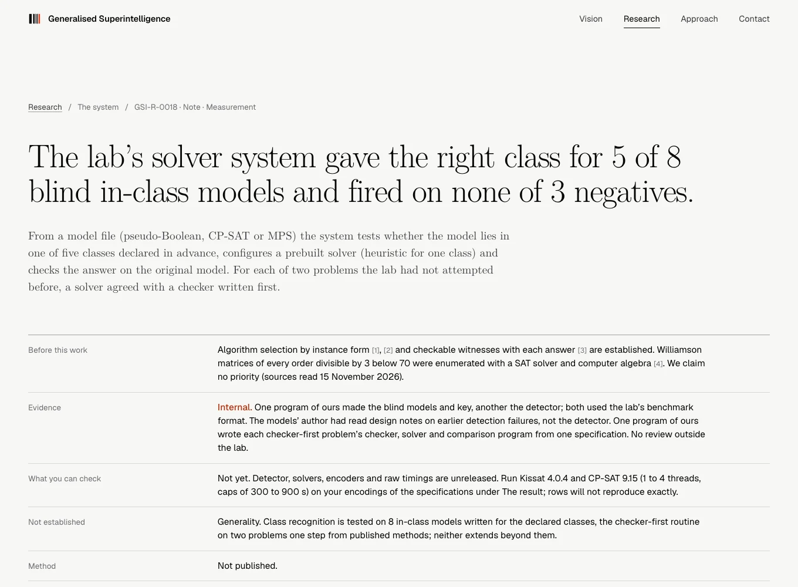

# Generalised Superintelligence: What Can We Verify About Its Discovery System?

> [中文](2026-11-23-generalised-superintelligence-verified-discovery.md) · [Official site](https://generalised.si/) · Reviewed November 23, 2026 (Melbourne)

Choose 145 of 465 points so that differences between chosen points follow a strict distribution. How do you prove no choice works? Trying every combination is the wrong starting point. [Generalised Superintelligence (GSI)](https://generalised.si/) proposes using mathematical structure to shrink the search, running specialized code, and checking the result. **The public material describes a discovery system and its research record, not an established demonstration of general superintelligence.**

## What it adds to an agent workflow

The [approach page](https://generalised.si/approach) assigns language models the job of writing and running experiments. Detected symmetries or algebraic structure inform the representation, pruning, and solver. Separately written verifiers check the output; reusable tools become starting points for later work. The authors acknowledge that their initial FLC engine was hand-built.

My reading is that the proposed gain comes from changing how a problem is searched, not simply asking an agent for more attempts. A coding agent with domain expertise can also organize that workflow. Its advantage depends on the algorithms, checkers, and evaluation, not the agent count. The site schedules an initial research-team preview for late November 2026 and offers research materials and contact channels. I did not request access or test the full system. [Contact](https://generalised.si/contact)

## The system experiment is narrower than the pitch

[GSI-R-0018](https://generalised.si/research/solver-compiler-and-factory) describes detection among five declared problem classes and configuration of prebuilt solvers. It reports correct classification for five of eight in-class models, with no triggers on three negative models. These were small internal tests; the detector, encoders, and solvers are unreleased. The note explicitly says automatic solver generation was not demonstrated.

That distinction matters: recognizing structure, selecting a solver, and inventing an algorithm for an unfamiliar domain need separate evidence.

## A public check I could rerun

I chose the [(465,145,45) difference-set record](https://generalised.si/research/cyclic-difference-set-465), which provides orbit representatives, a checker, and hashes. After inspecting the code, I rebuilt its candidate file and ran the unmodified checker locally:

| Check | Observed result |
|---|---|
| Expand 729 representatives and rebuild candidates | 45,198 list elements and 21,328 candidates; the candidate file matched the published SHA-256 |
| Validate the manifest | All five hashes matched |
| Run the checker | No candidate survived; all 7,812 positive controls were accepted; exit status 0 |

This reproduces a finite computation, not an independent discovery. I used the authors' checker and followed their candidate-generation method. The mathematical reduction still relies on cited theorems; this isn't a formal proof of the entire argument or a review of all GSI results. The page itself states that there has been no outside-lab review. [Original checker](https://generalised.si/files/cyclic-difference-set-465/check.py), [reproduction notes](imgs/generalised-superintelligence-verified-discovery/SOURCES.md)

## Read the qualifications next to the numbers

The [research index](https://generalised.si/research) listed 112 results and 31 papers or notes when checked. It includes constructions, bounds, measurements, table corrections, and computations that are not fully public. Those are not 112 externally confirmed new discoveries.

The [Williamson and good-matrix note](https://generalised.si/research/williamson-good-order-75) also separates timing comparisons. Its roughly 1,100–5,000-fold figures compare sampled completion times against the original authors' SAT stage on the same machine. The headline 47,000-fold figure compares whole runs against hours printed in older literature, with different hardware and timing conventions. I did not reproduce those performance claims. The note also distinguishes checking one valid matrix from establishing that no other one exists: the exhaustive search has no published completeness certificate.

## What to borrow

Start with a deliverable that someone can check: a construction, counterexample, bound, or certificate. Give the solver a checker with a different implementation and known positive and negative controls. Record selection rules, baselines, runtime, and failures. That lets a model help write the experiment without making successful execution stand in for a scientific conclusion. GSI's most useful public pages are the ones that document those qualifications, not just the ambition on its home page.
