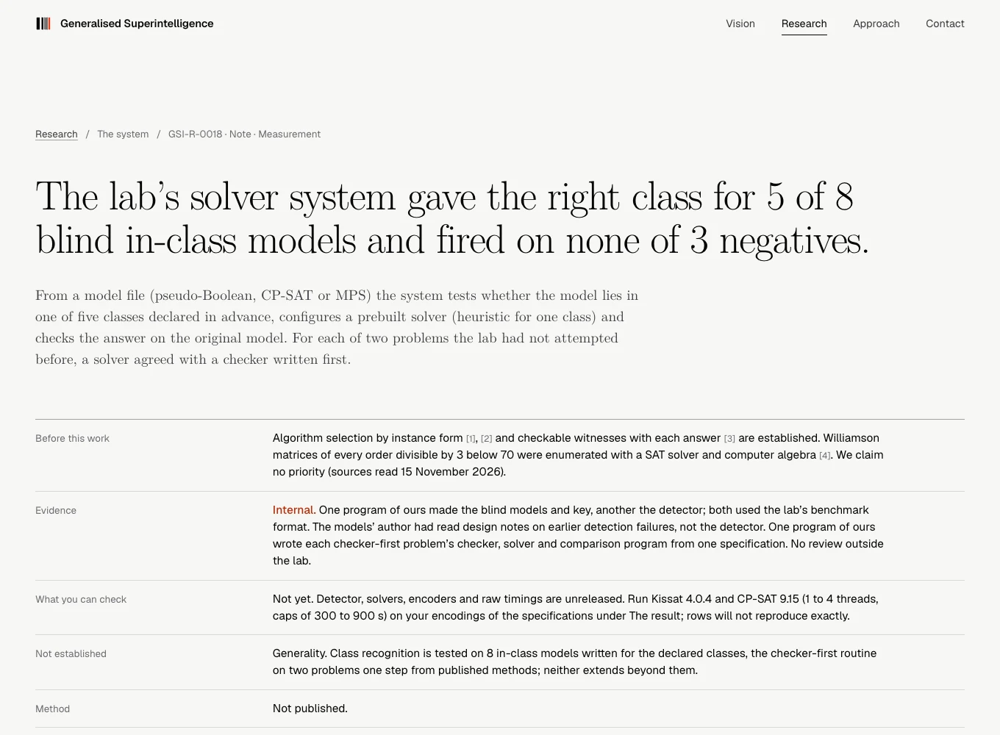

# Generalised Superintelligence：科学发现系统，能独立核到哪一步？

> [English](2026-11-23-generalised-superintelligence-verified-discovery-en.md) · [官网](https://generalised.si/) · 核查日期：2026 年 11 月 23 日（墨尔本）

从 465 个点中选 145 个，要求任意两个所选点的差满足一套严格的分布条件，怎样证明没有一种选法能做到？暴力试遍所有组合不是好办法。[Generalised Superintelligence（GSI）](https://generalised.si/)提出的路线是先利用数学结构排除大块不可能空间，再让专用程序搜索，最后验证结果。**它展示的是一套科学发现系统的方案和研究记录，不是已经证明拥有通用超智能的聊天模型。**

## 它想比普通 Agent 多做什么

按[方法页](https://generalised.si/approach)，语言模型负责写实验、运行工具和推进下一轮；系统先检查对称性、代数关系或可拆分的结构，再选择适合的表示、剪枝和求解方式。结果交给另外编写的验证器，工具则留给后续问题复用。作者也说明最早的 FLC 引擎是手工构建的。

我对这套方案的理解是：Agent 的作用不只是“多试几次答案”，还要改变搜索问题的表达和工具。但普通 coding agent 配合领域专家，也能组织这种流程；区别是否有效，得看专用算法、检查器和实验设计，不能只看 Agent 的数量。方法页把研究团队预览安排在 2026 年 11 月下旬，当前公开入口主要是研究材料与联系渠道；本次没有申请权限或测试完整系统。[联系页](https://generalised.si/contact)

## 宣传中的求解器，详细记录怎么说？

[系统研究记录 GSI-R-0018](https://generalised.si/research/solver-compiler-and-factory)描述了一次更具体、也更有限的测试：检测器针对预先声明的五类问题，识别后配置已有求解器。8 个类内模型中识别对 5 个，3 个类外负例没有触发。样本很小，材料由实验室自己制作，检测器、编码器和求解器尚未公开。记录明确说，这项实验**没有展示自动生成求解器**，不能据此推到任意未知领域。

这不等于系统没有价值，而是读法要换一下：将“识别某类结构”“配置某类求解器”和“为新问题自动发明算法”分成三项验收，分别要证据。

## 我实际复跑了什么

我选了公开材料较完整的[(465,145,45) 差集记录](https://generalised.si/research/cyclic-difference-set-465)。它给出一组轨道代表、检查器和哈希清单。先检查下载的代码，再按文档重建候选文件，最后在本机运行原始检查器，结果如下：

| 本地动作 | 观察结果 |
|---|---|
| 展开 729 个轨道代表并重建候选表 | 45,198 个列表元素，筛得 21,328 个候选；候选文件 SHA-256 与公开值一致 |
| 按清单核对文件 | 五项哈希全部匹配 |
| 运行公开检查器 | 目标条件的幸存候选为 0；7,812 个正向对照全部被接受；退出码为 0 |

这不是我独立发现了该结论。我运行的是作者的检查器，重建脚本也遵循公开的候选生成方法。它提高了读者复核有限计算的可行性，但没有把完整数学论证变成形式化证明。结构约化仍依赖文献定理，页面也注明没有实验室外审阅。我没有复核全部研究或发现过程。[原始检查器](https://generalised.si/files/cyclic-difference-set-465/check.py)、[本次复现步骤](imgs/generalised-superintelligence-verified-discovery/SOURCES.md)

## “112 项结果”和“47,000 倍”都要看限定词

[研究总表](https://generalised.si/research)核查时列出 112 项结果、31 份论文或说明。它混合了构造、界限、测量、表格更正以及尚未完全公开的计算，不能读成 112 项均获外部确认的新发现。

最醒目的提速数字也有不同口径。[Williamson 与 good 矩阵记录](https://generalised.si/research/williamson-good-order-75)中，1,100–5,000 倍针对同机抽样的单实例完成时间，与原作者的 SAT 步骤比较；最高 47,000 倍则来自完整运行与旧文献所报小时数的比较，硬件和时间口径并不相同。搜索程序未公开，我没重测这些性能。同一条记录还区分了“检查一个给出的矩阵确实有效”和“证明不存在别的矩阵”：后者的穷举完整性没有公开证书。很快地检查一个答案，不代表已复现找到答案的过程。

## 值得带走的是检查方式

如果把这种思路用到自己的研究任务，我会先定义能独立验收的产物：一个显式构造、一条反例、一个边界，或一份可检查证书。再给求解器配一个不同实现的检查器和已知正反对照，最后记录问题选择、基线、时间与失败结果。这样既能借助模型写代码，又不必把“代码运行成功”当成“科学结论成立”。GSI 现在最值得读的，也正是那些逐项写出证据和缺口的研究页，而不只是首页的超智能愿景。
