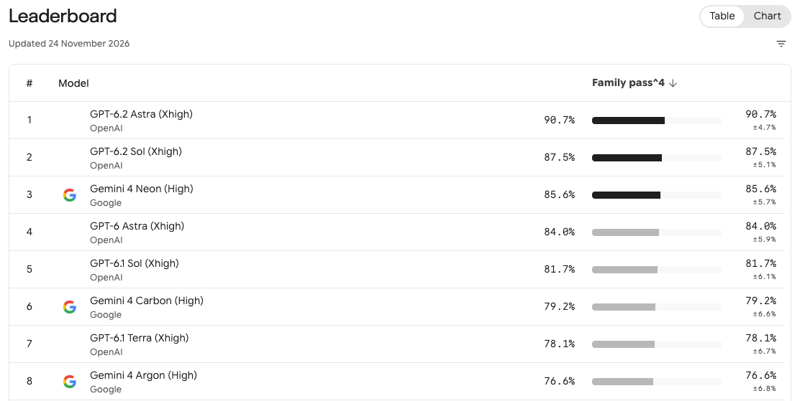

# Humanity’s First Exam: Why Five Correct Answers out of Six Can Score One Third

2026-11-24 · Google DeepMind / Model evaluation · [中文](2026-11-24-humanitys-first-exam.md)

Look at the neon sign below. Reading the slogan is not enough: the task is to identify the colour of the **third letter in each word**, in order. A model can read every word correctly and still give the wrong answer by counting from the wrong end or skipping a word.

The [published answer](https://blog.google/innovation-and-ai/models-and-research/google-deepmind/humanitys-first-exam/) is green, yellow, white, blue, blue. One correct reply makes a convincing demo. It tells you rather less about whether you could trust the model with the next hundred signs. Google DeepMind designed Humanity’s First Exam (HFE) to probe that distinction on elementary tasks.

## One set of answers, three different scores

The [technical report, section 3](https://storage.googleapis.com/deepmind-media/papers/hfe_tech_paper.pdf#page=6), starts with six independent responses per prompt. Suppose five are correct. Draw four responses from that set **without replacement**:

| Question | Result for this hypothetical prompt |
|---|---:|
| Is one randomly chosen response correct? (pass@1) | 5/6, or 83.3% |
| Is at least one of four correct? (pass@4) | 100%: there is only one wrong response to draw |
| Are all four correct? (pass⁴) | 5/15, or 33.3% |

Only five of the fifteen possible groups of four leave out the mistake. The model has not suddenly become a 33% model on its *next* attempt. What changed is the promise you are asking it to keep: deliver four answers without a single error.

The [Kaggle leaderboard](https://www.kaggle.com/benchmarks/deepmind/hfe/leaderboard) goes one step further. Each family contains a seed prompt and three variations that preserve the task logic. **Family pass⁴** estimates the probability that *all 16 responses* are correct when four are drawn for each of the four prompts, then averages over 136 families. Perfect scores on three variants cannot cancel an unreliable fourth. The similarly named **family pass@4** in the paper merely asks whether *at least one* of the 16 succeeds.

## Why the leader has two published scores

When checked on November 27, Kaggle marked the board updated November 24. These are two official evaluations of the same metric, not two versions of one table:

| Model | Kaggle: Family pass⁴ (effort) | Paper, Table 4: Family pass⁴ (effort) |
|---|---:|---:|
| GPT-6.2 Astra | 90.7% (xhigh) | 92.4% (xhigh) |
| GPT-6.2 Sol | 87.5% (xhigh) | 86.9% (xhigh) |
| Gemini 4 Neon | 85.6% (high) | 85.8% (xhigh) |

[Kaggle’s Harbor run](https://www.kaggle.com/benchmarks/deepmind/hfe/leaderboard) covers 16 model configurations; [Table 4](https://storage.googleapis.com/deepmind-media/papers/hfe_tech_paper.pdf) covers 18. Even Neon’s reasoning setting changes between them. Subtracting one column from the other is not a measure of progress. Nor does the board alone establish a decisive lead: the 3.2-point gap between Astra and Sol sits alongside reported 95% intervals of ±4.7 and ±5.1 points respectively.

## A test worth borrowing

HFE contains 544 single-turn text or image-and-text prompts across 20 foundational capabilities. The [public split](https://www.kaggle.com/datasets/deepmind/hfe-public) contains 112 prompts in 28 complete families; 432 prompts are held back. The authors deliberately sought understandable tasks on which models could stumble. A score of 90.7% does **not** mean nine in every hundred customer requests will fail, and it does not measure a system with search, tools or human review.

For an invoice reader, try four versions of one invoice: the original, a slightly rotated scan, a repositioned date and a subtotal printed beside the total. Run each six times. Record whether the system misreads a digit or reads the right number from the wrong field. If it repeatedly copies the subtotal into the total field, you have a specific validation rule to investigate. A screenshot of one successful extraction would never tell you that.
