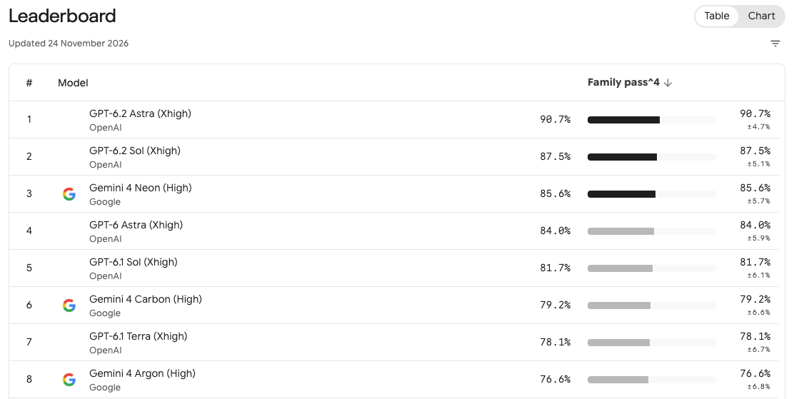

# Humanity’s First Exam：为什么一道简单题，六次答对五次也只得三分之一？

2026-11-24 · Google DeepMind / 模型评测 · [English](2026-11-24-humanitys-first-exam-en.md)

先看这块霓虹招牌。任务不是读出标语，而是按顺序报出每个单词**第三个字母的颜色**。认出单词、数到第三个字母、辨色、按原顺序输出，少做任何一步，答案就错了。

[官方公布的答案](https://blog.google/innovation-and-ai/models-and-research/google-deepmind/humanitys-first-exam/)是绿、黄、白、蓝、蓝。假如模型第一次全答对，你敢让它独立检查下一百张招牌吗？Google DeepMind 推出的 Humanity’s First Exam（HFE）想量的就是这两件事之间的距离：演示一次可以很漂亮，换张图、换个问法，再跑几次，结果还稳不稳？

## 六次答对五次，为什么得分只有三分之一？

[技术报告第 3 节](https://storage.googleapis.com/deepmind-media/papers/hfe_tech_paper.pdf#page=6)把单题和题族分开计分。每道题独立作答六次。假设其中五次对、一次错，从这六份答卷里**不放回地抽四份**：

| 问法 | 这道假设题的结果 |
|---|---:|
| 随机抽一份，答对了吗？（pass@1） | 5/6，约 83.3% |
| 抽四份，至少一份正确吗？（pass@4） | 100%，因为总共只有一份错 |
| 抽四份，四份全对吗？（pass⁴） | 5/15，约 33.3% |

最后一行的分母是从六份里选四份的 15 种组合；只有 5 种避开了那份错卷。这不是说模型下一次只有三成机会答对，而是说**连续交付四份答案，而且一份都不许错**，是另一种要求。

[Kaggle 排行榜](https://www.kaggle.com/benchmarks/deepmind/hfe/leaderboard)还要再过一关：每个题族有一道种子题和三道保留相同逻辑的变体。**Family pass⁴** 问的是四道题各抽四份时，**16 份全对**的概率估计，再对 136 个题族取平均。只要一个变体不稳定，其他三道满分也补不回来。反过来，论文中的 **family pass@4** 只需这 16 份里**至少一份对**；两者不要混读。

## 同一个榜首，为什么有两个数字？

11 月 27 日查看时，Kaggle 榜面标注更新于 11 月 24 日。下面是同一指标的两个官方结果，并非同一批测试：

| 模型 | Kaggle：Family pass⁴（推理档位） | 论文表 4：Family pass⁴（推理档位） |
|---|---:|---:|
| GPT-6.2 Astra | 90.7%（xhigh） | 92.4%（xhigh） |
| GPT-6.2 Sol | 87.5%（xhigh） | 86.9%（xhigh） |
| Gemini 4 Neon | 85.6%（high） | 85.8%（xhigh） |

[Kaggle 的 Harbor 评测](https://www.kaggle.com/benchmarks/deepmind/hfe/leaderboard)覆盖 16 个模型配置；[论文表 4](https://storage.googleapis.com/deepmind-media/papers/hfe_tech_paper.pdf)列出 18 个。连 Neon 的推理档位都不同，不能把两列相减当作模型进步或退步。Kaggle 给 Astra 和 Sol 的 95% 区间分别标为 ±4.7 和 ±5.1 个百分点，也不宜把 3.2 个百分点的名次差直接解释成确定优势。

## 把这种考法带回自己的产品

HFE 共 544 道单轮图文或纯文本题，覆盖 20 项基础能力；公开的是 [112 道题、28 个完整题族](https://www.kaggle.com/datasets/deepmind/hfe-public)，另有 432 道保留。题目在构造时有意寻找模型会犯错、而人容易理解的案例。因此榜首的 90.7% **不是**“真实用户每发一百个请求就会失败九次”，也不是带搜索、工具和人工复核的系统成功率。

更值得借走的是分组方法。比如你做票据识别，可以拿一张发票做四版：正本、轻微旋转、日期位置改变、金额旁多一行小计。每版跑六次，分别记下是读错了数字，还是选错了字段。如果模型能稳定认字，却总把小计填进总额，下一步该修的是字段选择或校验规则。只留一张“识别成功”的截图，你不会知道问题出在哪里。
