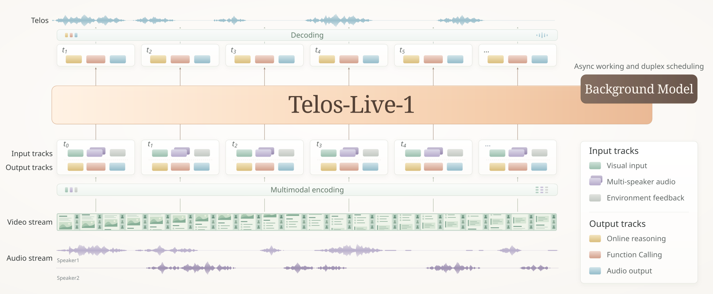
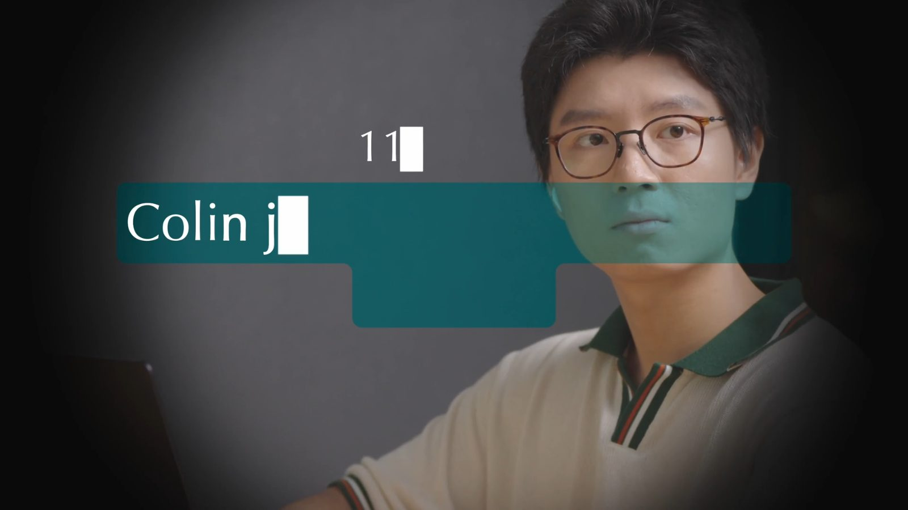
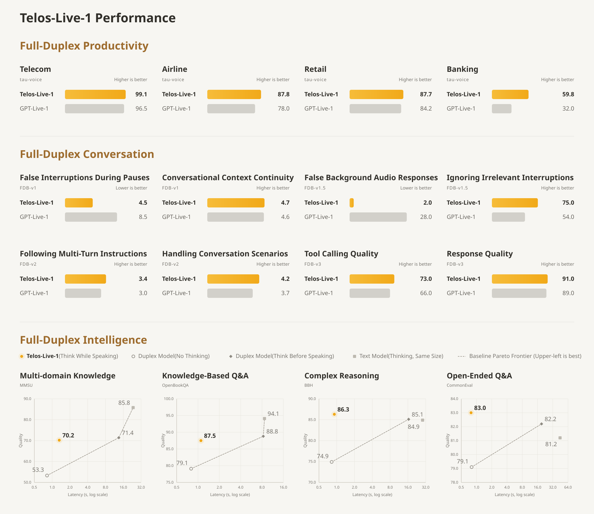

# Telos-Live-1: What Happens When the Agent Works While You Keep Talking?

> An AI can listen to a meeting, look something up, and bring its findings back while the group is still talking. That creates a new failure mode: by the time the answer arrives, the group may have changed the question.

- Released by Telos Lab on November 24, 2026. [Introducing Telos-Live-1](https://teloslab.com/research/introducing-telos-live-1)
- The launch offered preview applications and described public API access as forthcoming. [Request access](https://teloslab.com/contact)
- This review draws on the launch text, architecture and evaluation figures, and descriptions of recorded demos. It does not include hands-on preview access or a benchmark rerun.

## 1. Listening While Talking Is Different From Working in the Background

**Full duplex governs the interaction.** A conventional turn-based system decides that the user is done before formulating its reply. Streaming that reply does not necessarily mean it can still interpret new speech while talking. Telos calls its finer-grained units **micro-turns**: incoming video, multi-speaker audio and text can share a continually advancing sequence with reasoning, tool calls and spoken output. A hesitation is not always the end of a turn, and a colleague talking nearby is not necessarily addressing the agent. Knowing when to stay quiet is part of the job.

**Foreground and background scheduling governs how long work takes.** The foreground model stays with the conversation, while a background model can take on longer jobs such as search, coding or computer use. Telos describes a duplex protocol that brings background feedback into the live conversation. A prompt acknowledgment and a completed search are different events and should be timed separately.

*Telos's architecture figure explains the division of work. It is not a public API or a message-level protocol specification.*

Telos says it preserves pauses, overlapping speech and interruptions in real interaction data, and uses human-involved workflows to teach delegation. It also attributes an approximately **tenfold reduction in serving cost** versus previous full-duplex systems to continuous streaming infrastructure, shared context, caching and on-demand scheduling. The launch does not supply enough baseline or cost detail to translate that claim into an API price.

## 2. The Meeting Demo Has a Concrete Deliverable

In the recorded meeting, a team realizes that its audio-label categories overlap but that its spreadsheet allows only one label per clip. According to Telos, the agent checks public guidelines and internal examples while the discussion continues, then proposes a pilot on ten clips. The useful output is a small test that respects the spreadsheet constraint, not just a summary of the disagreement.

*Official demo poster. [Watch the recorded meeting demo](https://teloslab.com/cms-media/6c77ed5b924467127ab3.mp4).*

In the coding practice demo, a candidate writes a Python palindrome checker on a shared screen. The agent follows the revisions and asks about capitalization and extra spaces. That illustrates a question grounded in the current editor state. The whiteboard lesson, skills interview and workout coaching are also recorded preview scenarios, not tests across arbitrary participants, camera feeds or applications.

*Official demo poster. [Watch the recorded coding practice demo](https://teloslab.com/cms-media/b62cc5b768efd6ebc9e4.mp4).*

## 3. Read Each Benchmark for What It Measures

The table transcribes selected **vendor-reported Preview results** against the comparator labeled GPT-Live-1 in Telos's chart. The metrics have different scales and directions and should not be combined into a single score.

| Benchmark and metric | Telos-Live-1 | GPT-Live-1 | Direction |
| --- | ---: | ---: | --- |
| Full-Duplex-Bench v1: false interruptions during pauses | 4.5 | 8.5 | Lower is better |
| Full-Duplex-Bench v1.5: false responses to background audio | 2.0 | 28.0 | Lower is better |
| Full-Duplex-Bench v1.5: ignoring irrelevant interruptions | 75.0 | 54.0 | Higher is better |
| Full-Duplex-Bench v3: tool-calling quality | 73.0 | 66.0 | Higher is better |
| τ-Voice: telecom / airline | 99.1 / 87.8 | 96.5 / 78.0 | Higher is better |
| τ-Voice: retail / banking | 87.7 / 59.8 | 84.2 / 32.0 | Higher is better |

The background-audio result is worth investigating. An agent that responds to every nearby voice is hard to use in a meeting, however fast it answers. But these are [Full-Duplex-Bench](https://github.com/DanielLin94144/Full-Duplex-Bench) test conditions, not real-world meeting error rates. Likewise, Telos's four-domain τ-Voice comparison should not be read as a matching entry on [Sierra's public leaderboard](https://www.taubench.com/). The launch does not spell out the comparator configuration, benchmark revision and run-to-run uncertainty needed to reproduce that comparison.

The quality-latency plots show a trade-off too. On MMSU, the think-while-speaking result is **70.2 at 1.32 seconds**; the duplex think-before-speaking baseline is **71.4 at 13.43 seconds**, and the same-size thinking text baseline is **85.8 at 23.49 seconds**. That is evidence for retaining some reasoning quality at lower reported latency in this setup, not for winning on both axes everywhere. None of those times measures when a tool action finishes.

## 4. Test What Happens After the User Changes Their Mind

Consider an editing prototype, not a shipped Telos feature. A reviewer points at a frame and says, “Move that subtitle up,” then immediately adds, “Don't change it yet; tell me what it would overlap.” The system needs to bind “that” to the subtitle and playhead position at the time of the request, then cancel or isolate the earlier write. A late tool result can still help answer the question. It must not silently apply the withdrawn edit.

I would start a pilot with read-only tools and introduce a pause, side conversation, window switch and change of mind while work is in flight. Record **when the foreground responds, when the background job finishes, and whether a stale result is acted on**. Before allowing writes, test confirmation and undo, and check permissions and retention for microphone, camera, screen and tool logs. The launch does not publish an API contract for reproducing those behaviors.

Telos-Live-1 is worth following because it treats staying in the conversation and delivering a result as two jobs the same system must handle. The deployment test is whether it can stop the wrong action when the user changes the request, not whether it can keep talking while it searches.

Related: [SeedRealtime and audio-visual full duplex](../2026-08-05/2026-08-05-bytedance-seedrealtime-full-duplex-audio-video-en.md) · [GPT-Live and background delegation](../2026-07-08/2026-07-08-openai-gpt-live-full-duplex-voice-agent-runtime-en.md)
