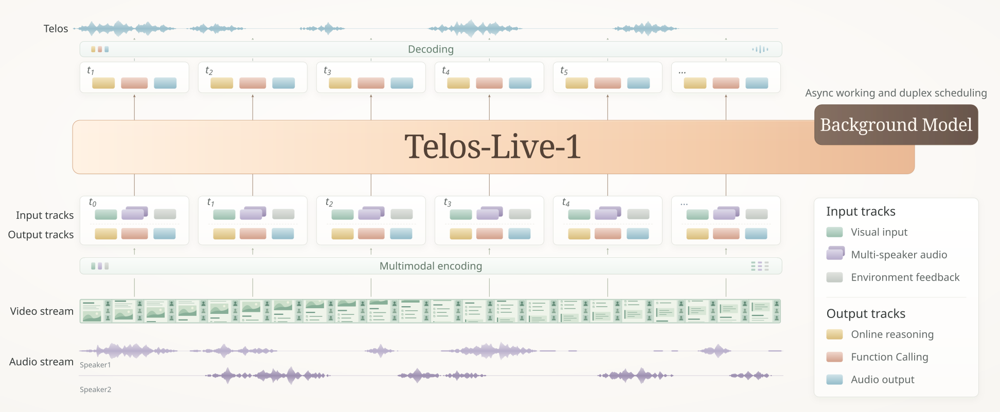
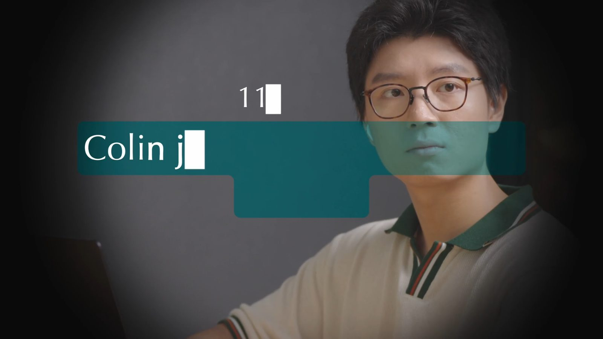
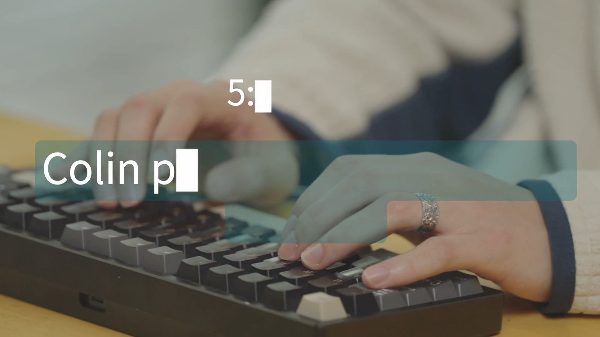
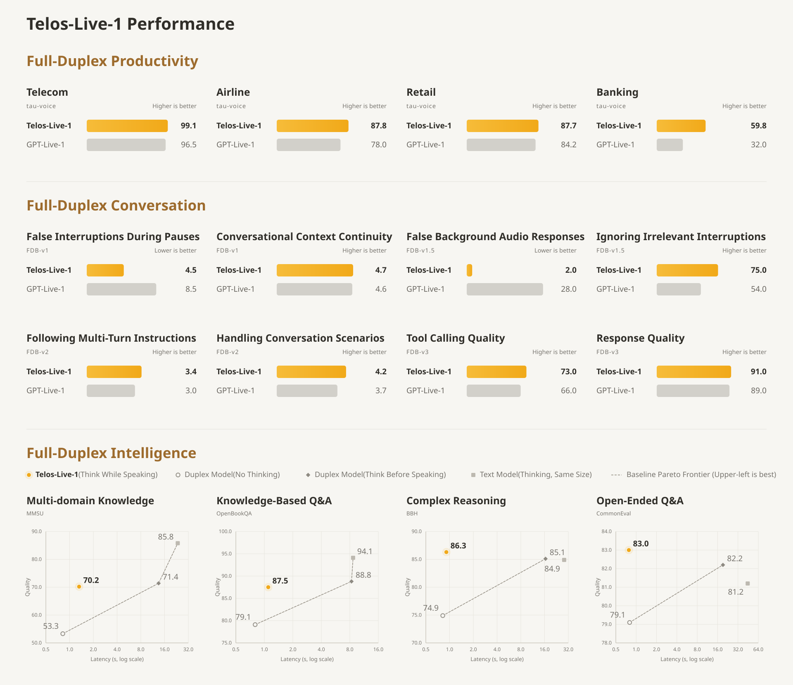

# Telos-Live-1：对话不停，后台怎样把事情做完？

> 开会时，AI 一边听大家讨论，一边去查资料，等结果回来再插进对话。这比「按一下说话、等它答完」多了一个难题：后台查的是半分钟前的问题，但人已经把问题改了。

- 发布：Telos Lab，2026 年 11 月 24 日。[Introducing Telos-Live-1](https://teloslab.com/research/introducing-telos-live-1)
- 状态：发布时开放预览申请，公共 API 标为即将推出。[申请入口](https://teloslab.com/contact)
- 核查范围：官方发布正文、架构图、评测图和录制演示说明。没有接入预览，也没有独立复跑评测。

## 1. 先把「全双工」和「后台干活」分开

**全双工管的是交互。** 普通的轮流说话模式要先判断用户讲完了，再组织答案；即使答案是流式播出的，也不一定能在自己说话时继续理解用户。Telos 把更小的交互单元叫做 **micro-turn（微轮次）**：持续到达的视频、多说话人音频和文本，与推理、工具调用、语音输出等轨道一起进入持续推进的序列。短暂停顿不是一句话结束，旁人的插话也不一定是在叫 AI。对话自然与否，部分取决于它什么时候不接话。

**前台和后台的分工管的是耗时。** 前台模型维持实时交流；搜索、写代码或操作电脑等长任务可以交给后台模型异步执行。Telos 说，两者通过双工协议交换反馈，把后台结果带回正在发生的对话。用户能立刻得到回应，不意味着搜索已经完成；这两个时间应当单独测。

*Telos 官方架构图。图示意的是模型和系统如何分工，不是公开的 API 或消息协议规格。*

Telos 还把停顿、重叠说话和打断保留在真实交互训练数据中，并用有人参与的工作流程训练何时委派。厂商称持续流、共享上下文、缓存和按需调度把全双工会话的服务成本降到此前系统的约 **1/10**。发布文没有给出足以换算客户价格的基线和成本明细；这个数不能当成 API 报价。

## 2. 最有说服力的演示，是开会时查资料

公开的会议录屏里，团队发现音频标注的分类有重叠，而现有表格每条只能选一个标签。按 Telos 的说明，模型在讨论仍在进行时查公开指南和内部例子，最后提出先试标十条音频。这里的交付不是一句总结，而是一个受现有表格约束、可以马上检验的小试验。

*Telos 录制演示封面。[观看多人会议演示](https://teloslab.com/cms-media/6c77ed5b924467127ab3.mp4)。*

另一个例子是共享编辑器写 Python 回文检查器。模型根据屏幕上的修改追问大小写和多余空格，是在跟踪眼前的代码，而不只是按预设题目念问题。现场辅导白板、技能面试和健身计次也是录好的预览案例，并不证明系统能应付任意画面、参与者或软件。

*Telos 录制演示封面。[观看编程练习演示](https://teloslab.com/cms-media/b62cc5b768efd6ebc9e4.mp4)。*

## 3. 跑分别只看谁高，要看测的是哪件事

以下为 Telos 发布图中的 **Preview 版自报结果**，对照为图上标记的 GPT-Live-1。不同指标的分值和方向不能混成一个总分。

| 评测及指标 | Telos-Live-1 | GPT-Live-1 | 方向 |
| --- | ---: | ---: | --- |
| Full-Duplex-Bench v1：停顿期间误打断 | 4.5 | 8.5 | 越低越好 |
| Full-Duplex-Bench v1.5：误回应背景音频 | 2.0 | 28.0 | 越低越好 |
| Full-Duplex-Bench v1.5：忽略无关打断 | 75.0 | 54.0 | 越高越好 |
| Full-Duplex-Bench v3：工具调用质量 | 73.0 | 66.0 | 越高越好 |
| τ-Voice：电信 / 航空 | 99.1 / 87.8 | 96.5 / 78.0 | 越高越好 |
| τ-Voice：零售 / 银行 | 87.7 / 59.8 | 84.2 / 32.0 | 越高越好 |

背景音频误回应最值得关注：一个总被隔壁说话带跑的助手，再快也很难放进会议里。但这组数是 [Full-Duplex-Bench](https://github.com/DanielLin94144/Full-Duplex-Bench) 的场景指标，不是所有真实会议的出错概率。Telos 报告的 τ-Voice 四领域结果也不应直接当成 [Sierra 公共榜单](https://www.taubench.com/) 的同口径排行；发布文没有完整交代对照模型配置、评测版本和重复运行的不确定性。

同一张图还展示了速度与正确性的取舍：在 MMSU 上，边说边推理是 **70.2 / 1.32 秒**，先推理再说的双工基线是 **71.4 / 13.43 秒**，同规模文本推理基线是 **85.8 / 23.49 秒**。这组点支持「能用较短的图示延迟保留一部分推理质量」，不支持「更快还全面更准」，也不是工具执行耗时。

## 4. 真正要测的是：人改主意后，旧任务怎么办？

以一个剪辑审片原型为例，而非 Telos 已发布的功能：用户指着画面说「把刚才那条字幕往上挪」，紧接着改口「先别动，告诉我会碰到什么」。系统需要把「刚才」绑定到当时的时间点和字幕，再取消或隔离旧的写入请求。后台晚到的结果可以用于解释，但不能把已经撤回的编辑偷偷应用上去。

试用时我会安排一个只读场景，在后台任务执行中加入停顿、旁人说话、窗口切换和改口，分别记下**前台何时回应、后台何时完成、过期结果有没有被用到**。如果接入能改数据的工具，再测试确认和撤销，并核对摄像头、麦克风、屏幕及工具记录的权限与保留规则。发布页没有给出足以复现这些行为的 API 细节。

Telos-Live-1 值得跟踪的地方，是把「保持交谈」和「把事情做完」都当成系统要承担的工作。上线前最重要的验收，不是它能否在查资料时一直说话，而是它能否在用户改变要求时，及时停下错误的动作。

相关阅读：[SeedRealtime 的音视频全双工](../2026-08-05/2026-08-05-bytedance-seedrealtime-full-duplex-audio-video.md) · [GPT-Live 的后台委派](../2026-07-08/2026-07-08-openai-gpt-live-full-duplex-voice-agent-runtime.md)
