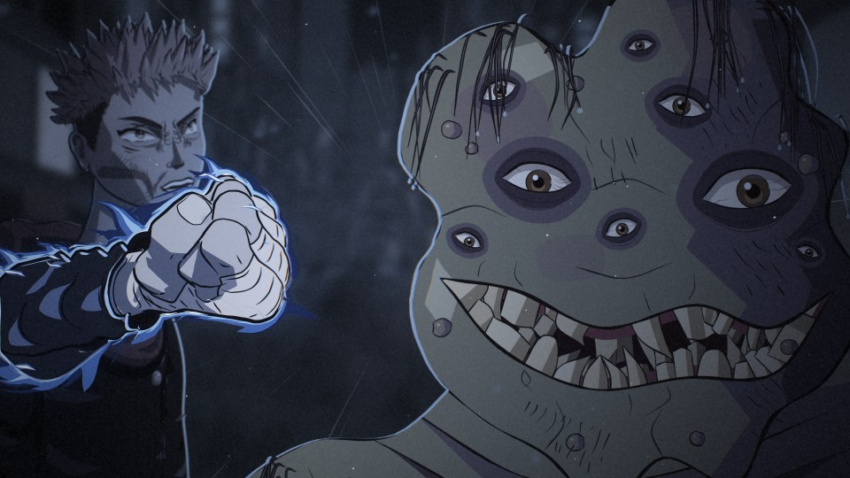
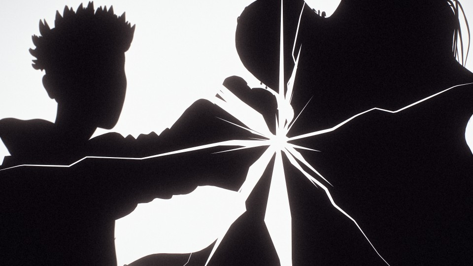
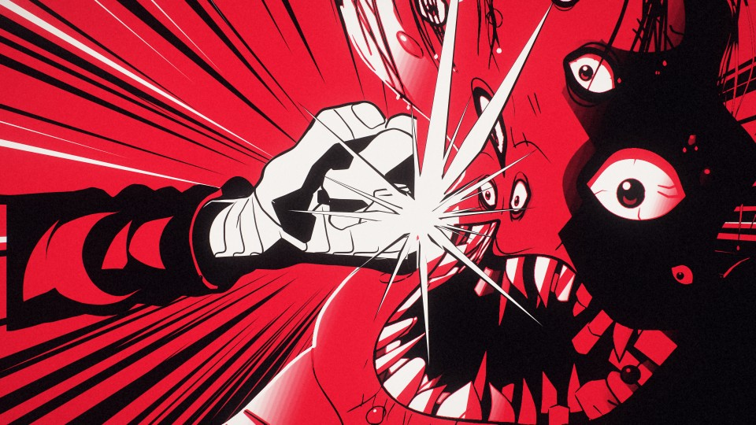
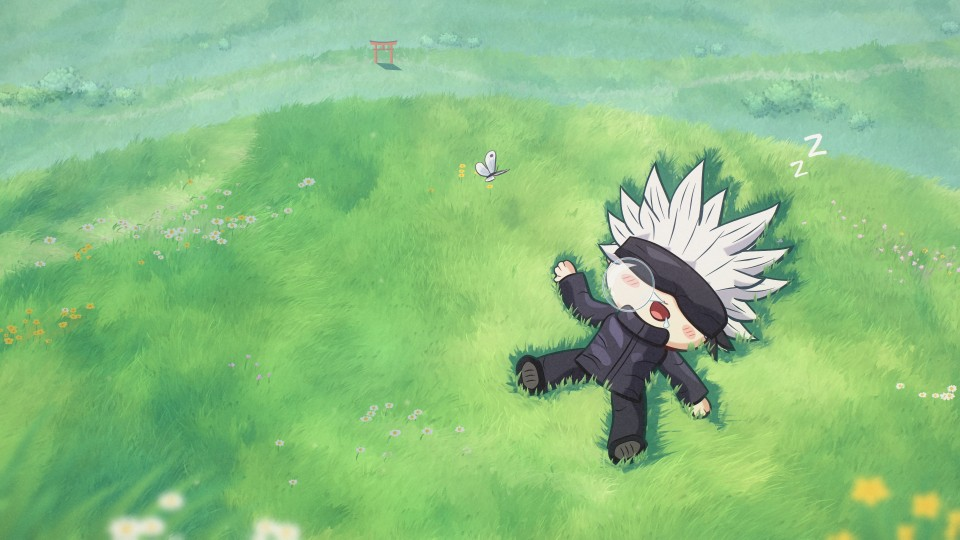
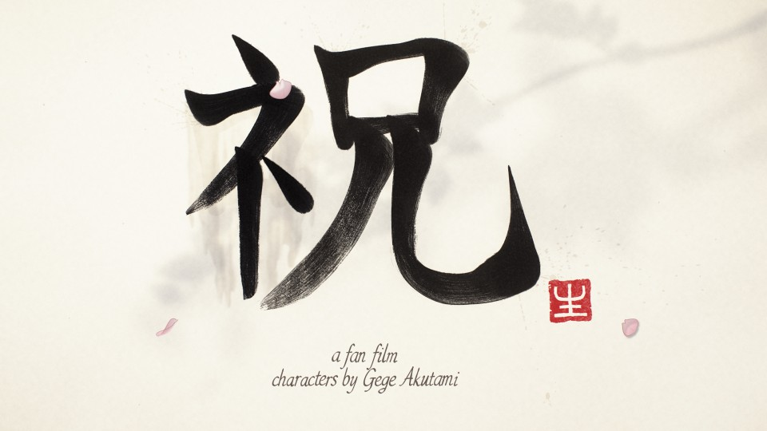

# Noroi / Iwai: Drawing, Animating and Singing a 114-Second Fan Film in Code

> Noroi / Iwai publishes the production code for a Jujutsu Kaisen fan short: Python draws the picture, JavaScript synthesizes voices, instruments and effects, and frame-based tools assemble the output. The interesting contribution is an inspectable animation pipeline, not a new generative-video model.

- Project: [ChetasLua/noroi-iwai](https://github.com/ChetasLua/noroi-iwai).
- Reviewed November 25, 2026, at commit [`edd3b89`](https://github.com/ChetasLua/noroi-iwai/tree/edd3b89753d8f17353ec17f8738b39a781667c6b).
- Advertised film specification: 114 seconds, 1920×1080, 24 fps, 2,736 frames, 37 shots and 160 BPM. This review checked the timeline and reproduced selected pictures and audio, not the complete finished film.
- The repository identifies this as an unofficial fan work, with Jujutsu Kaisen and its characters credited to Gege Akutami; it says the work was not made or endorsed by the original creator or rights holders. [Project description](https://github.com/ChetasLua/noroi-iwai/blob/edd3b89753d8f17353ec17f8738b39a781667c6b/README.md)

*Frame 40 of `shots/d4.py`, rendered locally at 1080p and reduced to 960×540 for this article. This is a source render, not a promotional-video capture or an image-model output.*

## 1. A Film's Source, Not a General Animation App

There is no finished interface for entering an arbitrary screenplay. The repository separates this particular film into reusable drawing machinery and highly specific creative instructions:

| Layer | Main location | Responsibility |
| --- | --- | --- |
| Film timeline | `film.py` | Shot order, start frames and lengths |
| Drawing and space | `jj/` | Projection, skeletons, contours, brushwork, environments, effects and compositing |
| Characters | `chars/` | Character-specific faces, hair, clothing and expressions |
| Shots | `shots/` | Staging, motion, camera decisions and events |
| Sound | `audio/` | Score, singing, instruments, effects and mixing |
| Output and inspection | `tools/` | Stills, frame sequences, shot renders, event collection and assembly |

The snapshot includes 37 shot modules, but `dist/` contains only a placeholder, not a ready-to-play full MP4. Reuse means studying and adapting the production code, not replacing one prompt and expecting an equally elaborate film. [Pinned source tree](https://github.com/ChetasLua/noroi-iwai/tree/edd3b89753d8f17353ec17f8738b39a781667c6b)

Nor should “no image models at runtime” be confused with “no AI assistance in writing the code.” All three public commits carry a Claude Opus 5.5 co-author credit. That metadata does not establish the number of prompts, the amount of human revision or one-shot generation. [Commit history](https://github.com/ChetasLua/noroi-iwai/commits/edd3b89753d8f17353ec17f8738b39a781667c6b)

## 2. How Code Produces These Characters

This is more than translating primitive shapes or moving a flat character picture. It mixes 2D drawing, 3D construction and compositing.

**Heads have spatial structure.** `jj/head3.py` defines cross-sections and a facial surface, projects authored facial coordinates through yaw, pitch and roll, and derives contours. Character modules then supply eyes, hair and expression. [Head construction](https://github.com/ChetasLua/noroi-iwai/blob/edd3b89753d8f17353ec17f8738b39a781667c6b/jj/head3.py)

**Bodies are constructed, then redrawn.** A skeleton poses procedural body volumes. Distance-field rendering produces labels, depth, normals and other intermediate buffers; the drawing layer turns those into contours, cel colors, shadows and ink. The spatial machinery supports pose and occlusion, while the displayed result remains a stylized drawing. [Body construction](https://github.com/ChetasLua/noroi-iwai/blob/edd3b89753d8f17353ec17f8738b39a781667c6b/jj/fig_sdf.py) · [Figure redraw](https://github.com/ChetasLua/noroi-iwai/blob/edd3b89753d8f17353ec17f8738b39a781667c6b/jj/figure.py)

**The line is designed too.** Supersampled PyCairo surfaces support variable-width strokes, tapered ends and controlled wobble. Finishing adds diffusion, bloom, slight chromatic separation and grain. The visual style is expressed as drawing rules and parameters rather than inferred by an image model. [Ink tools](https://github.com/ChetasLua/noroi-iwai/blob/edd3b89753d8f17353ec17f8738b39a781667c6b/jj/ink.py) · [Compositing](https://github.com/ChetasLua/noroi-iwai/blob/edd3b89753d8f17353ec17f8738b39a781667c6b/jj/comp.py)

Having 3D construction does not mean the project delivers polished character assets ready for arbitrary DCC software. Its core assets are the Python construction, posing and drawing logic.

## 3. Animation Needs More Than Interpolation

Shot `d4` explicitly stages the sprint, anticipation, eye close-up, last metre and impact aftermath. At the hit, smooth interpolation gives way to deliberately different drawings:

| Frame 54 | Frame 55 |
| --- | --- |
|  |  |

*Both frames were rendered from the shot source. Their abrupt graphic changes are intentional impact drawings, not rendering failures.*

The script also arranges pauses, smears, deformation and camera shake. The useful division is between geometry that maintains spatial relationships and shot-specific drawings that give action weight. Making everything uniformly smooth can erase that timing. [Shot `d4`](https://github.com/ChetasLua/noroi-iwai/blob/edd3b89753d8f17353ec17f8738b39a781667c6b/shots/d4.py)

The hillside uses a different approach: procedural brush marks sample a color guide affected by gusts, cloud shadows and contact shadows, with bending grass blades layered above. Generated plates are cached; the background is not an external grass texture.

*Shot `b1`, frame 36. The composition, palette and acting are already authored in the code; Python alone does not supply those creative decisions. [Hillside renderer](https://github.com/ChetasLua/noroi-iwai/blob/edd3b89753d8f17353ec17f8738b39a781667c6b/jj/grass.py) · [Shot staging](https://github.com/ChetasLua/noroi-iwai/blob/edd3b89753d8f17353ec17f8738b39a781667c6b/shots/b1.py)*

## 4. The Singer Is Synthesized, Not TTS

`audio/score.json` stores pitches, durations, Japanese morae and sections. A performance layer turns them into pitch, articulation, breath and effort controls. The source synthesizes individual glottal pulses and applies a vocal-tract transfer function based on 44 lossy tube sections, with nasal branching and consonant noise. [Score](https://github.com/ChetasLua/noroi-iwai/blob/edd3b89753d8f17353ec17f8738b39a781667c6b/audio/score.json) · [Performance](https://github.com/ChetasLua/noroi-iwai/blob/edd3b89753d8f17353ec17f8738b39a781667c6b/audio/voice_perf.mjs) · [Source synthesis](https://github.com/ChetasLua/noroi-iwai/blob/edd3b89753d8f17353ec17f8738b39a781667c6b/audio/voice_core.mjs) · [Vocal tract](https://github.com/ChetasLua/noroi-iwai/blob/edd3b89753d8f17353ec17f8738b39a781667c6b/audio/voice_tract.mjs)

“Zero-dependency JavaScript” refers to sound code using Node built-ins and repository-local DSP rather than npm sound libraries. It does not remove the picture pipeline's NumPy, OpenCV, Cairo or FFmpeg dependencies. Instruments have dedicated synthesis code too: plucked strings, for example, use Karplus–Strong/waveguide techniques rather than recorded guitar samples. [Plucked instruments](https://github.com/ChetasLua/noroi-iwai/blob/edd3b89753d8f17353ec17f8738b39a781667c6b/audio/inst_pluck.mjs)

I ran the `b1` lead-only entry twice. Each produced a 4.4-second, 48 kHz, 16-bit mono WAV with the same SHA-256. That demonstrates a working, repeatable synthesis path in this environment, not human-level singing naturalness or a finished soundtrack.

The project retains two voice engines. Its documented build uses the first engine's choir alongside the newer voice output; the default mixer expects that older choir. Running only the latest lead renderer does not recreate the complete vocal arrangement. [First-engine note](https://github.com/ChetasLua/noroi-iwai/blob/edd3b89753d8f17353ec17f8738b39a781667c6b/audio/voice_v1/voice.mjs) · [Mix selection](https://github.com/ChetasLua/noroi-iwai/blob/edd3b89753d8f17353ec17f8738b39a781667c6b/audio/mix.mjs)

## 5. Picture and Sound Share a Clock

At 160 BPM, a beat lasts 0.375 seconds: exactly nine frames at 24 fps. Four beats make 36 frames per bar, and 76 bars make 114 seconds. The timeline asserts contiguous shots and the total frame count; this review independently checked those values. [Timeline](https://github.com/ChetasLua/noroi-iwai/blob/edd3b89753d8f17353ec17f8738b39a781667c6b/film.py)

Each shot's `Shot.EVENTS` records local frame positions for steps, punches, collisions or silence. The collection tool adds the shot offset and produces absolute frames and seconds for sound mapping. It collected **694 events from all 37 shots, with no shot falling back to draft events**. Collection does not establish that every event was successfully or appropriately sounded. [Event collection](https://github.com/ChetasLua/noroi-iwai/blob/edd3b89753d8f17353ec17f8738b39a781667c6b/tools/events.py) · [Sound mapping](https://github.com/ChetasLua/noroi-iwai/blob/edd3b89753d8f17353ec17f8738b39a781667c6b/audio/event_map.mjs)

This is a useful production pattern: timing changes have explicit records to follow. Musical phrasing, impact emphasis and sound tails still require judgment. Matching frame numbers does not automatically make a sequence work.

## 6. Lettering Is Drawing Too

*Shot `g4`, frame 90. The kanji strokes, Latin credit lettering, seal and paper treatment have procedural implementations.*

“No fonts on screen” does not mean “no text.” The ending constructs lettering from stroke shapes, changing widths and ink behavior; `g4` also models dissolution, flow and absorption along paper fibers. Separately, the assembly tool generates English lyric SRT subtitles and muxes an optional soft-subtitle track into the MP4. [Lettering](https://github.com/ChetasLua/noroi-iwai/blob/edd3b89753d8f17353ec17f8738b39a781667c6b/jj/letters.py) · [Ending shot](https://github.com/ChetasLua/noroi-iwai/blob/edd3b89753d8f17353ec17f8738b39a781667c6b/shots/g4.py) · [Assembly and subtitles](https://github.com/ChetasLua/noroi-iwai/blob/edd3b89753d8f17353ec17f8738b39a781667c6b/tools/film.py)

## 7. What Was Reproduced?

The local environment was macOS, Python 3.12.12 and Node 25.7.0, using an isolated virtual environment and an existing Cairo installation, not a clean-machine installation test:

- Rendered `b1` frames 36/54, `d4` frames 40/54/55 and `g4` frame 90, using the repository's finishing code. Five reduced stills are preserved here.
- Rendered `d4` frames 36–47 into a 1920×1080, 24 fps H.264 clip: 12 frames, 0.5 seconds, with no errors during full decoding.
- Synthesized and checked the lead sample, verified the timeline and collected the 694 picture events.
- Probed the recently changed `e4`/`h2` random generators in subprocesses with different `PYTHONHASHSEED` values; outputs agreed. This is an RNG probe, not full-frame reproducibility verification. [Stable-seed fix](https://github.com/ChetasLua/noroi-iwai/commit/edd3b89753d8f17353ec17f8738b39a781667c6b)

I did not rebuild all 2,736 frames, the complete band and choir, the final mix or the assembled film. No claim is made about full-film continuity, overall singing quality or complete build time. [Reproduction and image notes](imgs/noroi-iwai-code-anime/SOURCES.md) preserve the commands and boundaries.

Start with a still rather than the full build. The pipeline expects fixed `.mm/env/bin/` paths, generated caches and sound stems. Some mixing paths tolerate missing stems, so a successful process exit alone does not establish complete content.

Finally, source visibility and reuse permission are different. The reviewed snapshot contains no LICENSE file, and GitHub reports no detected license. Together with its use of existing anime characters, that makes it important to clarify code and underlying-IP permissions separately before copying, publishing or commercial reuse, rather than assuming MIT terms.

The strongest lesson is how specific creative judgments become editable code: the camera angle, held frames, impact drawing and moments when sound gives way. This is an inspectable route to procedural animation, not proof that a general agent can unconditionally replace animation production.

Related: [Choosing Among Claude Video and Motion Repositories](../2026-11-04/2026-11-04-claude-motion-ten-repo-selection-en.md) · [A Source-Rebuild Audit Including the Same Creator's Crimson Loong](../2026-11-16/2026-11-16-awesome-fable-52-works-audit-en.md).
