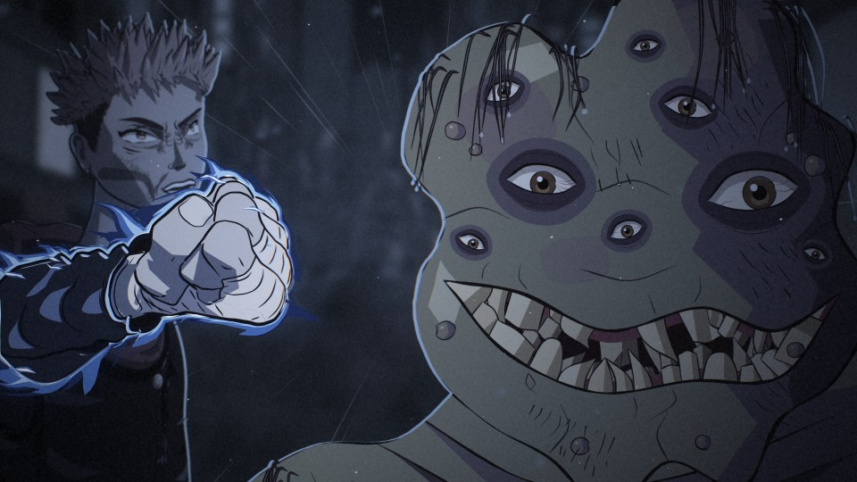
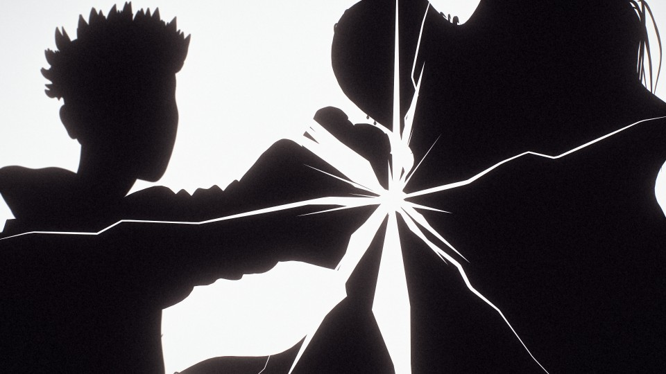
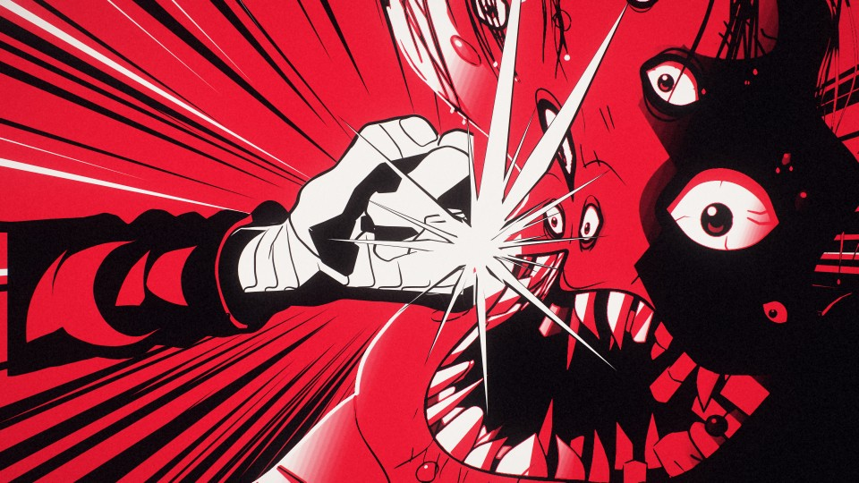
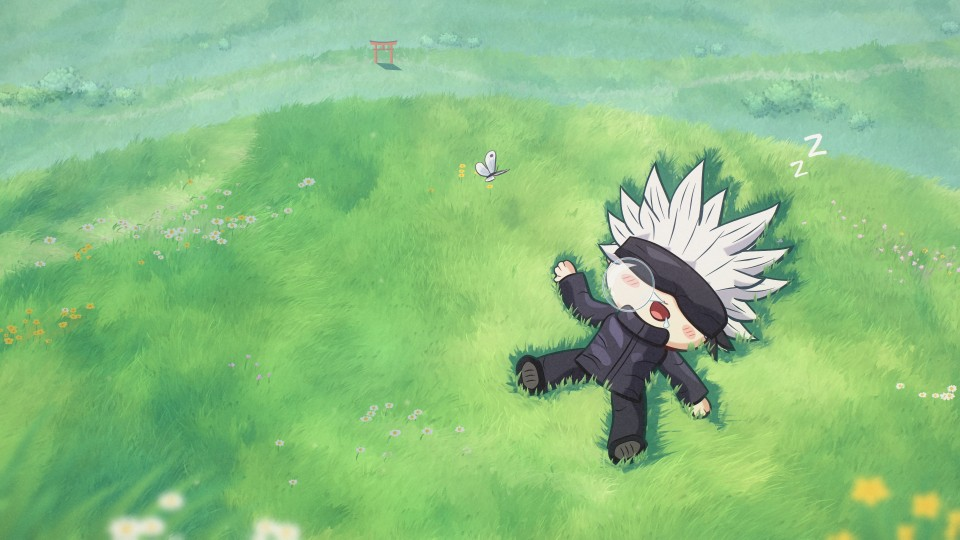
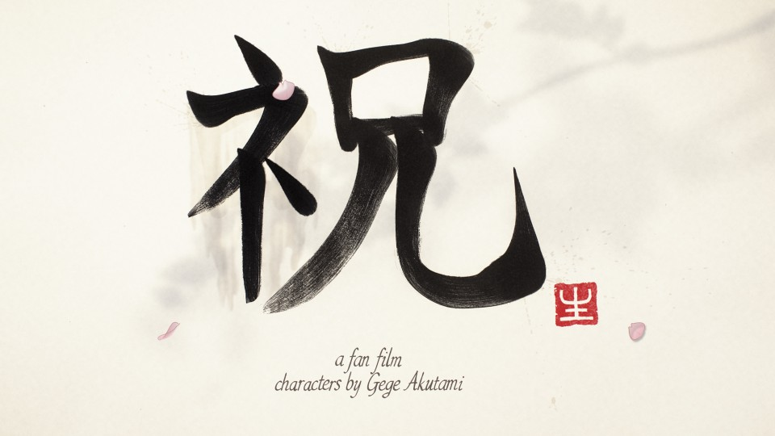

# Noroi / Iwai：不用生图模型，怎样用代码画出一部 114 秒同人动画？

> 《呪い / 祝い》（Noroi / Iwai）公开的是一部《咒术回战》同人短片的制作源码：Python 绘制画面，JavaScript 合成歌声、乐器和音效，再按帧组装。它最值得研究的是如何把绘画、表演和音画节奏写成可复现的程序，而不是把它误认成新的动画生成模型。

- 项目：[ChetasLua/noroi-iwai](https://github.com/ChetasLua/noroi-iwai)。
- 核查日期：2026-11-25；源码固定在 [`edd3b89`](https://github.com/ChetasLua/noroi-iwai/tree/edd3b89753d8f17353ec17f8738b39a781667c6b)。
- 作者声明的成片规格：114 秒、1920×1080、24 fps、2,736 帧、37 个镜头、160 BPM。本文核对了时间表，并局部复现了画面和声音，没有重建或审看完整成片。
- 项目明确标注为非官方同人作品，《咒术回战》及角色归属芥见下下；原作者和权利方没有制作或背书这部作品。[项目说明](https://github.com/ChetasLua/noroi-iwai/blob/edd3b89753d8f17353ec17f8738b39a781667c6b/README.md)

*本地从 `shots/d4.py` 生成的第 40 帧，原画面 1080p，文章配图缩至 960×540。不是从宣传视频截取，也没有调用生图服务。*

## 1. 这是什么：一部影片的源码，不是通用动画软件

仓库里没有供用户输入剧本的成品界面。它把这部影片拆成绘制工具、人物定义、背景、镜头脚本和声音脚本：

| 层 | 主要文件 | 职责 |
| --- | --- | --- |
| 全片时间表 | `film.py` | 镜头顺序、起始帧与长度 |
| 绘制与空间 | `jj/` | 相机投影、骨架、轮廓、笔触、背景、特效与合成 |
| 角色 | `chars/` | 五官、发型、服装、表情等角色专用绘制逻辑 |
| 镜头 | `shots/` | 每个镜头的布景、动作、机位及事件 |
| 声音 | `audio/` | 乐谱、歌唱合成、乐器、音效及混音 |
| 输出与检查 | `tools/` | 静帧、连续帧、镜头片段、事件汇总与成片组装 |

源码树包含 37 个镜头模块，但 `dist/` 在这个快照中只有占位文件，并没有附带可直接播放的完整 MP4。[固定源码树](https://github.com/ChetasLua/noroi-iwai/tree/edd3b89753d8f17353ec17f8738b39a781667c6b)

所以它的复用方式是阅读和改写这套影片代码，而不是换一个提示词就保证生成另一部同等复杂的作品。也不应把“运行时不调用图像模型”理解为“创作代码时没有 AI 参与”。这三个公开提交都带有 Claude Opus 5.5 的共同作者署名；提交记录并不能证明用了多少轮提示、多少人工修改，或一次生成了多少内容。[提交记录](https://github.com/ChetasLua/noroi-iwai/commits/edd3b89753d8f17353ec17f8738b39a781667c6b)

## 2. 代码怎么能画出这种人物？

它不是简单地把圆形、方块平移一下，也不是把一张人物图片做缩放。画面混合了二维绘制、三维构造和最终合成。

**头部有空间结构。** `jj/head3.py` 定义头部截面和脸部表面，把正面坐标中的五官按 yaw、pitch、roll 投影到画面，并据此求轮廓。角色文件再负责眼睛、头发和表情。这样改变朝向时，五官位置与透视能共用一套几何依据。[头部实现](https://github.com/ChetasLua/noroi-iwai/blob/edd3b89753d8f17353ec17f8738b39a781667c6b/jj/head3.py)

**身体先构造，再重画。** 全身人物由骨架姿势和程序化体块组成；距离场渲染得到部位标签、深度、法线等中间缓冲，随后提取轮廓、填色、画阴影与墨线。三维结构在这里帮助解决姿态、遮挡和光照，最终呈现仍是赛璐璐与手绘笔触。[身体构造](https://github.com/ChetasLua/noroi-iwai/blob/edd3b89753d8f17353ec17f8738b39a781667c6b/jj/fig_sdf.py) · [人物重绘](https://github.com/ChetasLua/noroi-iwai/blob/edd3b89753d8f17353ec17f8738b39a781667c6b/jj/figure.py)

**线条本身也经过设计。** PyCairo 的超采样画布配合可变宽度笔触、尖端收细和受控抖动；后期再加入扩散、高光泛光、轻微色差和颗粒。这里没有一个神经网络在“理解动漫风格”，风格被拆成了绘制规则和数值。[墨线工具](https://github.com/ChetasLua/noroi-iwai/blob/edd3b89753d8f17353ec17f8738b39a781667c6b/jj/ink.py) · [最终合成](https://github.com/ChetasLua/noroi-iwai/blob/edd3b89753d8f17353ec17f8738b39a781667c6b/jj/comp.py)

这也解释了为什么“有三维结构”不等于仓库提供了一套可直接拿去任意 DCC 软件编辑的精细角色模型：核心交付是 Python 中的构造、姿势和画法。

## 3. 动画感来自绘制节奏，不只是插值

`d4` 镜头把奔跑、蓄力、眼部特写、最后一米和冲击后的爆发分别编排。真正击中的瞬间，没有继续平滑插值，而是切换成专门设计的冲击画：

| 第 54 帧 | 第 55 帧 |
| --- | --- |
|  |  |

*两张均由同一镜头源码独立渲染。它们是有意改变画法的冲击帧，不是画面故障。*

脚本还安排了停顿、拖影、局部变形和手持晃动。可借鉴的是这种分工：骨架保证空间关系，逐镜头的特殊画法决定动作是否有重量。把所有内容统一成平滑运动，反而可能失去这种节奏。[`d4` 镜头脚本](https://github.com/ChetasLua/noroi-iwai/blob/edd3b89753d8f17353ec17f8738b39a781667c6b/shots/d4.py)

另一种画法出现在草坡镜头：地面由程序笔触形成，阵风、云影与接触阴影影响颜色引导，再叠加会随风弯曲的草叶。它并不是使用一张外部草地贴图；已经生成的底板会缓存下来，减少重复计算。

*`b1` 第 36 帧。人物、草坡与前景同样来自代码。代码里已经明确写入了构图、颜色和表演，不能把结果归因于“只要写 Python 就自动好看”。[草坡渲染](https://github.com/ChetasLua/noroi-iwai/blob/edd3b89753d8f17353ec17f8738b39a781667c6b/jj/grass.py) · [镜头编排](https://github.com/ChetasLua/noroi-iwai/blob/edd3b89753d8f17353ec17f8738b39a781667c6b/shots/b1.py)*

## 4. 歌声也由代码合成，但不是 TTS

`audio/score.json` 保存音高、时值、日语音拍和段落；表演层把它们变成基频、发音动作、气息和力度曲线。声源层合成每个声门周期的脉冲，再经过由 44 段有损管道近似的声道传递函数，加入鼻腔分支、辅音噪声等处理。[乐谱](https://github.com/ChetasLua/noroi-iwai/blob/edd3b89753d8f17353ec17f8738b39a781667c6b/audio/score.json) · [发音与表演](https://github.com/ChetasLua/noroi-iwai/blob/edd3b89753d8f17353ec17f8738b39a781667c6b/audio/voice_perf.mjs) · [声源](https://github.com/ChetasLua/noroi-iwai/blob/edd3b89753d8f17353ec17f8738b39a781667c6b/audio/voice_core.mjs) · [声道](https://github.com/ChetasLua/noroi-iwai/blob/edd3b89753d8f17353ec17f8738b39a781667c6b/audio/voice_tract.mjs)

所谓 JavaScript“零依赖”，指声音脚本使用 Node 内置模块及仓库自己的 DSP 代码，不需要 npm 音源包；不是指画面端也没有 NumPy、OpenCV、Cairo 或 FFmpeg 等依赖。乐器也有专用合成实现，例如拨弦部分使用 Karplus–Strong／波导思路，而非读取吉他采样。[拨弦合成](https://github.com/ChetasLua/noroi-iwai/blob/edd3b89753d8f17353ec17f8738b39a781667c6b/audio/inst_pluck.mjs)

我运行了主唱的 `b1` 单句入口，两次都输出 48 kHz、16 位、单声道、4.4 秒的 WAV，SHA-256 完全相同。它证明这条合成路径可运行且本次重复结果一致，不证明声音已经达到真人歌唱的自然度，也不代表整首混音完成。

还要留意版本关系：项目保留两套人声引擎，README 要求从第一代引擎额外取出合唱轨；默认混音会使用它。只运行最新主唱脚本，就不能声称复现了作者的完整声音方案。[第一代引擎说明](https://github.com/ChetasLua/noroi-iwai/blob/edd3b89753d8f17353ec17f8738b39a781667c6b/audio/voice_v1/voice.mjs) · [混音选择](https://github.com/ChetasLua/noroi-iwai/blob/edd3b89753d8f17353ec17f8738b39a781667c6b/audio/mix.mjs)

## 5. 音画能对齐，是因为共用时间依据

160 BPM 意味着一拍 0.375 秒，在 24 fps 下正好 9 帧；四拍一小节就是 36 帧。全片 76 小节，合计 114 秒。`film.py` 对镜头相接和总帧数做了断言，本次也核对了这些数字。[全片时间表](https://github.com/ChetasLua/noroi-iwai/blob/edd3b89753d8f17353ec17f8738b39a781667c6b/film.py)

各镜头的 `Shot.EVENTS` 再记录脚步、挥拳、碰撞或静默的局部帧号。事件工具加上镜头在全片中的偏移，换算成绝对帧和秒，供声音映射与混音使用。本次汇总得到 **37 个镜头、694 条事件，零个镜头需要回退到草稿事件**；这并不表示每条事件都已被正确配音，映射仍要检查。[事件汇总](https://github.com/ChetasLua/noroi-iwai/blob/edd3b89753d8f17353ec17f8738b39a781667c6b/tools/events.py) · [声音映射](https://github.com/ChetasLua/noroi-iwai/blob/edd3b89753d8f17353ec17f8738b39a781667c6b/audio/event_map.mjs)

对代码制片，这比“画面做完再凭感觉贴音效”更值得复用：动作时间改了，至少有明确的事件记录可以追踪。音乐段落、动作击点和声音尾音仍需创作者判断，帧号一致并不自动等于节奏好。

## 6. 文字也可以是画，而不是字体

*`g4` 第 90 帧。汉字笔画、拉丁字母署名、印章和纸面效果都有相应的程序实现。*

“不用字体”不等于“没有文字”。片尾通过笔画轮廓、宽度变化和墨水处理绘字；`g4` 还模拟溶解、流动和纸纤维吸附。与此同时，组装工具会另外生成英文歌词 SRT，并作为可选软字幕轨封装进 MP4。不要把画面内不依赖字体文件，扩张成整部作品没有字幕。[笔画与字母](https://github.com/ChetasLua/noroi-iwai/blob/edd3b89753d8f17353ec17f8738b39a781667c6b/jj/letters.py) · [片尾镜头](https://github.com/ChetasLua/noroi-iwai/blob/edd3b89753d8f17353ec17f8738b39a781667c6b/shots/g4.py) · [组装与字幕](https://github.com/ChetasLua/noroi-iwai/blob/edd3b89753d8f17353ec17f8738b39a781667c6b/tools/film.py)

## 7. 本次复现到哪一步？

在 macOS、Python 3.12.12、Node 25.7.0 上，本次使用隔离虚拟环境并复用本机 Cairo，不是全新机器的冷安装测试：

- 生成 `b1` 的第 36、54 帧，`d4` 的第 40、54、55 帧，以及 `g4` 第 90 帧；均经过项目自带合成步骤，本文保留其中五张缩小配图。
- 渲染 `d4` 第 36–47 帧，得到 H.264、1920×1080、24 fps、12 帧／0.5 秒片段；完整解码无报错。
- 合成并校验上述主唱样本；核对时间表及 694 条镜头事件。
- 对最新提交修改的 `e4`、`h2` 随机数函数，用两个不同 `PYTHONHASHSEED` 子进程抽样，结果一致；这只是随机数探针，不是完整画面一致性测试。[稳定种子修复](https://github.com/ChetasLua/noroi-iwai/commit/edd3b89753d8f17353ec17f8738b39a781667c6b)

没有重建 2,736 帧、完整乐队与合唱，也没有执行最终混音和整片封装。因此本文不评价全片叙事流畅度、整体演唱质量或完整构建耗时。[复现记录与配图来源](imgs/noroi-iwai-code-anime/SOURCES.md) 保留具体命令和边界。

初次试跑可以从 README 的单帧入口开始，而不是立即全片渲染。完整流程还依赖固定的 `.mm/env/bin/` 路径、生成缓存和声音分轨；部分混音路径会容忍缺失分轨，不能只看“命令退出成功”就认定内容齐全。

最后要区分“能研究”与“有明确复用授权”：核查快照未见 LICENSE 文件，GitHub API 的 license 字段也为空；加上作品使用现有动漫角色，后续复制、发布或商业使用前，应分别确认代码作者与原作相关权利，而不是默认它采用 MIT。

这部作品最有价值的示范，是把创作判断留在程序里：哪个角度最好看、哪几帧停住、击中瞬间换哪种画法、声音何时退让，都有具体的代码位置可以修改。它展示了一条可检查的编程动画路径，而没有证明“通用 Agent 已经能无条件替代动画制作”。

相关阅读：[Claude 视频与动效仓库的选型区别](../2026-11-04/2026-11-04-claude-motion-ten-repo-selection.md) · [包含同作者《赤龍》的案例复现](../2026-11-16/2026-11-16-awesome-fable-52-works-audit.md)。
