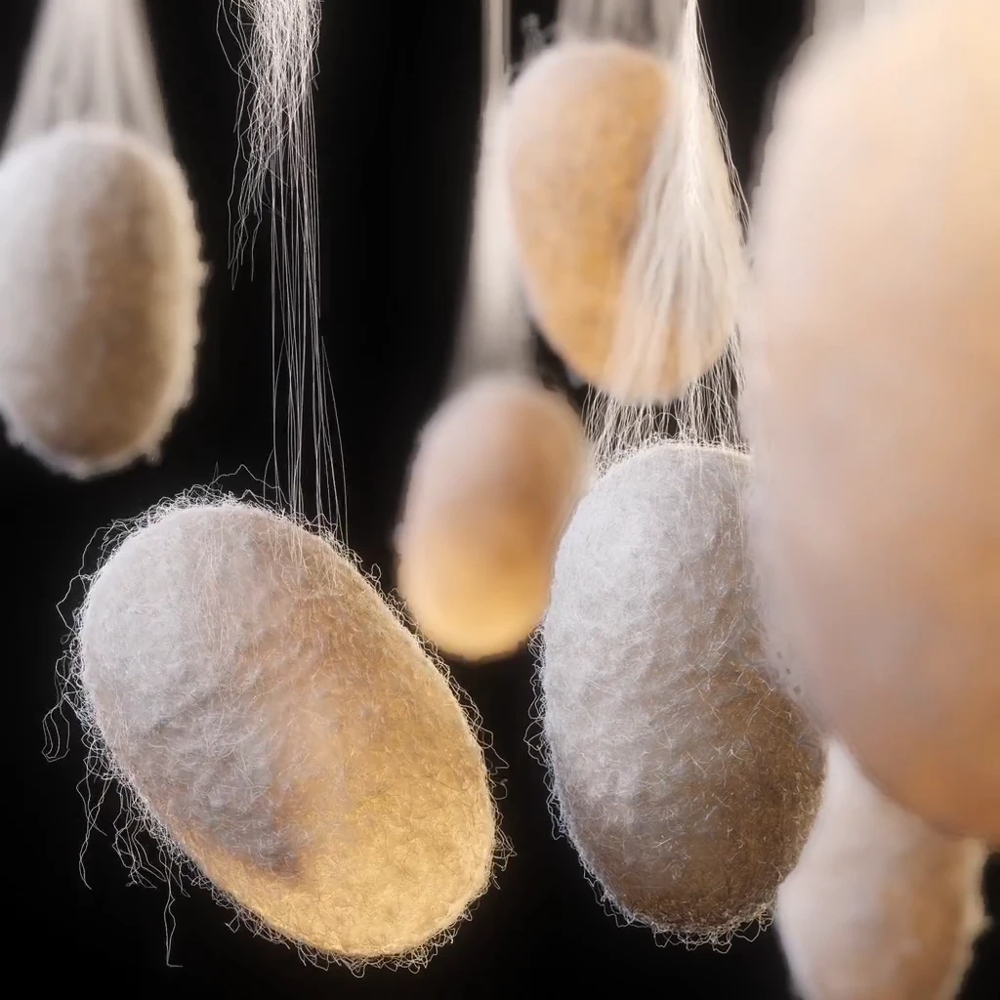
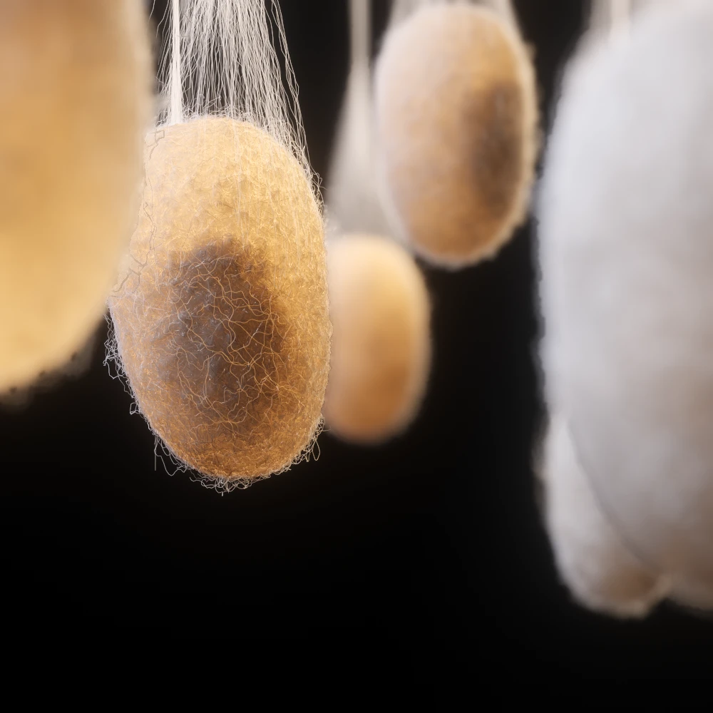
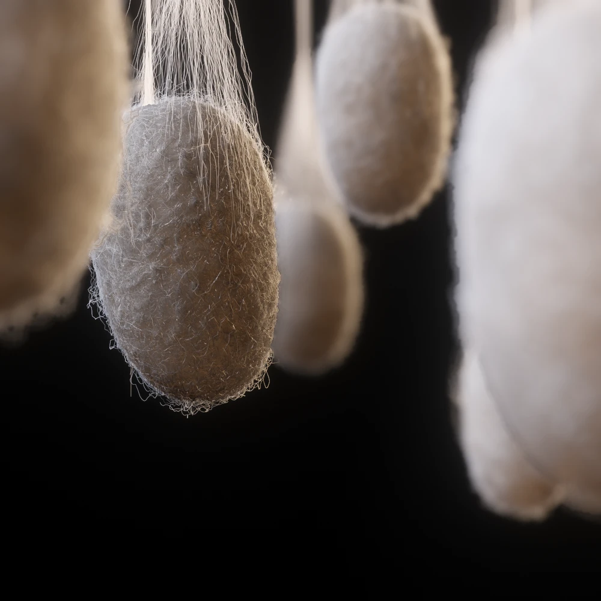

# Cocoon：Blender 先算光，浏览器再给八万根丝线打光

> 蚕茧从黑暗里降下来，奶白色的丝渐渐透出暖光，随后吊网逐束断开，茧坠出画面。Yuri Artiukh 用 WebGPU 把这条 26 秒的循环做成了现场渲染。Blender 的工作没有消失：它先离线算出光怎样穿过茧壳、怎样在丝线间散射，再把这些结果交给小型网络学习。

- 作者：Yuri Artiukh（@akella）；Codevember 2026 第 20 个实验，原帖发布于 2026 年 11 月 26 日。[X 原帖](https://x.com/akella/status/2125917117526540700)
- [实时作品](https://akella.github.io/codevember-2026/20/) · [作者技术笔记](https://akella.github.io/codevember-2026/20/notes.html) · [核对的源码快照](https://github.com/akella/codevember-2026/tree/902fcb1f492dac4138d72aad16dd85af71ceeda4/20-cocoon)
- 实测范围：Mac 上的 Chrome 158、1000 × 1000 画布。核对了画面持续变化，并在固定时间测试内部灯光开关；没有重训模型，也没有复测作者的帧耗时。

*Yuri Artiukh 的原帖视频，第 18.5 秒。原帖是 1024 × 1024、30 fps 的录制版；网站是实时渲染版。*

## 1. 模型学的是光，茧和丝线仍是几何

主场景里九只茧是同一个高细节资产的九个实例。每只茧有壳体和 **87,260 根纤维**，包含绕在壳表的丝、翘起的圈、短绒和长游丝；一只茧约有 **138 万个曲线控制点**。这些形状由 `bake/hero.py` 等脚本构造，不是神经网络在播放过程中生出来的。网络回答的是：从这个角度看，在这组灯光下，这段丝应该有多亮、偏什么颜色？[几何脚本](https://github.com/akella/codevember-2026/blob/902fcb1f492dac4138d72aad16dd85af71ceeda4/20-cocoon/bake/hero.py) · [技术笔记](https://akella.github.io/codevember-2026/20/notes.html)

| 阶段 | 做什么 |
| --- | --- |
| 离线生成样本 | Cycles 渲染 1,400 个视图，576 × 576、48 样本；把不同外灯和内部光拆开记录。 |
| 离线拟合 | 训练小网络、空间特征纹理和每根纤维的局部参数，学习这些几何位置对光的响应。 |
| 网页加载 | 解包曲线和已训练的数据，GPU 生成壳面起伏，Web Workers 先求解几套吊网断裂轨迹。 |
| 每帧显示 | WebGPU 计算需要更新的受光，将纤维画成沿曲线展开的窄带，再做景深、泛光和色调映射。 |

这条链路既不是视频生成，也不是把茧做成高斯点云。主页面的计算和绘制用原生 WebGPU，Three.js 主要提供相机数学和环绕控制，并不负责这里的主要着色。[训练脚本](https://github.com/akella/codevember-2026/blob/902fcb1f492dac4138d72aad16dd85af71ceeda4/20-cocoon/bake/train_hero.py) · [WebGPU 主程序](https://github.com/akella/codevember-2026/blob/902fcb1f492dac4138d72aad16dd85af71ceeda4/20-cocoon/src/glow/index.ts)

## 2. 为什么它不是一张烘焙的贴图？

传统烘焙贴图可以把固定灯光下的结果烤进纹理，换灯之后却不会自行重算。这里用的是 **预计算辐射传输**（PRT）：预先学的是光照如何影响茧，不是只记下一张打好光的照片。作者把一盏灯的贡献拆成两边：一边由纤维位置和观察方向决定，另一边由光源方向决定，最后用点积组合。不同灯的贡献可以相加；实现中先把灯的权重折进网络最后一层，就不用对每个丝线控制点按灯数重复整套推理。这个做法不意味着调度、阴影或整个渲染器的成本与灯数无关。[Cocoon 的光照分解](https://akella.github.io/codevember-2026/20/notes.html) · [Neural PRT 论文](https://repo-sam.inria.fr/fungraph/neural-prt/)

**固定第 13 秒，只动一项。** 我使用作品的调试接口锁住播放时间，把 `inside` 从默认 `1.1` 改为 `0`。蚕茧和吊丝没有换位置，前景中心茧的内部暖光却明显减弱。两图都是网页当场渲染，不是对着录播做色彩调整。

| 默认内部光 `1.1` | 内部光 `0` |
| --- | --- |
|  |  |

这也有边界：它近似的是已训练这只茧的表面光照，不是把任意 GLB 丢进去就能重打光。茧与茧之间的阴影用椭球近似；纤维上的细亮点有手写补偿。茧内逐渐变亮时，外侧照明还会被压暗，让它看起来像一盏灯，这是镜头设计，不是蚕茧的物理性质。[作者对近似和取舍的说明](https://akella.github.io/codevember-2026/20/notes.html)

## 3. 真正省帧耗时的是少算不变的光

固定机位让内外光照可以分别保存，绘制时再按当前亮度混合。静止的茧不必因为内部光变亮而重新计算全部受光；转动超过阈值的及时重算，其余按状态分帧更新。清晰处保留更多纤维，离焦处减少纤维数量并相应加宽；沿曲线的受光也可以隔点求值，再在中间插值。这样节省的是画面里看不出差别的工作。作者记录过一个反例：某次优化把画面画黑了，计时照样变快，所以后来同时做像素对照。[性能与像素检查](https://akella.github.io/codevember-2026/20/notes.html)

作者笔记里最终主场景的数字是 **M1 Max、2268 × 1473、约 12.3 ms/帧**。表中较早的 54 ms 对应七只茧和 1600 × 900，不能直接当成同场景、同分辨率的加速比。另一个容易读错的数是 **72 KB**：那是网络权重，不是完整网页资产。官方拆账约 **5.97 MB**，还包括丝线点位、学习纹理、纤维特征和代码。[作者的计时与下载拆账](https://akella.github.io/codevember-2026/20/notes.html)

## 4. 对做网页 3D 镜头有什么用？

它最适合作为一类镜头的参考：**资产确定、光照要变化、强调纤维或半透明材质**。不妨先做单个物体，保存一个离线 Cycles 对照帧，再在浏览器里用同一机位比较亮暗、边缘细节和内部透光。随后才决定哪些光需要实时刷新、哪些细节进了虚焦就可以省略。若只是交付一条固定 MP4，直接离线渲染往往更省事；这个方案的价值在于，画面发布之后仍可由浏览器重算。

顺便观察它的循环：断裂轨迹在网页加载时由 worker 求解，播放时按每只茧的相位取样。两端都把对象收出画面，不必靠首尾叠化掩盖接缝。和神经光照相比，这是更容易单独借鉴的技巧。[循环时序](https://github.com/akella/codevember-2026/blob/902fcb1f492dac4138d72aad16dd85af71ceeda4/20-cocoon/src/glow/life.ts)
