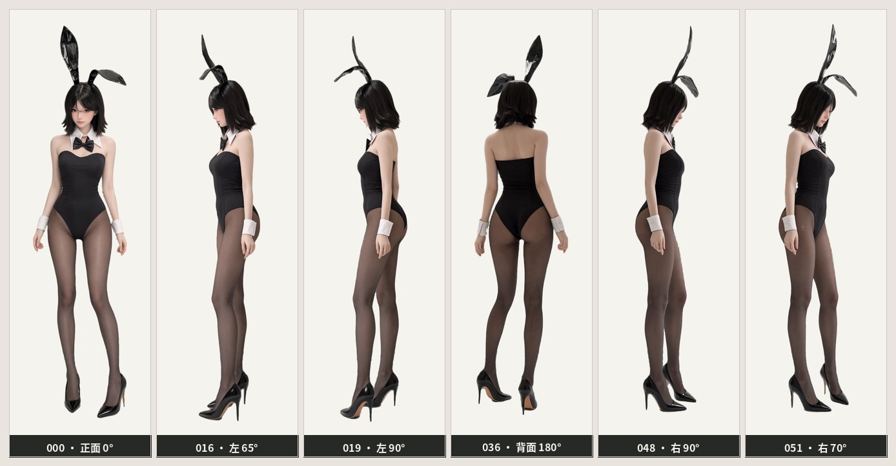

# Sprite Turntable: Why the Side View Is Frame 19

2026-11-27 · Character presentation / Multi-view sprites · [中文](2026-11-27-sprite-turntable.md)

Drag the character in [Sprite Turntable’s offline release](https://github.com/Arekejoker/sprite-turntable/releases/tag/v1.0.0) from the front to the back and it looks like a model on a turntable. Stop at the rear, though, and the browser is drawing `orbit_036.png`. There is no back mesh to inspect. The deliverable is a ring of character views with a useful control for choosing between them.

*Image: Arekejoker’s six-view guide from the project repository.*

## Where the back comes from

In [the author’s workflow](https://github.com/Arekejoker/sprite-turntable), Qwen-Image 2.1 establishes the front-facing character. The artist isolates the figure on neutral grey, then supplies the same image as both the first and last frame of a MiniMax H3 video. An orbit LoRA guides the camera around the stationary pose. Of the 73 generated frames, the first 72 form the loop; keeping a duplicate front at the end would give the turn an extra beat.

Matching endpoints tells the generator **where to return**, not what was sewn onto the back of a costume. An invented rear view might be a useful proposal for an original character. If a production design calls for a particular clasp or crossed straps, the generated back still needs checking against that design.

The grey background serves a second purpose. SAM 2.1 tracks the silhouette in both directions from the matching frontal views; the known background colour helps recover fractional opacity at the edges. Identifying a strand of hair as foreground and deciding how much of a new background should show through it are different jobs. Repairs to this character’s cuffs, shoes and front-facing arms use asset-specific information. Their pixel coordinates are not a recipe for fixing the next character.

## Why 90 degrees is not frame 18

With 72 evenly spaced views, the two profiles would land at frames 18 and 54. The generated camera does not move at constant angular speed. The [Canvas viewer](https://github.com/Arekejoker/sprite-turntable/blob/v1.0.0/edge-matte/showcase.html) instead anchors known directions to specific frames, interpolates between those anchors, rounds the result, and draws one native PNG. It interpolates the **frame index**, not the pixels.

I verified the v1.0.0 HTML against the release checksum, opened the file with browser networking disabled and moved the horizontal slider. The viewer reported these zero-based indices:

| Slider | Front, 0° | Left, −90° | Rear, 180° | Right, +90° |
|---|---:|---:|---:|---:|
| Displayed frame | 0 | 19 | 36 | 48 |

Zooming the right profile from 1× to 2× left frame 48 selected. You can enlarge the existing art, but raising the camera to see the top of the head or moving a light to cast a new shadow would require information the viewer does not have.

## Bringing your own artwork

Already have transparent turnaround frames? Skip the AI stages. The [exporter](https://github.com/Arekejoker/sprite-turntable/blob/v1.0.0/tools/export_html.py) uses only the Python standard library and accepts a ZIP containing exactly 72 consistently sized, 8-bit RGBA PNGs named `orbit_000.png` through `orbit_071.png` at the archive root. The example is 640 × 1920; other uniform dimensions work. Locate the actual profiles and rear in your sequence and adjust the template’s `angleMap` before packaging it. The release’s PNG archive is about 31.9 MiB; the self-contained HTML with embedded images is about 42.5 MiB.

For a casting page, a costume review or a fixed-elevation game catalogue, I would judge the result by slowly dragging past the profile, the gap between wrist and waist, and the join back to the front. Those transitions reveal problems a polished cover image can hide. For a shot requiring a new pose, a high angle or different lighting, commission the geometry and materials instead. The local check here covers the released viewer, not a fresh generation run.
