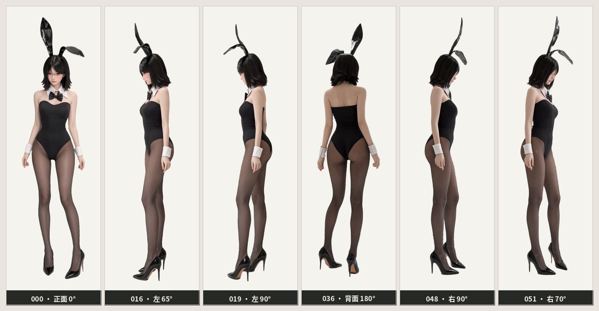

# Sprite Turntable：拖动角色转一圈，为什么侧面是第 19 帧？

2026-11-27 · 角色展示 / 多视角素材 · [English](2026-11-27-sprite-turntable-en.md)

打开 [Sprite Turntable 的离线展示页发行包](https://github.com/Arekejoker/sprite-turntable/releases/tag/v1.0.0)，把水平视角从正面拖到左侧，再绕到背面，角色看起来像站在一个可以转动的台子上。但把视角停在背面时，浏览器并没有计算背部几何：它只是画出了 `orbit_036.png`。**这个项目交付的是一圈可以交互浏览的角色图，不是一个可以任意摆机位的 3D 模型。**

*图：Arekejoker，项目仓库的六视角预览。*

## 背面从哪里来？

[作者的制作记录](https://github.com/Arekejoker/sprite-turntable)从一张正面定妆图开始。示例先用 Qwen-Image 2.1 确定人物，再抠出全身，放到中性灰底上。接下来，把同一张灰底图同时放在 MiniMax H3 视频的起点和终点，配合环绕镜头 LoRA，让镜头绕过一个姿势不变的人物。生成 73 帧，留下前 72 帧循环，免得回到正面时重复停一拍。

这里有个制作上的取舍：**同一张首尾图能约束镜头回到哪里，却不能告诉模型衣服背后到底是什么样。** 如果是原创角色，生成的背面可以作为设计提案；如果服装有指定的背饰或交叉绑带，就该拿背面设定图逐项核对。能绕一圈，不能证明没拍到的细节也正确。

灰底不是最后的背景。作者用 SAM 2.1 从首尾正面双向追踪人物轮廓，再利用已知灰底恢复边缘的半透明度。两步解决的问题不同：分割决定哪里是人，透明度决定一根细发丝盖住新背景多少。示例里袖口、鞋口和正面手臂还做了针对具体画面的修补；换人物时，不宜把这些补丁连同像素坐标照搬过去。

## 拖动角度，不等于均匀翻页

如果视频匀速转满一圈，72 张图每 5° 换一次，两个侧面就应是编号 18 和 54。实际生成的镜头并不匀速。作者在 [Canvas 查看器](https://github.com/Arekejoker/sprite-turntable/blob/v1.0.0/edge-matte/showcase.html)里给已知朝向标了帧号，在相邻标记间插值，再四舍五入选一张原图。插值的是**角度到帧号的映射**，不是两张图片之间的像素。

我核对了 v1.0.0 离线 HTML 的发布校验和，禁用浏览器网络后直接打开文件，操作水平视角滑杆，读到以下结果（从 0 编号）：

| 滑杆 | 正面 0° | 左侧 −90° | 背面 180° | 右侧 +90° |
|---|---:|---:|---:|---:|
| 实际显示帧 | 0 | 19 | 36 | 48 |

停在右侧再从 1× 放大到 2×，显示的仍是第 48 帧。这个小测试也划出了边界：你可以放大已有图像，但不能抬高镜头看到头顶，也不能换盏灯，让衣服上的阴影重新计算。

## 自己的角色，从哪一步接手？

如果手里**已经有多角度透明图**，就不必再跑生成模型。[导出器](https://github.com/Arekejoker/sprite-turntable/blob/v1.0.0/tools/export_html.py)只用 Python 标准库：把 72 个文件从 `orbit_000.png` 到 `orbit_071.png` 直接放在 ZIP 根目录，每张都是尺寸一致的 8 位 RGBA PNG。示例是 640 × 1920，但脚本不要求照用这个分辨率。先找出自己素材的左右侧面和背面，校准查看器的 `angleMap`，再打包。正式发布的 PNG 包约 31.9 MiB，内嵌全部图片的离线 HTML 约 42.5 MiB。

我的选择标准是：角色选型页、服装方案评审、固定俯仰角的游戏图鉴，可以用这种转台。验收时别只看正面有多漂亮，要慢慢拖过侧脸、手与腰之间的空隙，以及最后一帧接回第一帧的地方。如果需求是改动作、从高处拍，或让同一角色适应不同光位，那就该做带几何和材质的资产。本文实测的是**发布版展示与交互**，没有从头重跑 AI 生成。
